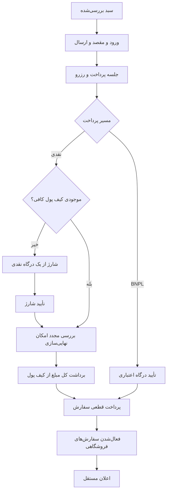

# معماری منطقی و مرز مسئولیت‌ها

این بخش طرح پیشنهادی برای بررسی است؛ stack، دیتابیس، topology استقرار، REST/GraphQL یا microservice انتخاب نشده‌اند. سه محیط کاربری لزوماً سه backend نیستند. این اسناد قرارداد اجرایی آماده تولید client نیستند.

## مرزهای منطقی

- کاتالوگ مالک هویت محصول، پیشنهاد فروش و موجودی است.
- قیمت‌گذاری مالک انتخاب کمیسیون و نتیجه محاسبه است؛ frontend مبلغ قطعی را تعیین نمی‌کند.
- checkout مالک جلسه و رزرو و ارتباط سبد با تلاش خرید است.
- پرداخت مالک نتیجه درگاه، گردش کیف پول و بازپرداخت است؛ شارژ و خرید دو نتیجه مستقل‌اند.
- سفارش مالک تأمین و توقف/لغو است؛ ارسال مالک محموله و تسویه مالک تخصیص سهم فروشنده است.
- اعلان مصرف‌کننده رخداد قطعی است؛ شکست آن تراکنش تجاری را برنمی‌گرداند.

تعریف موجودیت و قانون در حوزه‌هاست؛ اینجا فقط مرز هماهنگی را بیان می‌کنیم. [مدل روابط](data-model.md)، [قراردادهای منطقی](contracts/interactions.md) و [معیارهای کیفیت](quality.md) ورودی طراحی اجرایی‌اند.

## جریان پرداخت

شکست/انقضا در هر مرحله طبق قواعد حوزه پرداخت و تصمیم‌های باقی‌مانده Q-015/Q-022 بررسی می‌شود؛ نمودار فقط مسیر موفق است. دو پیکان به معنی تضمین تراکنش توزیع‌شده نیستند.

## هماهنگی داده و شکست؛ پیشنهاد طراحی

| مرز حساس | تضمین موردنیاز | تصمیم اجرایی آینده |
| --- | --- | --- |
| رزرو آخرین موجودی | عدم بیش‌فروشی | قفل/کنترل نسخه/تراکنش طبق دیتابیس منتخب |
| شارژ و callback | فقط یک افزایش اعتبار | کلید یکتا و بررسی نتیجه ارائه‌دهنده |
| برداشت کیف پول و پرداخت خرید | نه برداشت بی‌خرید، نه خرید بی‌پرداخت | ثبت اتمیک یا جبران قابل بازیابی |
| لغو و ارسال | قلم نتواند هم‌زمان لغوشده و ارسال‌شده شود | نقطه قطعی و کنترل نسخه |
| refund و برداشت | عدم خروج مضاعف از یک ظرفیت | تخصیص/رزرو ظرفیت و استعلام نتیجه |
| رخداد قطعی و پیامک | اعلان گم نشود و شکست آن خرید را برنگرداند | ثبت قابل بازیابی رخداد و dedup؛ ابزار انتخاب نشده |

## PWA و داده حساس

دامنه PWA برای سایت مشتری و پنل فروشگاه در [دامنه محصول](../product/scope.md) تأیید شده؛ بک‌آفیس الزام PWA ندارد. رفتار مودال محصول در [کشف](../experiences/storefront/discovery.md) است. پیشنهاد: app shell در خطای شبکه تجربه قابل فهم بدهد، اما پرداخت/قیمت معتبر آفلاین وعده داده نشود. صفحه‌های مالی، آدرس، داده سفارش و OTP نباید در cache عمومی یا cache قابل استفاده کاربر بعدی بمانند. logout و تغییر حساب باید داده محلی حساس را پاک کند. دامنه محیط‌ها قطعی است؛ جزئیات نصب، offline shell، cache و سیاست به‌روزرسانی در Q-026 برای طراحی اجرایی باقی است. حفاظت از داده خصوصی در بک‌آفیس وب نیز مستقل از PWA بودن لازم است.

## ورود به طراحی اجرایی

ابتدا موانع برش موردنظر حل، سپس schema، قرارداد machine-readable، مدل خطا، روش احراز هویت و تصمیم استقرار در اسناد مرتبط اضافه شود. ایجاد endpoint حدسی یا schema نهایی از این مدل منطقی مجاز نیست.
