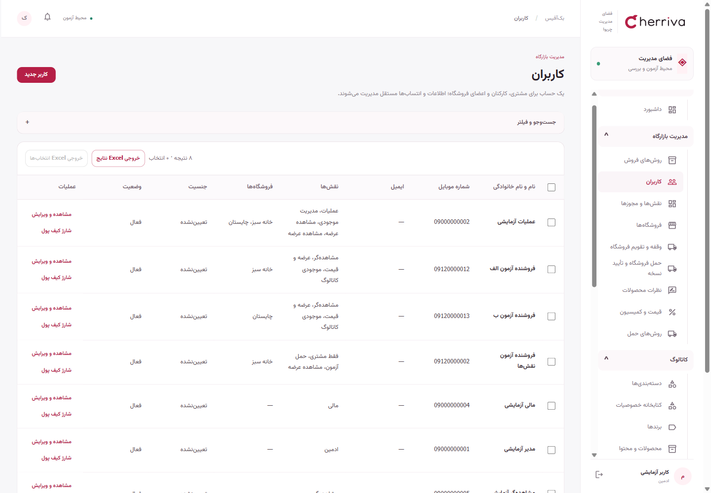
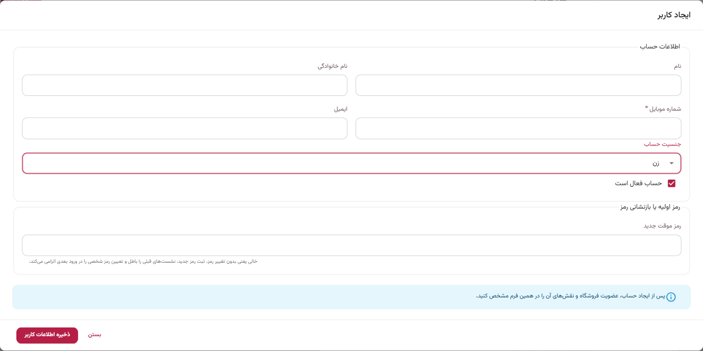
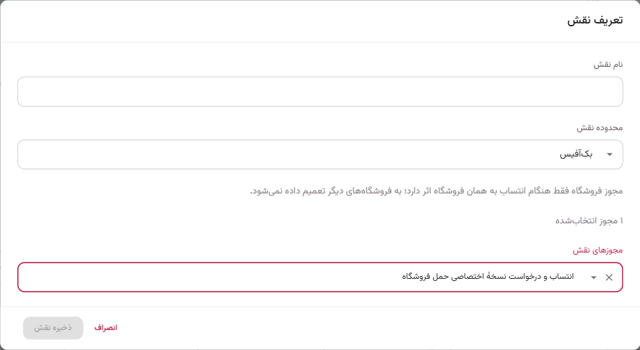
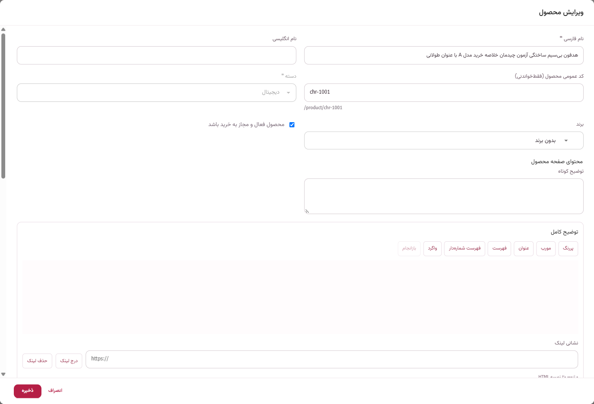
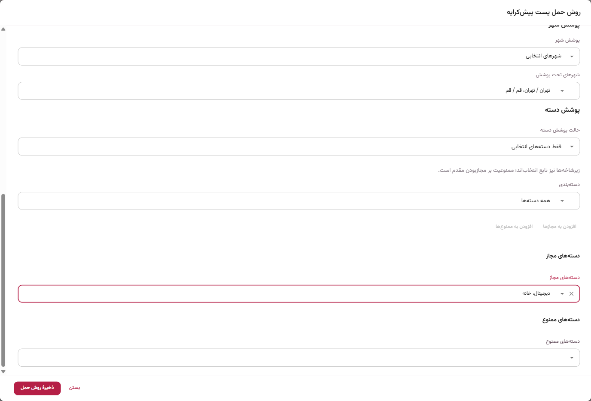
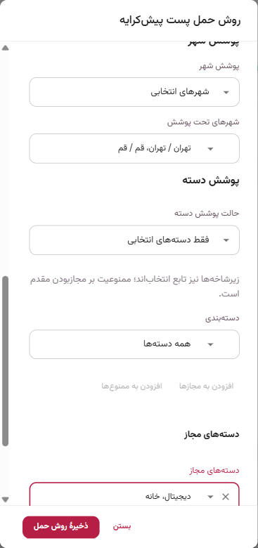
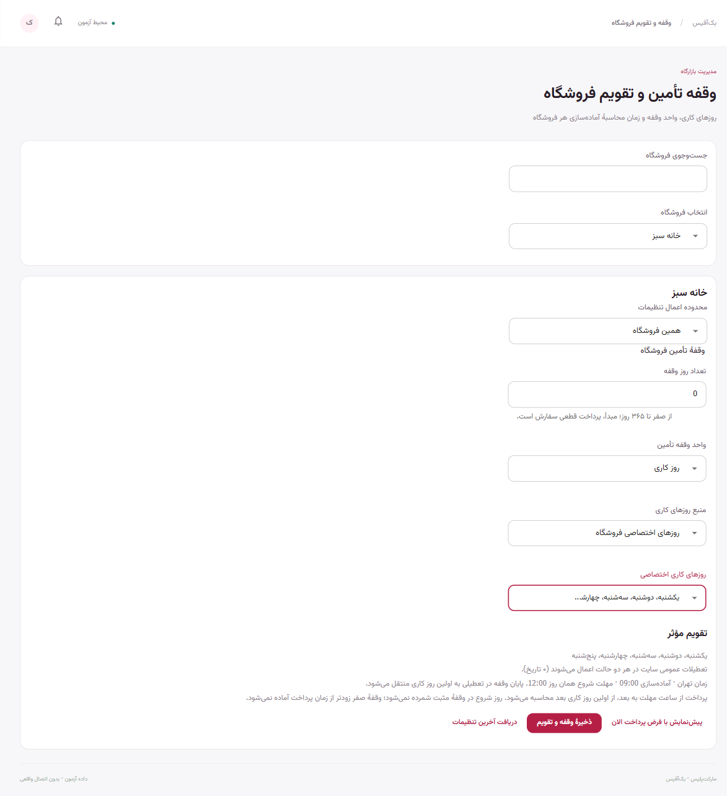

# یکدست‌سازی کنترل‌ها، فیلترها و فرم‌های بک‌آفیس — ۲۰۲۶-۱۱-۲۷

این گزارش شاهد اجرای درخواست مستقیم الیاس برای مرحلهٔ اول بازبینی عمومی بک‌آفیس است. وضعیت تأیید مشخصات `in-review` باقی است؛ این تحویل جایگزین بازبینی دستی فرم‌به‌فرم مالک نمی‌شود. [مرجع طراحی جاری](../../experiences/backoffice/panel-design.md) و [برنامه اصلاح پنل](README.md).

## رفتار نهایی

| بخش | نتیجه |
| --- | --- |
| انتخاب تک‌مقداری | انتخاب‌های چیپی وضعیت، نوع، روش، فروشگاه، برند و دسته به dropdown جست‌وجوپذیر تبدیل شدند. دسته با مسیر سلسله‌مراتبی نمایش داده می‌شود؛ در انتخاب والد، خود دسته و زیرشاخه‌های آن قابل انتخاب نیستند. مقدار واقعی شناسه و مجوزهای موجود حفظ شدند. |
| انتخاب چندمقداری | مجوزهای نقش، دسته‌های مجاز/ممنوع، شهرهای تحت پوشش، روش‌های فروش/پرداخت، روزهای کاری/تعطیل، بازه‌های تحویل، مقصد کپی برنامه و اعضای گروه نمایشی از dropdown چندانتخابی استفاده می‌کنند. انتخاب‌ها در کنترل به صورت متن خلاصه می‌شوند و به چیپ‌های جداگانه تبدیل نمی‌شوند. گزینه‌های فهرست چندانتخابی نشانگر انتخاب دارند و پس از هر انتخاب بسته نمی‌شوند. |
| label و ارتفاع | label تمام ورودی‌های متنی و انتخابی بالای کنترل است؛ الگوی شناور روی border کنار label بیرونی قرار نمی‌گیرد. کنترل‌های MUI و native هم‌راستا شدند؛ border داخلی اضافهٔ ورودی dropdown در فرم محصول هم حذف شد. |
| فیلتر گرید | نوار «جست‌وجو و فیلتر» بالای نتایج است. محتوا پیش‌فرض و پس از تغییر مسیر بسته است؛ باز/بسته‌کردن مقادیر واردشده را پاک نمی‌کند. فیلترهای متنی و انتخابی با دکمهٔ primary «جست‌وجو» یا Enter اعمال می‌شوند. دکمه‌های ایجاد دسته/برند خارج بخش بستهٔ فیلتر باقی‌اند. |
| جست‌وجو و دریافت مجدد | دکمه‌های تکراری دریافت مجدد کاربران/فروشگاه‌ها حذف شدند؛ جست‌وجوی دوباره با همان فیلتر، فهرست آن‌ها را بازخوانی می‌کند. در محل‌هایی که بازخوانی مستقل لازم است، عنوان آن «به‌روزرسانی فهرست» است؛ این دکمه از اقدام primary جست‌وجو جداست. |
| فرم‌های پرفیلد | محصول، تنوع، عرضه، کاربر، فروشگاه، خصوصیت، انتساب خصوصیات، بنر، حمل و جزئیات خرید فضای بزرگ‌تری دارند. فرم‌های محصول/تنوع در دسکتاپ دو ستونی و در عرض کوچک تک‌ستونی‌اند؛ عنوان و اقدام‌های Dialog بیرون بخش پیمایش محتوا باقی می‌مانند. مسیرهای مستقل جزئیات موجود حفظ شدند. |
| دادهٔ خالی | بازکردن ویرایش محصول با مزایا/معایب `null`، نمایش تنوع بدون مقادیر محور و بازکردن تنظیمات با تعطیلات خالی دیگر خطای render نمی‌دهد. این اصلاح‌ها فقط خواندن/ویرایش پیش‌نویس رابط را مقاوم می‌کنند و دادهٔ ذخیره‌شده را خودکار تغییر نمی‌دهند. |

وضعیت‌ها و نشان‌های صرفاً نمایشی همچنان badge هستند؛ دکمه‌های قالب‌بندی متن، مانند پررنگ و فهرست، عملیات ویرایشگرند. گزینهٔ فعال/غیرفعال مستقل از انتخاب یک عضو در فهرست، checkbox باقی می‌ماند.

## شواهد اجرا

- TypeScript/lint، `npm run test:shipping-dates` با۳ آزمون و build نهایی بک‌آفیس موفق بودند. وابستگی محصول تازه یا تغییر API/دیتابیس برای این اصلاحات اضافه نشد.
- مرورگر با دادهٔ ساختگی در schema مستقل `shipping123_review_20261127`، پورت۱۸۰۹۸: کاربران، فروشگاه‌ها، دسته‌ها، برندها، محصول، خصوصیات، حمل عمومی، حمل فروشگاه، نظرات، قیمت، سفارش، پشتیبانی، تأمین جایگزین، مالی، اعلان، گزارش، بنر، روش فروش، خرید، کوپن، تنظیمات خرید و تقویم فروشگاه بررسی شدند؛ مجموع۲۲ مسیر. در فهرست‌ها فیلتر باز اولیه یا چیپ انتخابی/حذف‌شدنی وجود نداشت.
- کاربران: انتخاب «غیرفعال» تا زدن جست‌وجو تعداد۸ردیف اولیه را عوض نکرد؛ پس از جست‌وجو نتیجه اعمال شد و پاک‌کردن فیلتر فهرست را برگرداند. انتخاب تک‌مقداری جنسیت و انتخاب دو مجوز و حذف یکی از آن‌ها در dropdown نقش موفق بود. محل label و ورودی۶فیلد فرم کاربر اندازه‌گیری و بالابودن label کنترل شد.
- محصول: جست‌وجوی «گلدان» پس از زدن دکمه،۲ردیف را به۱ردیف رساند. ویرایش محصول ساختگی دارای مزایا/معایب خالی و مدیریت تنوع بدون محور باز شدند. عرض مودال محصول، کاربر، تنوع و حمل در viewport۱۴۴۰، بیش از۱۰۰۰پیکسل و برای محصول/کاربر۱۳۷۶پیکسل بود.
- حمل: جست‌وجوی نام روش، انتخاب چند شهر و چند دسته، و بازشدن فرم بررسی شدند. در عرض۳۹۰، عرض مودال حدود۳۶۶٫۴پیکسل و بدون overflow افقی خود مودال بود. فرم تو در تو در آزمون محصول/کاربر/حمل وجود نداشت.
- دامنهٔ مجاز: ادمین گزینهٔ اعمال روی یک یا همهٔ فروشگاه‌ها را داشت؛ روز کاری اختصاصی در dropdown چندانتخابی تغییر کرد. عضو فروشگاه آزمون فقط یک فروشگاه مجاز دید و کنترل اعمال سراسری نداشت. هیچ تنظیمی در این آزمون ذخیره نشد.
- پس از اصلاح دادهٔ خالی، console دور نهایی مرور۲۲ مسیر، صفر خطا و صفر هشدار داشت. نشست‌های ورود آزمون ساخته شدند؛ هیچ فرم مدیریتی، سفارش، پرداخت، مجوز یا دادهٔ حساب مالک برای تست ذخیره/تغییر نشد.

این شاهد، بررسی بازشدن مسیرها و تعامل کنترل‌هاست؛ اجرای تمام عملیات تجاری هر فرم نیست. بازبینی جزئیات فرم‌ها مطابق درخواست مالک مرحلهٔ بعد است. سرور اصلی API و storefront در طول کار متوقف یا restart نشدند؛ نسخهٔ رابط بک‌آفیس روی [۸۰۹۸](http://localhost:8098) به‌روز شد. انتشار عمومی و ادغام PR جدا هستند.

## تصاویر

