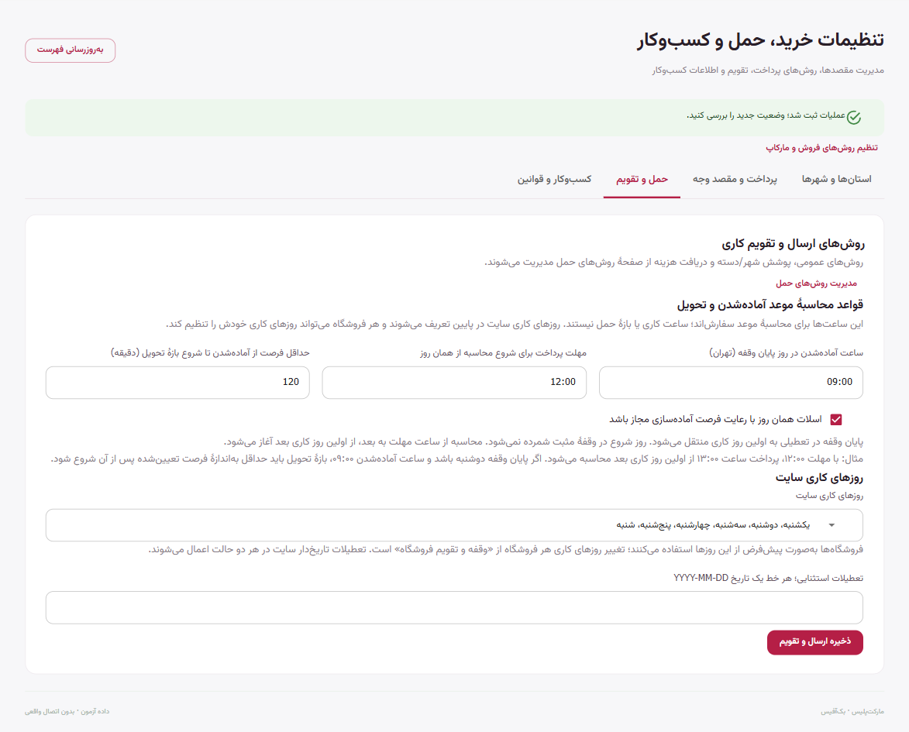
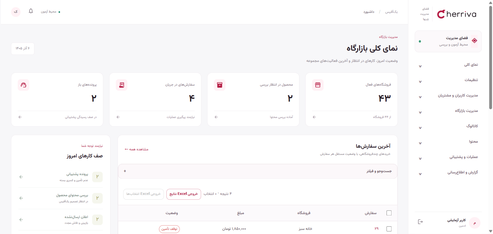
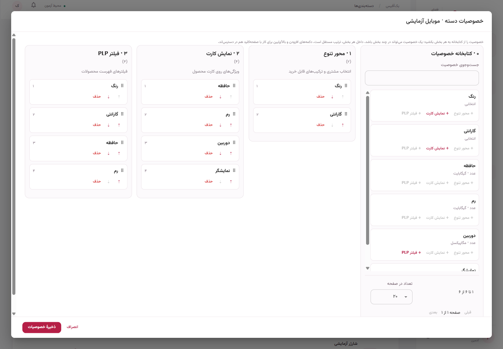
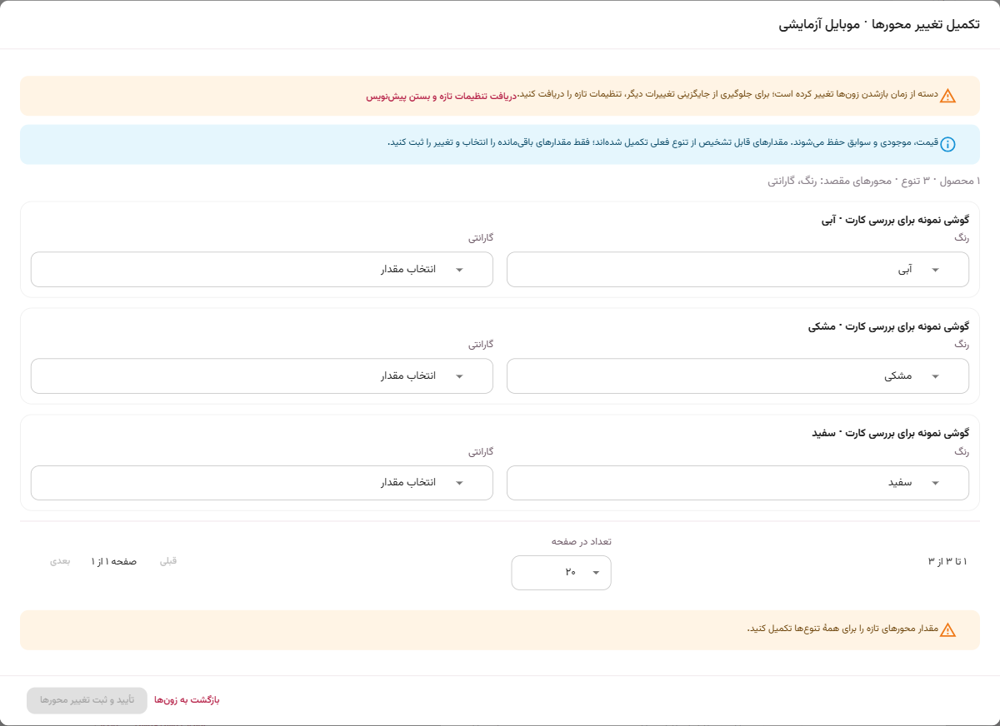
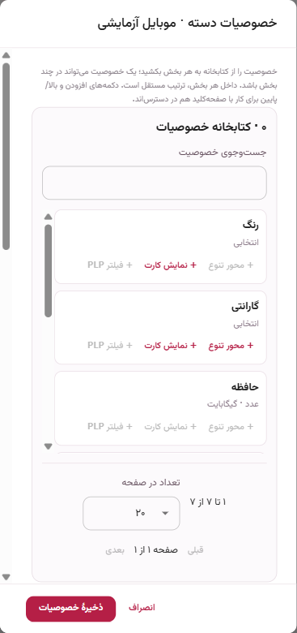
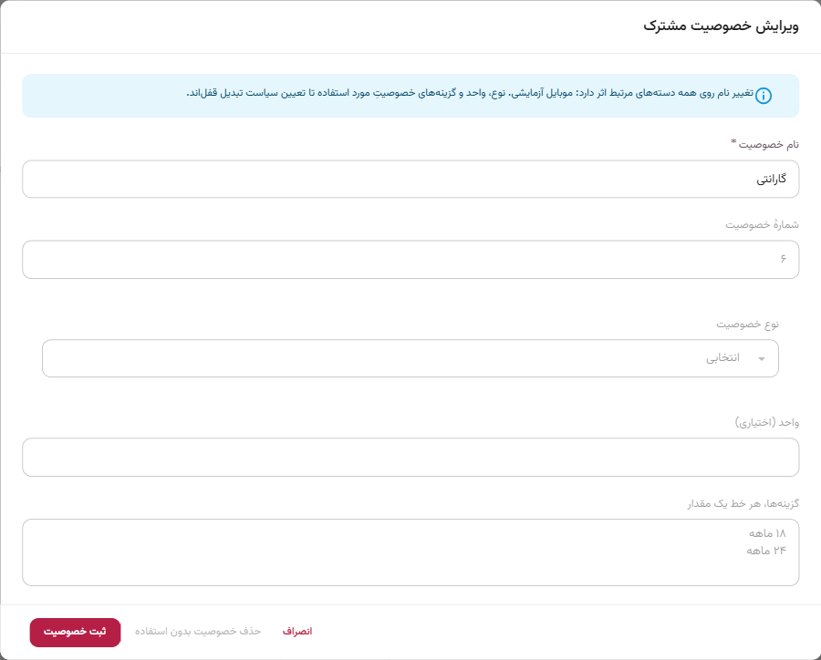
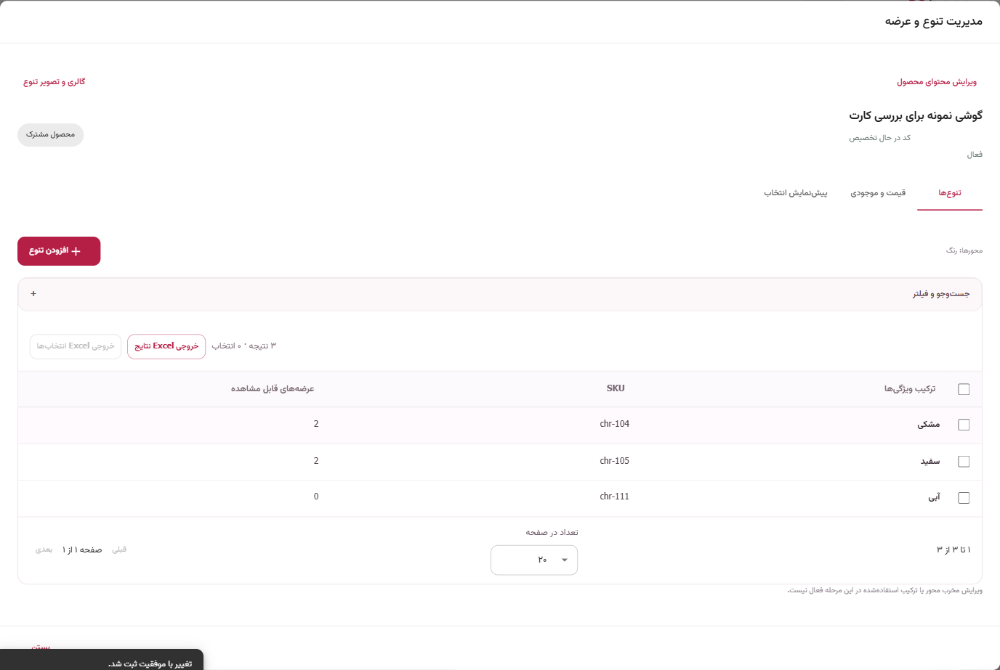
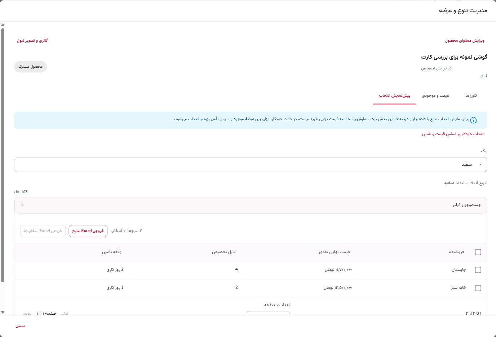
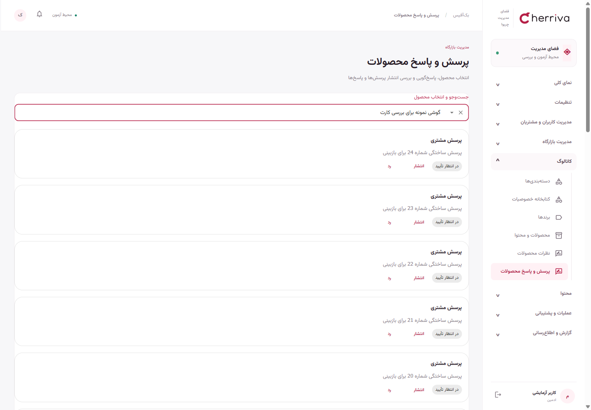

# بازبینی تقویم، کاتالوگ و عملیات محصول — ۲۰۲۶-۱۱-۲۷

این گزارش اجرای درخواست مستقیم مالک برای ثبت تسک و اصلاح بک‌آفیس است. مشخصات مرتبط همچنان `in-review` هستند؛ تکمیل فنی این اصلاحات، تأیید کل محصول یا انتشار عمومی نیست. سورس: [2ac2da5](https://github.com/MohamadParsa/marketplace/commit/2ac2da55a47d5cd444d251995734412c85f83ed7) در [PR #106](https://github.com/MohamadParsa/marketplace/pull/106).

## تسک‌ها و پوشش درخواست

| Issue | خروجی اجراشده | شاهد |
| --- | --- | --- |
| [#124](https://github.com/MohamadParsa/marketplace/issues/124) | انتخاب مثبت «روزهای کاری سایت»، توضیح آماده‌شدن/مهلت پرداخت/فرصت اسلات با مثال و حفظ تقویم مستقل فروشگاه | انتخاب پنج‌شنبه، ذخیرهٔ `closed_weekdays=[5]` و باقی‌ماندن تب حمل؛ API قبلی حفظ است. |
| [#125](https://github.com/MohamadParsa/marketplace/issues/125) | همهٔ سرمنوها در بارگذاری اول بسته؛ نظر و پرسش زیر کاتالوگ؛ `/product-questions` مستقل با انتخاب محصول؛ حذف تب پرسش از محصول | صفر سرمنوی باز بعد ورود؛ انتشار پرسش و صفحه‌بندی۲۰+۴رکورد. |
| [#126](https://github.com/MohamadParsa/marketplace/issues/126) | بررسی کاربرد صفحهٔ قدیمی قیمت/کمیسیون و تبدیل آن به راهنمای مسیرهای معتبر | مصرف `Workspace.Rules` تنها فهرست نمونه و toggle بود؛ قرارداد فروشگاه یا ورودی محاسبهٔ خرید نیست. توضیح و لینک محصولات/دسته/روش فروش جای فهرست گمراه‌کننده را گرفت. |
| [#127](https://github.com/MohamadParsa/marketplace/issues/127) | دکمهٔ دسته در چپ، حذف ستون خصوصیات، کتابخانه و سه زون، افزودن/حذف نقش و اولویت مستقل با Drag and Drop و دکمهٔ بالا/پایین | جابه‌جایی واقعی رم/حافظه در کارت بدون تغییر فیلتر؛ ذخیره/بازخوانی؛ تبدیل محور با یک تأیید؛ جلوگیری از جایگزینی پیش‌نویس کهنه. |
| [#128](https://github.com/MohamadParsa/marketplace/issues/128) | حذف ستون دسته و تمام ویرایشگر/دکمهٔ گروه گارانتی از کتابخانه، فرم کوچک‌تر و شمارهٔ خودکار | مشاهده/ایجاد خصوصیت متنی با۲۰۴؛ گروه‌های قبلی در داده حفظ می‌شوند. منوی جدید گارانتی در این درخواست ساخته نشده است. |
| [#129](https://github.com/MohamadParsa/marketplace/issues/129) | عکس اصلی کوچک قبل نام، جزئیات در اکشن، یک مودال و یک درخواست برای قیمت و موجودی | تصویر۴۰پیکسلی از رسانهٔ مجاز بارگذاری شد؛ `offer.update` هر دو مقدار را با۲۰۴ثبت کرد و فرم مادر باز ماند. |
| [#130](https://github.com/MohamadParsa/marketplace/issues/130) | SKU خودکار `chr-<number>`، شمارهٔ نمایشی پایدار، حذف GUID از متن فرم‌های مرتبط و پیش‌نمایش خودکار | تنوع آبی بدون SKU دستی با `chr-111` در fixture ساخته شد؛ پیش‌نمایش با ارزان‌ترشدن سفید، سفید را انتخاب کرد؛ آزمون تساوی قیمت، وقفهٔ کمتر را اول آورد. |

تمام هفت تسک به `eliassarband` اساین شده‌اند و اجرای فنی دامنهٔ جدول کامل است. هر۵بررسی CI سورس در [run 46047411179](https://github.com/MohamadParsa/marketplace/actions/runs/46047411179) موفق‌اند؛ شامل API با race/vet و PostgreSQL/Redis و هر سه رابط و قراردادها. رسید نهایی و کامنت شاهد در خود Issueهای جدول قابل مشاهده است.

## معنی بخش زمان تحویل

«ساعت آماده‌شدن» ساعت مرجع در روز پایان وقفه است. «مهلت پرداخت» تعیین می‌کند محاسبه از همان روز کاری شروع شود یا روز کاری بعد. «حداقل فرصت» فاصلهٔ آماده‌شدن تا شروع اسلات تحویل است. این‌ها برنامهٔ ساعت حمل نیستند و مقدارهای نمونه الزام عملیات واقعی نیستند. روزهای کاری سایت به‌صورت انتخاب مثبت نمایش داده می‌شوند؛ در مرز API، مکمل هفت روز همچنان `closed_weekdays` است. فروشگاه می‌تواند تقویم را ارث ببرد یا روزهای کاری خودش را تعیین کند؛ تعطیلات تاریخ‌دار عمومی برقرارند. [قواعد حمل](../../domains/shipping/method-policies.md).

## مرز قیمت و کمیسیون

در سورس جاری، `Rule` قدیمی نام/سطح/نوع/مقدار/فعال دارد و به فروشگاه یا قرارداد منتسب نیست. ایجاد/ویرایش آن پیاده نشده و تنها toggle قبلی هم محاسبات خرید را تغییر نمی‌دهد. ساختن CRUD روی آن بدون اتصال معتبر، قرارداد مالی ایجاد نمی‌کند. قیمت پایه و موجودی در عرضه، و مارکاپ در روش فروش/دسته تنظیم می‌شوند. بنابراین صفحه به «وضعیت قوانین کمیسیون» با راهنمای مسیرهای واقعی تبدیل شد و زیرمنوی قرارداد فروشگاه ساخته نشد. ادامهٔ فرمول نقدی/کمیسیون و تسویه در [#72](https://github.com/MohamadParsa/marketplace/issues/72) است؛ #126 یک بررسی تکمیل‌شده است و #72 از آن بسته نمی‌شود.

## حفاظت داده و قراردادهای تازه

- ترتیب هر زون با `axis_position`، `card_position` و `filter_position` ذخیره می‌شود. رکورد قدیمی بدون این فیلدها از `position` قبلی استفاده می‌کند. ترتیب در projection کارت، فیلتر PLP و محور PDP/پنل مصرف می‌شود، صرفاً جابه‌جایی ظاهری نیست.
- حذف از یک زون تنها همان نقش را خاموش می‌کند؛ تعریف مشترک و مقدارهای محصول حذف نمی‌شوند. تغییر محور در دستهٔ دارای محصول به تکمیل مقدارهای لازم و یک تأیید می‌رسد. مقادیر موجود یا تنها گزینهٔ معتبر خودکار تکمیل می‌شوند؛ برخورد دو ترکیب و رزرو فعال همچنان مانع واقعی‌اند.
- تبدیل، تنظیم تمام زون‌ها و مقادیر تنوع را در یک برنامه/تراکنش اعمال می‌کند. تغییر نسخه از زمان بازشدن زون‌ها، حتی اگر GET تبدیل نسخهٔ تازه‌ای بخواند، اجازهٔ اعمال پیش‌نویس قدیمی نمی‌دهد. دریافت تنظیمات تازه با برچسب روشن، پیش‌نویس را می‌بندد.
- `offer.update` فیلدهای مجاز قیمت/قیمت قبل تخفیف/موجودی را اتمیک می‌نویسد؛ نداشتن مجوز یکی از فیلدهای ارسالی، کل درخواست را رد می‌کند. stock کمتر از reserved، نسخهٔ کهنه و تخفیف نامعتبر هیچ تغییر جزئی ایجاد نمی‌کنند. فرم فقط فیلدهای دارای مجوز را ارسال می‌کند و روی تداخل، ورودی را نگه می‌دارد.
- شمارهٔ نمایشی، رجیستری افزایشی `record_numbers` در همان JSON state موجود است. شمارهٔ حذف‌شده دوباره تخصیص نمی‌یابد؛ شماره‌ها پس از PostgreSQL/restart حفظ و در خروجی هر کاربر فقط به رکوردهای مجاز محدود می‌شوند. رجیستری وارد projection عمومی/Redis نمی‌شود. کلیدهای داخلی، رابطه‌ها و SKUهای مبدأ قبلی بازنویسی نشده‌اند؛ پنل برای آن‌ها کد عددی نمایشی دارد. تنوع تازه، از جمله تنوع پایهٔ محصول بدون محور، SKU واقعی خودکار می‌گیرد.

[قرارداد خصوصیات](../../architecture/contracts/catalog-attributes.md) · [قرارداد تنوع و عرضه](../../architecture/contracts/product-workspace.md).

## بررسی انجام‌شده

۵۰۰تست/زیرسناریوی Go در۱۵package با PostgreSQL و Redis محلی موفق و `go vet ./...` موفق بود. چهار skip مربوط به importer snapshot اختیاری و سه browser harness اختیاری موجودند؛ مرورگر این تحویل جدا اجرا شد. race محلی اجرا نشده و به CI لینوکس سپرده شده است. TypeScript، build بک‌آفیس و هر۳آزمون تاریخ حمل موفق‌اند؛ هشدار اندازهٔ bundle باقی است.

تست‌های تازه، ترتیب مستقل/سازگاری دادهٔ قدیمی، SKU و retry، عدم استفادهٔ دوباره از شماره، محدودهٔ فروشنده، ذخیرهٔ اتمیک و رقابت دو ویرایش، تکمیل زون‌ها همراه تبدیل، و حفظ شماره/قیمت/موجودی پس از بازکردن دوبارهٔ PostgreSQL را پوشش می‌دهند. baseline آزمون rollback واردسازی از snapshot پیش از عملیات گرفته شد تا شماره‌های تخصیص‌یافته هنگام ساخت repository هم در مقایسه باشند؛ مقایسهٔ کامل rollback حذف نشده است.

مرورگر روی API حافظه‌ای مستقل۱۸۱۰۲ با۴۴فروشگاه، رسانهٔ ساختگی و۲۴پرسش اجرا شد؛ هیچ فرم مدیریتی روی دادهٔ اصلی ذخیره نشد. کشیدن واقعی، کنترل صفحه‌کلید، ذخیره/بازخوانی، تبدیل موفق و منع رزرو، ویرایش هم‌زمان در دو پنجره، SKU، عکس، مودال قیمت/موجودی و صفحهٔ پرسش بررسی شدند. عرض۳۹۰ overflow افقی نداشت. در تست چند ورود پیاپی، محدودیت OTP حساب ساختگی فعال شد و با حساب عملیاتِ fixture ادامه یافت؛ این خطای عمدی ورود از خطای صفحه جداست.

نسخهٔ محلی۸۰۹۸و۵۱۹۷با executable همین سورس به‌روز شد؛ frontend سایت تغییری نکرد. هیچ migration SQL تازه‌ای برای این بسته وجود ندارد. ادغام main و استقرار عمومی انجام نشده‌اند.

## تصاویر

