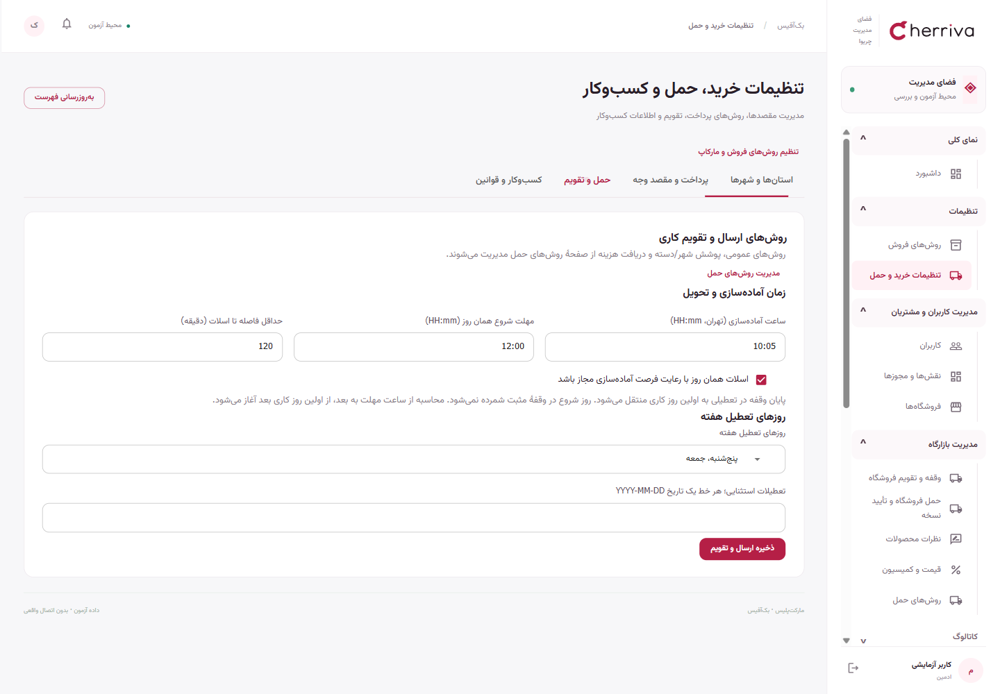
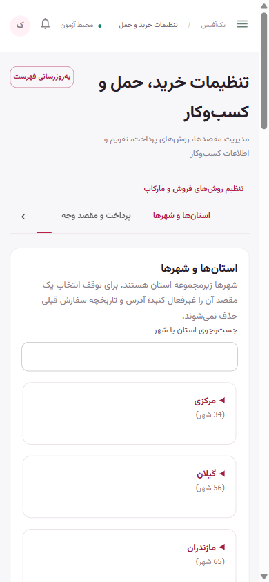
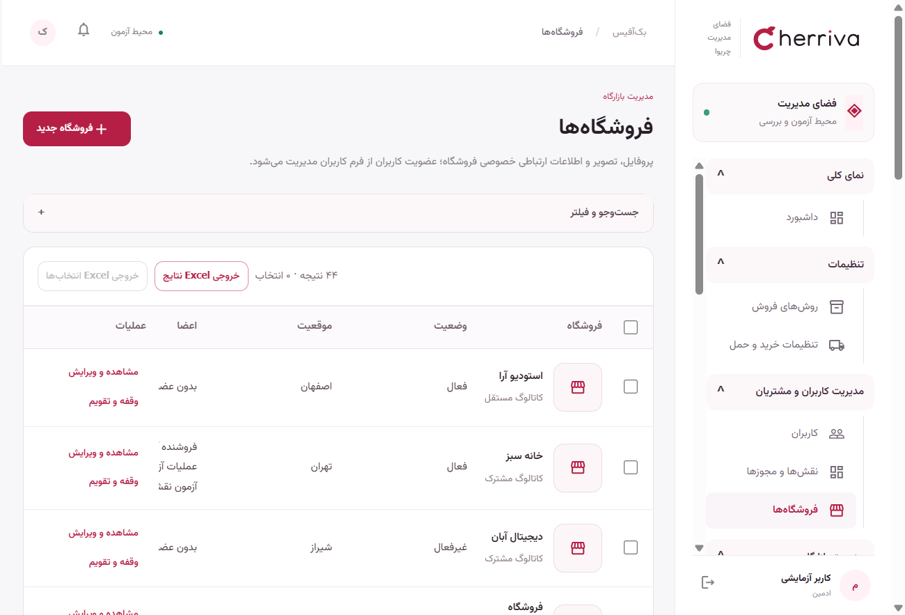
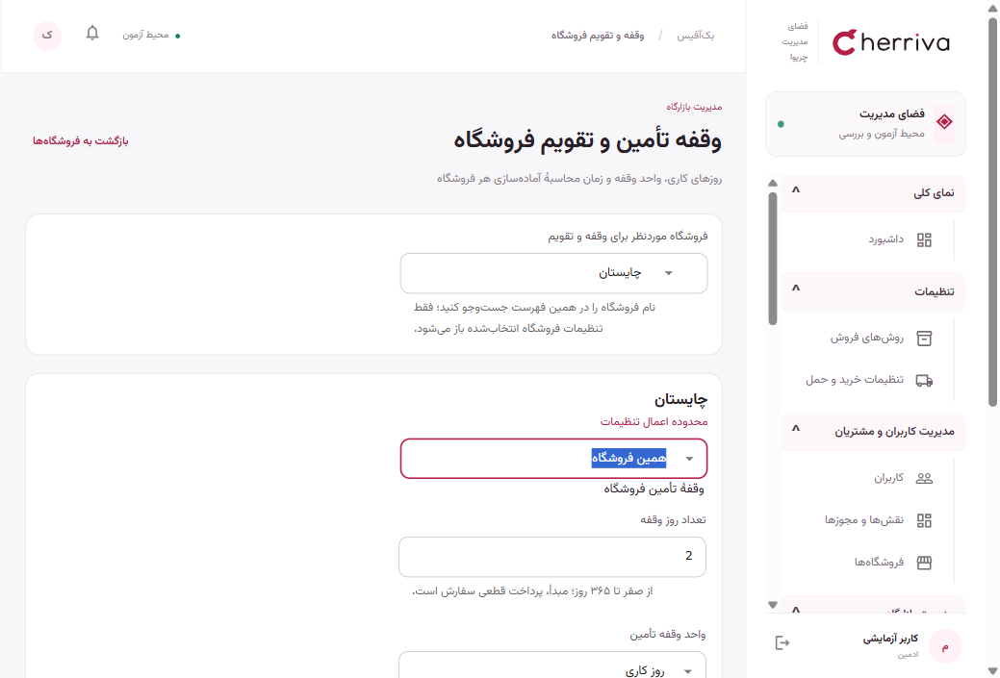
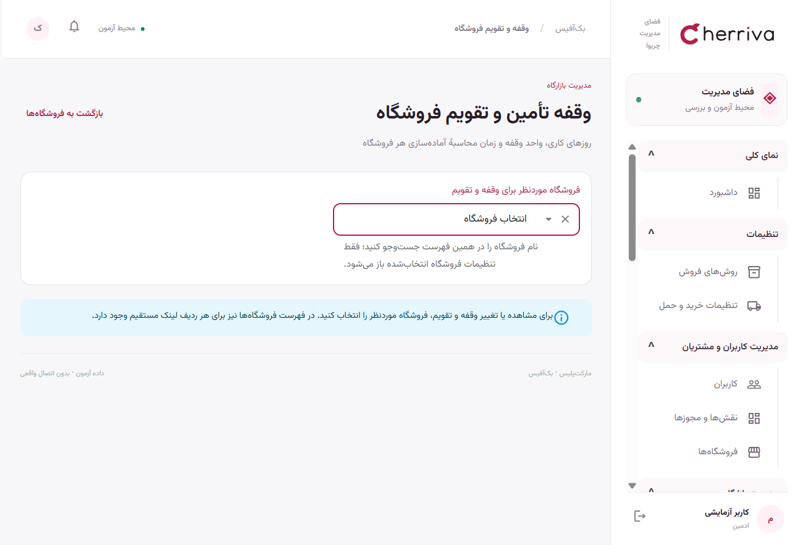

# تب‌بندی تنظیمات و انتخاب تقویم فروشگاه — ۲۰۲۶-۱۱-۲۷

یادداشت ادامه: این گزارش وضعیت همان بازبینی را نگه می‌دارد. مالک سپس پیشنهاد مورد سوم را پذیرفت و [یکپارچه‌سازی حمل در تنظیمات فروشگاه](store-shipping-integration-2026-11-27.md) اجرا شد؛ عبارت «اجرا نشده» در پایین، سابقهٔ پیش از این انتخاب است.

این گزارش اجرای دو درخواست مستقیم الیاس است: تب‌بندی تنظیمات خرید/حمل و شفاف‌کردن انتخاب فروشگاه برای وقفه/تقویم. مورد سوم، «حمل فروشگاه و تأیید نسخه»، فقط بررسی شده است؛ کد آن، روش‌های حمل عمومی و قواعد سرور تغییر نکرده‌اند. وضعیت تأیید مشخصات همچنان `in-review` است. [برنامهٔ اصلاحات](README.md).

سورس دو اصلاح: [f22d200](https://github.com/MohamadParsa/marketplace/commit/f22d2001c30daf4a8ffd4e91a4d5a47060765d17) · [تطبیق سورس و مدارک](../source-document-map.md).

## دو تغییر اجراشده

تنظیمات خرید و حمل چهار تب دارد: «استان‌ها و شهرها»، «پرداخت و مقصد وجه»، «حمل و تقویم» و «کسب‌وکار و قوانین». هر بار فقط یک بخش دیده می‌شود. تغییر تب، ورودی ذخیره‌نشدهٔ همان فرم را نگه می‌دارد؛ پس از ذخیره و بازخوانی نسخهٔ تنظیمات نیز تب فعال حفظ می‌شود. دکمه‌های ذخیره و مجوز مستقل هر بخش قبلی‌اند. پیوند روش‌های فروش هم مسیریابی داخلی دارد و نشست صفحه را با بارگذاری کامل از بین نمی‌برد.

در فهرست فروشگاه‌ها، هر ردیف لینک «وقفه و تقویم» دارد؛ لینک داخل مودال فروشگاه هم اصلاح شده است. هر دو به `/store-preparation?store=<id>` همان فروشگاه می‌روند. صفحهٔ وقفه یک dropdown قابل جست‌وجو با label و توضیح روشن دارد و پارامتر آدرس را با انتخاب کاربر هماهنگ می‌کند. در ورود بدون فروشگاه، ابتدا انتخاب خواسته می‌شود؛ دیگر اولین ردیف بی‌خبر باز نمی‌شود. شناسهٔ نامعتبر/غیرمجاز، هشدار می‌دهد و به فروشگاه دیگری برنمی‌گردد.

ادمین همچنان تنظیمات یک یا همهٔ فروشگاه‌ها را دارد؛ عضو فقط فروشگاه‌های مجاز خودش را می‌بیند. درخواست‌های ذخیره، شناسه و نسخهٔ همان فروشگاه و API قبلی را دارند. قرارداد سرور و کنترل هم‌زمانی/دسترسی/اعمال گروهی تغییر نکرده است.

## بررسی مورد سوم — بدون پیاده‌سازی

نام «استودیو آرا» عنوان روش حمل نیست؛ نام فروشگاه انتخاب‌شده است. در کد فعلی، `StoreShippingPage` در نبود انتخاب صریح، اولین فروشگاه پاسخ را برمی‌دارد. پاسخ سرور بر اساس نام مرتب است؛ انتخابگر فروشگاه نیز در `FilterPanel` بسته قرار دارد. در نتیجه، کاربر نام یک فروشگاه را بالای صفحه می‌بیند و زمینهٔ انتخابش را نمی‌بیند. این رفتار در این نوبت اصلاح نشده است.

| عمل فعلی | معنی |
| --- | --- |
| پذیرش عمومی | این فروشگاه تنظیمات جاری همان روش عمومی را استفاده کند؛ درخواست اختصاصی جاری کنار گذاشته می‌شود. این اقدام تعریف روش حمل تازه نیست. |
| غیرفعال در فروشگاه | همان روش فقط برای این فروشگاه ارائه نشود؛ روش عمومی و سایر فروشگاه‌ها غیرفعال نمی‌شوند. |
| تنظیم اختصاصی | کپی قابل ویرایش برای فروشگاه از روش عمومی، با محدودیت‌های همان روش؛ نوع پیش‌کرایه/پس‌کرایه و هویت روش از عمومی ارث می‌رسند. |
| جزئیات و تفاوت‌ها | مقایسهٔ عمومی جاری، مبنای درخواست، نسخهٔ منتشرشده و پیش‌نویس همراه تاریخچه. کاربرد اصلی آن بررسی اصلاحات است؛ اکنون همان مودال بزرگ برای تأیید سادهٔ عمومی/غیرفعال هم استفاده شده و صفحه را پیچیده کرده است. |
| تأیید نسخه | در مدل فعلی، تغییر اختصاصی پس از ارسال و تأیید پلتفرم در خرید مصرف می‌شود؛ پیش‌نویس، نسخهٔ قبلیِ قابل استفاده را بی‌خبر عوض نمی‌کند. |

این تفکیک برای قواعد عمومی و تنظیم مختص فروشگاه در [قاعدهٔ R07 و ارتباط ادمین/فروشگاه](../../domains/shipping/method-policies.md) و [تحویل #122](../shipping-refinement-2026-11-26/issue-122-verification.md) آمده است. منطق تنظیم عمومی و پذیرش/اصلاحِ هر فروشگاه با خواستهٔ مالک هم‌خوان است؛ وجود صفحهٔ مستقل با این چیدمان، تنها شکل ممکن ارائهٔ آن نیست.

**پیشنهاد برای بررسی، اجرا نشده:** تعریف عمومی در «روش‌های حمل» بماند؛ هر فروشگاه یک تب «روش‌های حمل» برای استفاده از عمومی، غیرفعال‌کردن یا اصلاح اختصاصی داشته باشد. ادمین نیز همان تنظیمات را با محدودهٔ یک/همه مدیریت کند. جدول اختلاف فقط هنگام بررسی تغییرات/درخواست اختصاصی باز شود؛ پذیرش عمومی و غیرفعال‌سازی به تأیید کوتاه و روشن نیاز دارند. تغییر چرخهٔ تأیید فعلی، در این بررسی تصویب یا اجرا نشده است.

## شواهد آزمون دو تغییر اول

- TypeScript، build بک‌آفیس و هر سه آزمون تاریخ حمل موفق شدند؛ هشدار قبلی اندازهٔ bundle باقی است.
- API حافظه‌ای مستقل روی۱۸۱۰۲با۴۴فروشگاه ساختگی برای تست استفاده شد. هیچ ذخیرهٔ مدیریتی روی دیتابیس اصلی انجام نشد.
- هر چهار تب تنظیمات در دسکتاپ و عرض۳۹۰باز شدند؛ هم‌زمان فقط یک panel قابل مشاهده بود. نام روش پرداختِ ذخیره‌نشده با تغییر تب حفظ شد. زمان آماده‌سازی آزمایشی `10:05` در تب حمل ذخیره شد و همان تب فعال ماند.
- لینک ردیف «خانه سبز» دقیقاً `store=s1` را باز کرد؛ تغییر وقفه به۳فقط به `PUT .../s1/preparation` ارسال شد و پاسخ همان شناسه/مقدار را داشت. جست‌وجوی چایستان، `store=s2` و فرم همان فروشگاه را باز کرد.
- انتخاب «انتخاب فروشگاه» پارامتر را پاک و فرم را بست؛ شناسهٔ نامعتبر نیز هیچ فرم پیش‌فرض دیگری را باز نکرد.
- ادمین گزینهٔ «همین فروشگاه/همه فروشگاه‌ها» را داشت. عضو آزمون فقط خانه سبز را دید و کنترل همه نداشت؛ دست‌کاری آدرس به `store=s2`، هشدارِ نبود مجوز و نبود editor داد.
- dropdown وقفه و تقویم نیز در عرض۳۹۰با همان محدودهٔ مجاز باز شد و صفحه overflow افقی نداشت.
- console دور نهاییِ مسیرهای اصلاح‌شده صفر خطا و هشدار داشت. سرویس‌های اصلی۸۰۹۸و۵۱۹۷restart نشدند؛ خروجی رابط تازه در مسیر سرویس۸۰۹۸است.

[Checks نسخه در PR #106](https://github.com/MohamadParsa/marketplace/pull/106/checks). ادغام و استقرار عمومی از این تحویل محلی جداست.

## تصاویر

