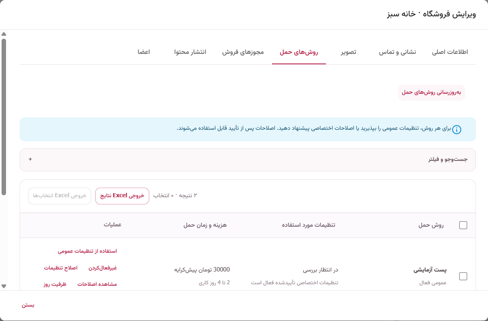
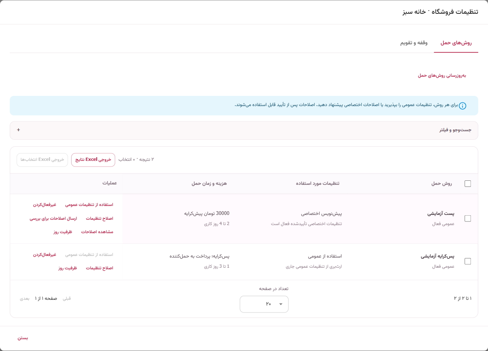
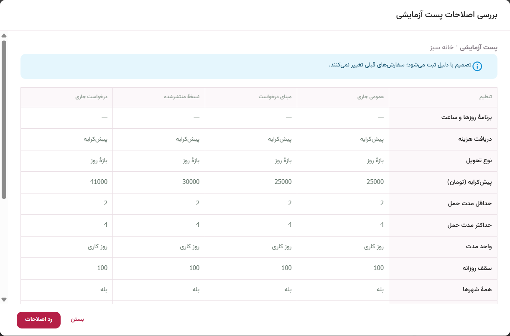
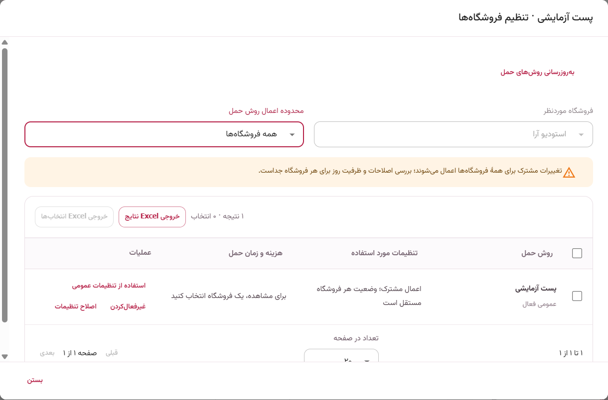
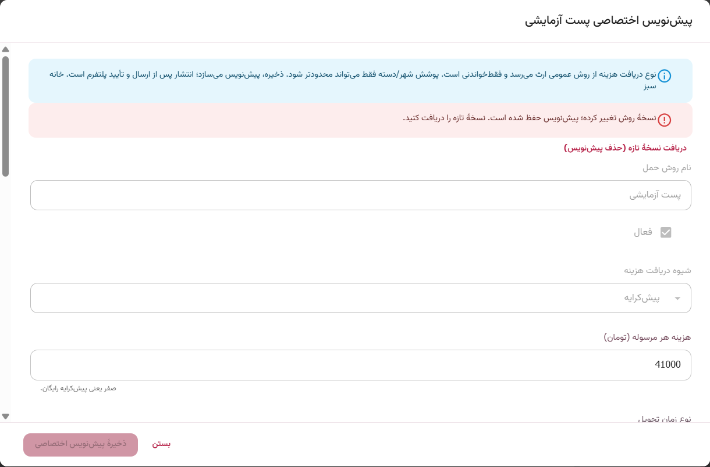
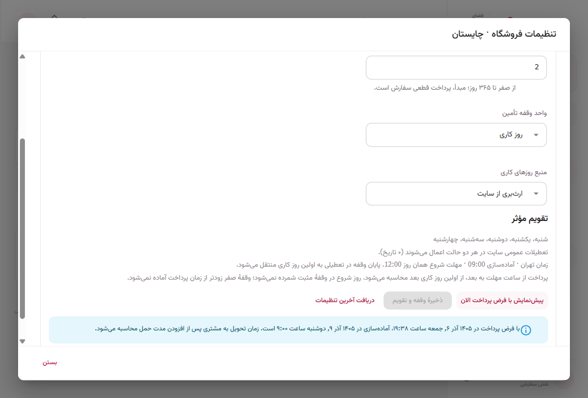
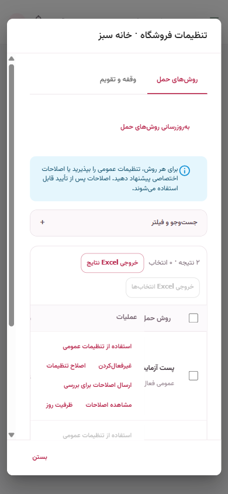

# یکپارچه‌سازی روش‌های حمل در تنظیمات فروشگاه — ۲۰۲۶-۱۱-۲۷

این تحویل اجرای پیشنهاد پذیرفته‌شدهٔ مالک، «طبق پیشنهادت انجام بده»، پس از [بررسی قبلی](settings-preparation-review-2026-11-27.md) است. تعریف عمومی روش در «روش‌های حمل» می‌ماند و استفاده یا اصلاح آن در تنظیمات همان فروشگاه انجام می‌شود. وضعیت مشخصات همچنان `in-review` است؛ تغییر چرخهٔ تأیید، سفارش‌های تاریخی و قواعد مالی در این درخواست نیست.

سورس: [b528fe5](https://github.com/MohamadParsa/marketplace/commit/b528fe5a5f4a489a7a00394a775518bfff0113c8) · [PR #106](https://github.com/MohamadParsa/marketplace/pull/106) · [تطبیق سورس و مدارک](../source-document-map.md).

## مسیرهای جاری

| کاربر / کار | مسیر |
| --- | --- |
| ادمین، تنظیم یک فروشگاه | «مدیریت کاربران و مشتریان ← فروشگاه‌ها»، لینک ردیف یا تب «روش‌های حمل»: `/stores?store=<id>&tab=shipping` |
| ادمین، تنظیم یک/همه برای یک روش | «روش‌های حمل» در `/shipping`، دکمهٔ «تنظیم فروشگاه‌ها» در ردیف روش؛ فروشگاه یا محدودهٔ همه باید صریح انتخاب شود. |
| عضو فروشگاه | «فروشگاه‌های من» در `/my-stores`، سپس «تنظیمات فروشگاه»؛ تب حمل و/یا تقویم مطابق مجوز همان فروشگاه دیده می‌شود. لینک مستقیم: `/my-stores?store=<id>&tab=shipping` یا `tab=preparation`. |
| لینک قبلی حمل | `/store-shipping?store=<id>` پس از ورود، به تنظیمات همان فروشگاه در محیط ادمین/فروشنده هدایت می‌شود؛ بدون شناسه، فروشگاهی خودکار انتخاب نمی‌شود. |

منوی مستقل «حمل فروشگاه و تأیید نسخه» حذف شد. نام فروشگاه در عنوان تنظیمات همان فروشگاه قرار دارد؛ دیگر از اولین فروشگاهِ پاسخ به‌صورت پنهان انتخاب نمی‌شود. لینک مستقیم ادمین با فیلتر شناسهٔ موجود سرور کار می‌کند و به صفحهٔ اول گرید محدود نیست. شناسهٔ نامعتبر یا غیرمجاز هشدار می‌دهد و تنظیمات فروشگاه دیگری را باز نمی‌کند.

«استفاده از تنظیمات عمومی»، «غیرفعال‌کردن» و «ارسال اصلاحات برای بررسی» تأیید کوتاه با نام روش و محدودهٔ روشن دارند. جدول مقایسه و تاریخچه فقط برای مشاهدهٔ اصلاحات یا بررسی/تأیید/رد آن‌ها باز می‌شود؛ دلیل تصمیم بررسی همچنان اجباری است. «ظرفیت روز» نیز در تنظیمات هر فروشگاه در دسترس است.

اعمال مشترک فقط با اختیار ادمین و نسخهٔ تمام فروشگاه‌های هدف انجام می‌شود. در محدودهٔ همه، قیمت یا وضعیت یک فروشگاه به‌عنوان وضعیت همه نمایش داده نمی‌شود؛ پیش‌نویس مشترک از تعریف عمومی آغاز می‌شود. ارسال مشترک فقط وقتی در دسترس است که همهٔ هدف‌ها پیش‌نویس قابل ارسال داشته باشند؛ بررسی و ظرفیت برای هر فروشگاه مستقل‌اند.

## مرز دسترسی و داده

قرارداد و کد API تغییر نکرده‌اند. درخواست‌ها همچنان به `/{surface}/stores/shipping` با شناسه/نسخهٔ هدف‌ها، نسخهٔ روش عمومی و کلید idempotency می‌روند. کنترل سرور برای مجوز، محدودیت پوشش، نوع دریافت هزینهٔ فقط‌خواندنی، هم‌زمانی و انتشار پس از تأیید برقرار است. تغییر فرم، مجوز تازه‌ای برای عضو فروشگاه یا انتشار مستقیم ایجاد نمی‌کند. [قواعد مشترک حمل](../../domains/shipping/method-policies.md).

«فروشگاه‌های من» اجتماع فروشگاه‌های مجاز حمل و تقویم را نشان می‌دهد؛ نداشتن مجوز حمل، دسترسی تقویم مجاز را حذف نمی‌کند. خطای دریافت هر بخش مستقل گزارش می‌شود. فرم اصلی هنگام عملیات یا بازبودن پنجرهٔ فرزند بسته نمی‌شود؛ تغییر تب و بستن پس از پایان عملیات دوباره ممکن است.

## شواهد آزمون

تمام ذخیره‌های مرورگر روی API حافظه‌ای مستقل با۴۴فروشگاه ساختگی روی۱۸۱۰۲انجام شدند؛ اطلاعات فروشگاه‌ها و حساب‌های دیتابیس اصلی تغییر نکرد. سرویس‌های اصلی۸۰۹۸و۵۱۹۷restart نشدند؛ build تازه در سرویس۸۰۹۸قابل دریافت است.

- TypeScript، build بک‌آفیس و هر۳آزمون تاریخ حمل موفق شدند. هشدار قبلی اندازهٔ bundle باقی است.
- آزمون‌های مرتبط Go در `internal/application/backoffice` و `internal/bootstrap` برای حمل فروشگاه، روش عمومی و ظرفیت، با PostgreSQL موفق شدند. آزمون race/vet کامل در CI لینوکس پیگیری می‌شود.
- فروشنده از لینک مستقیم وارد شد؛ تنها فروشگاه مجازش را دید و کنترل همه/تأیید ادمین نداشت. غیرفعال‌کردن و بازگشت به عمومی فقط `s1` را با `all=false` هدف گرفتند؛ تأیید کوتاه جدول اختلاف نداشت.
- پیش‌نویس۳۰هزار تومانی فروشنده ارسال و توسط ادمین با دلیل تأیید شد؛ هزینهٔ مؤثر۳۰هزار شد. ارسال و سپس رد پیش‌نویس تازه۴۱هزار نیز نسخهٔ مؤثر۳۰هزار را حفظ کرد.
- اعمال مشترک روی هر۴۴فروشگاه، شناسه/نسخهٔ تمام هدف‌ها و `all=true` داشت. با وجود پیش‌نویس اختصاصی۴۵هزارِ اولین فروشگاه، ویرایش مشترک از عمومی۲۵هزار آغاز شد؛ پیش‌نویس۴۰هزار برای همه ذخیره و ارسال شد و عمومی۲۵هزار باقی ماند.
- تغییر هم‌زمان ادمین و ذخیرهٔ فروشنده خطای واقعی۴۰۹داد؛ مقدار۴۱هزارِ واردشده حفظ و ذخیرهٔ نسخهٔ قدیمی بسته شد. دریافت صریح نسخهٔ تازه و ذخیرهٔ مجدد موفق بود. تنها خطای console دور فروشنده همین۴۰۹عمدی بود؛ شناسه و فرم اصلی پس از پایان ذخیره/ارسال باقی ماندند.
- ظرفیت روز و تب تقویم در تنظیمات فروشنده باز شدند. فروشندهٔ فقط‌تقویم تنها «چایستان» و تب تقویم را دید؛ ذخیره غیرفعال بود و پیش‌نمایش۲۰۰برگشت. دست‌کاری URL به فروشگاه غیرمجاز هیچ editor باز نکرد.
- لینک مستقیم `ui-store-40` فروشگاه خارج از صفحهٔ اول را روی تب حمل باز کرد؛ شناسهٔ نامعتبر هیچ فروشگاه جایگزینی باز نکرد. لینک قدیمی در هر دو محیط به مسیر درست هدایت شد.
- عرض۳۹۰، هر دو تب فروشنده، بستن و پنجرهٔ فرزند بررسی شدند؛ عرض سند و viewport هر دو۳۹۰بودند. تصاویر زیر از رابط آزمایشی‌اند.

## تصاویر

هر۵بررسی CI سورس در [run 46031207626](https://github.com/MohamadParsa/marketplace/actions/runs/46031207626) موفق شدند؛ شامل API با race/vet و PostgreSQL/Redis، بک‌آفیس، پنل فروشنده، سایت و قراردادها. این تحویل محلی و انتشار شاخه از ادغام و استقرار عمومی جداست. پذیرش بصری نهایی فرم‌ها با مالک است؛ وضعیت نسخهٔ نهایی مدارک از [بررسی‌های PR](https://github.com/MohamadParsa/marketplace/pull/106/checks) قابل پیگیری است.
