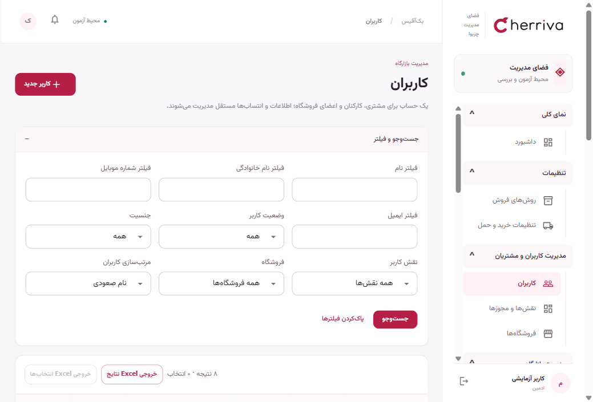
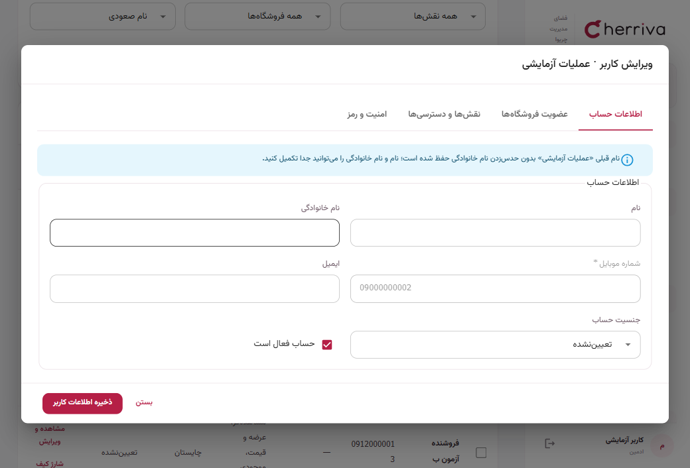
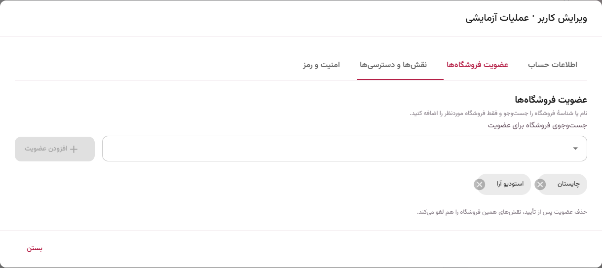
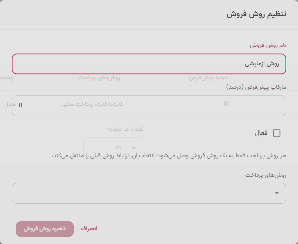
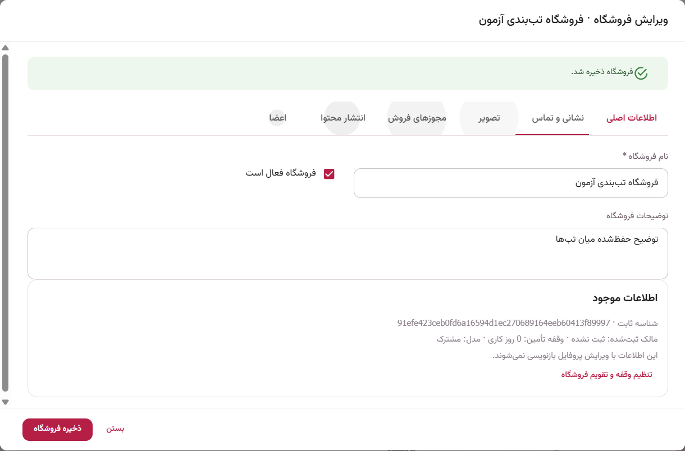
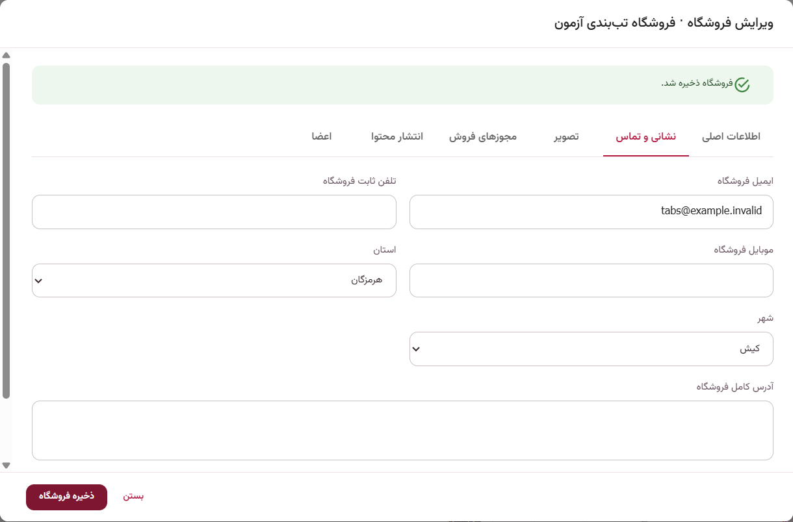
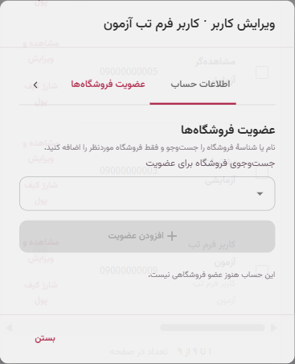
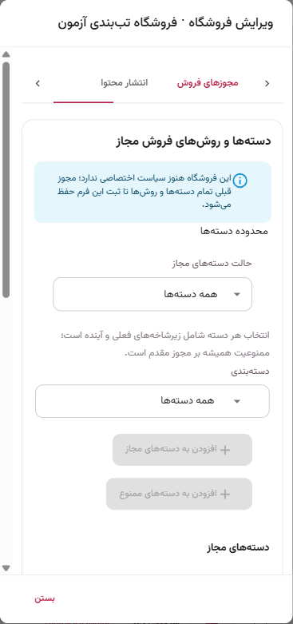

# بازبینی فرم‌های روش فروش، کاربران، نقش‌ها و فروشگاه‌ها — ۲۰۲۶-۱۱-۲۷

این گزارش اجرای درخواست مستقیم الیاس برای بازبینی فرم‌به‌فرم بک‌آفیس است. وضعیت مشخصات `in-review` باقی است؛ [برنامهٔ اصلاحات](README.md) و [مرجع تجربهٔ پنل](../../experiences/backoffice/panel-design.md) تغییر وضعیت تأیید نمی‌دهند. تغییرات در رابط بک‌آفیس است؛ قرارداد API، مجوزها و دادهٔ اصلی تغییر نکردند.

سورس: [2b056e1](https://github.com/MohamadParsa/marketplace/commit/2b056e1cd09cc82a61c0c021efdc5303bbf6ac0f) · [تطبیق سورس و مدارک](../source-document-map.md).

## نتیجهٔ درخواست‌ها

| فرم/موضوع | رفتار جدید |
| --- | --- |
| منو | «تنظیمات» شامل روش‌های فروش و تنظیمات خرید/حمل است. «مدیریت کاربران و مشتریان» شامل کاربران، نقش‌ها و مجوزها و فروشگاه‌هاست. گروه‌ها همان panelbar باز/بسته‌شونده‌اند؛ مجوز مشاهدهٔ هر لینک حفظ است. |
| افزودن جدید | ۲۴ دکمهٔ ایجاد/افزودن در فرم‌های بک‌آفیس از `CreateButton` مشترک، با Primary توپر، علامت +، اندازه و فاصلهٔ یکسان استفاده می‌کنند؛ شامل محصول/تنوع/عرضه، دسته/برند/خصوصیت، کاربر/نقش/فروشگاه، روش فروش/حمل، کوپن و افزودن ردیف‌های تنظیمات. جست‌وجو و عملیات ویرایش از دکمهٔ ایجاد جدا هستند. |
| روش فروش | دکمهٔ جدید Primary؛ مودال متناسب با فیلدها، با سقف عرض۶۰۰پیکسل و فاصلهٔ منظم کنترل‌ها. ذخیره نیز Primary است. |
| فیلتر کاربران و فروشگاه‌ها | کنترل‌های متنی و انتخابی در یک گرید مشترک سه‌ستونی، سپس دو ستون و یک ستون در عرض کم. وضعیت، جنسیت، نقش، فروشگاه و مرتب‌سازی عرض کاملِ مستقل نمی‌گیرند. فیلتر همچنان ابتدا بسته و فقط با جست‌وجو اعمال می‌شود. |
| ویرایش کاربر | چهار تب «اطلاعات حساب»، «عضویت فروشگاه‌ها»، «نقش‌ها و دسترسی‌ها» و «امنیت و رمز». جنسیت و فعال‌بودن در گرید حساب کنار هم‌اند. افزودن اولیهٔ حساب فرم ساده را حفظ کرده است. |
| عضویت فروشگاه | فهرست همهٔ فروشگاه‌ها در بدنهٔ مودال حذف شد. با حداقل دو حرف از نام یا شناسه جست‌وجو، یک فروشگاه انتخاب و عضویت افزوده می‌شود. فقط عضویت‌های موجود به‌شکل چیپِ قابل حذف دیده می‌شوند. افزودن/حذف همان تأیید و کنترل نسخهٔ قبلی را دارد؛ حذف عضویت، نقش‌های همان فروشگاه را هم لغو می‌کند. فروشگاه‌های عضو دوباره برای افزودن پیشنهاد نمی‌شوند. |
| نقش کاربر | نقش پایه و نقش‌های سفارشی در تب دسترسی‌اند؛ گزینه‌های انتساب نقش به dropdown تبدیل شدند. نقش‌های فروشگاهی فقط برای عضویت‌های همان کاربر دیده می‌شوند؛ مجوز/OTP و جلوگیری از تغییر نامجاز حفظ‌اند. |
| فروشگاه | شش تب «اطلاعات اصلی»، «نشانی و تماس»، «تصویر»، «مجوزهای فروش»، «انتشار محتوا» و «اعضا». در ایجاد اولیه دو تب پروفایل/تماس در دسترس‌اند؛ پس از ذخیره، بقیه باز می‌شوند. ذخیرهٔ پروفایل، تصویر، سیاست محتوا و مجوزهای فروش مسیرهای مستقل قبلی را دارند. |

محتوای تب‌ها هنگام جابه‌جایی حذف و ساخته نمی‌شود؛ اطلاعات تایپ‌شده و انتخاب‌های ذخیره‌نشده حفظ می‌شوند. فیلدهای تماس و رمز به فرم اصلی خود متصل‌اند. اگر اعتبارسنجی بومی مرورگر، فیلد اجباریِ یک تب بسته را نامعتبر بیابد، همان تب باز و فیلد متمرکز می‌شود. دکمهٔ ذخیرهٔ پروفایل در تب‌های عضویت/نقش/تصویر/مجوز نمایش داده نمی‌شود تا با عملیات مستقل آن‌ها اشتباه نشود.

## بررسی انجام‌شده

- `npm run lint`، build بک‌آفیس و هر سه آزمون تاریخ حمل موفق شدند. هشدار موجود اندازهٔ bundle همچنان برقرار است.
- مرورگر به API حافظه‌ای مستقل در پورت۱۸۱۰۲ وصل شد؛ ۴۴فروشگاه ساختگی، حساب‌های آزمون، نقش‌های نمونه و فهرست کشور داشت. این API به دیتابیس اصلی وصل نبود.
- ۹فیلتر کاربران در سه سطر با عرض یکسان۲۲۰پیکسل و ۶فیلتر فروشگاه با عرض یکسان۳۴۸پیکسل در viewportهای بررسی اندازه‌گیری شدند؛ دیگر انتخابگر تمام‌عرض کنار فیلدهای کوچک نبود.
- در میان۴۴فروشگاه، بازکردن انتخابگر خالی هیچ گزینه‌ای نشان نداد؛ جست‌وجوی «استودیو» فقط نتیجهٔ مرتبط را داد. افزودن «استودیو آرا» با تأیید، چیپ را اضافه و انتخابگر را پاک کرد. حذف «خانه سبز» با کلید Delete و تأیید، فقط همان عضویت و نقش‌هایش را لغو کرد؛ چایستان و استودیو باقی ماندند.
- مقدار ذخیره‌نشدهٔ نام کاربر هنگام تغییر تب حفظ شد. کاربر ساختگی با جنسیت و رمز موقت ایجاد شد؛ وضعیت نیاز به تغییر رمز در تب امنیت قابل مشاهده بود. ذخیره از تب امنیت، اطلاعات حساب در تب دیگر را هم درست ثبت کرد.
- فروشگاه ساختگی با نام/توضیح در تب اصلی و ایمیل/هرمزگان/کیش در تب تماس ذخیره و پس از بازکردن دوباره بررسی شد. هر شش تب باز شدند. فیلد نام و شهرِ اجباری در تب بسته، ذخیره را متوقف و تب مربوط را باز کردند؛ خطای «فیلد نامعتبر قابل فوکوس نیست» رخ نداد.
- عرض مودال روش فروش۶۰۰ و ارتفاع۴۹۱پیکسل اندازه‌گیری شد؛ دکمهٔ ایجاد Primary بود.
- تب‌های کاربر و فروشگاه در عرض۳۹۰پیکسل با اسکرول افقی خود نوار تب قابل استفاده بودند و مودال از viewport بیرون نزد. console دور آزمایش، صفر خطا و صفر هشدار داشت.

همهٔ ذخیره‌ها و تغییر عضویت‌های این گزارش روی fixture مستقل بودند. سرویس‌های اصلی بک‌آفیس۸۰۹۸ و سایت۵۱۹۷ قطع یا restart نشدند؛ خروجی build تازه در مسیر سرویس۸۰۹۸ قرار دارد و صفحهٔ از قبل باز نیاز به `Ctrl+F5` دارد. نتیجهٔ CI هر نسخه در [Checks PR #106](https://github.com/MohamadParsa/marketplace/pull/106/checks) است؛ ادغام و استقرار عمومی جدا هستند.

## تصاویر

