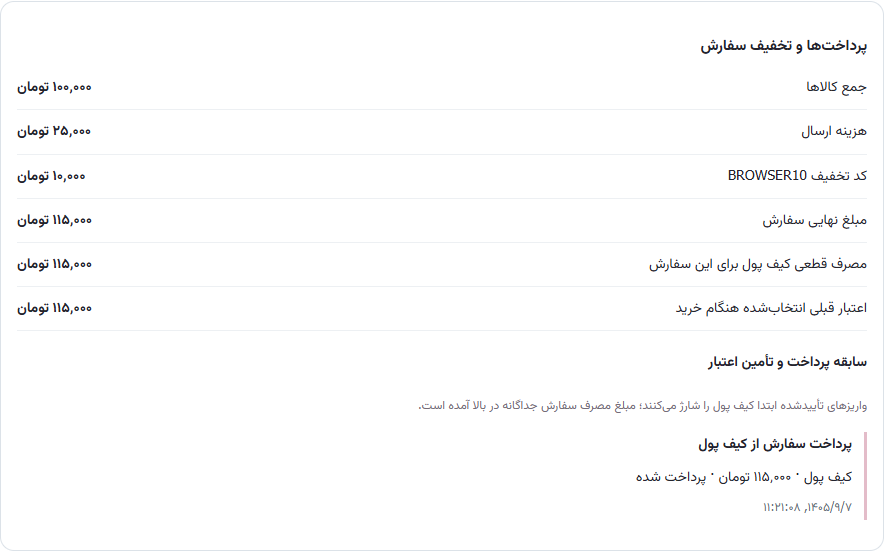

# نسخه آماده بررسی مالک

هر۸Issue از [#142](https://github.com/MohamadParsa/marketplace/issues/142) تا [#149](https://github.com/MohamadParsa/marketplace/issues/149) با تست، commit/push مستقل و کامنت شواهد بسته شدند. [جدول کامیت، کامنت و CI هر کار](README.md#نتیجه-اجرا) و [فهرست ماشین‌خوان](task-index.json). برای هر تحویل، هر۵check شامل API با race در لینوکس، دو رابط، پنل فروشنده و قراردادها موفق بودند. اصلاح انتظار قدیمی رقابت خرید/برداشت در کامیت7aee4ed نیز CI موفق دارد.

## نتیجه قابل مشاهده

- ورود بک‌آفیس: رمز و OTP در همان فرم شماره؛ بازیابی نشست معتبر پس از F5 و لینک مستقیم با اعتبارسنجی سرور و همان عمر قبلی نشست.
- سفارش‌ها: فیلتر مستقل موبایل با ارقام فارسی/عربی/لاتین و دکمه مشاهده در انتهای ردیف.
- خرید: درخواست بیش از نیاز کیف پول به مبلغ لازم محدود می‌شود؛ مانده صفر هنگام ثبت، با قطعیت واقعی و اتمیک paid می‌شود. پردازش هر فروشگاه همچنان اقدام مستقل است.
- مرسوله‌ها: فهرست و جزئیات مستقل در هر دو پنل، فقط پس از شروع همان گروه؛ فروشگاه فقط محدوده مجاز خود را می‌بیند/عمل می‌کند. فعال‌ها پیش‌فرض و تحویل‌شده/لغوشده در تاریخچه قابل مشاهده‌اند. پاسخ ORDERFOLLOW-Q01 طبق انتخاب مالک اعمال شد.
- عملیات: توضیح تک‌سطر اولیه هم‌ارتفاع با انتخابگر، راهنمای اقدام و ثبت توضیح کوتاه مشتری همراه رویداد واقعی؛ Reason داخلی جدا می‌ماند.
- حساب مشتری: جزئیات مالی از snapshot و debit واقعی، کوپن، پرداخت/تأمین اعتبار، اقلام هر مرسوله و مراحل و تاریخچه گرافیکی مستقل؛ حالت لغو/توقف و نبود سابقه زمان ساختگی نمی‌سازند.

## شواهد آزمون

`go test ./...` با PostgreSQL در schemaهای ایزوله و Redis DB15 و `go vet ./...` موفق بودند. build بک‌آفیس و storefront و تست‌های تاریخ شمسی/نمایش اعداد موفق‌اند؛۶تست مدل پیشرفت نیز به CI اضافه شد. race محلی در Windows به علت نبود cgo اجرا نشد و همان بررسی در CI لینوکس موفق بود.

مسیر مالی با دو فروشگاه، جمع صفر واقعی، جمع مثبت پوشش‌یافته، تزریق شکست دیرهنگام ذخیره و rollback کامل، replay پس از reopen، کلید تازه و۸درخواست هم‌زمان بررسی شد. رقابت خرید/برداشت۱۰۰بار محلی تکرار شد؛ فقط یک مصرف یا یک hold برداشت مجاز است. کفایت مانده، محدودیت منابع، stock، ظرفیت، کوپن، رضایت به quote و جلوگیری از پردازش خودکار حفظ شدند.

در مرورگر fixture حافظه‌ای، ورود با شماره/OTP فارسی، رد ورودی نامعتبر، رفرش و خروج، جست‌وجوی موبایل، مشاهده جزئیات، صف مرسوله، هم‌ارتفاعی۴۲پیکسلی کنترل‌ها و عرض۳۹۰بررسی شدند. خرید ساختگی با کوپن۱۰۰۰۰تومان و درخواست کیف پول۹۹۹۹۹۹تومان، فقط۱۱۵۰۰۰تومان مصرف کرد و خودکار paid شد؛ retry سفارش دوم نساخت و مرسوله شروع‌نشده وارد صف نشد. جزئیات مشتری دو مرسوله با مراحل متفاوت و تاریخچه بدون یادداشت خصوصی را نمایش داد.

[نمای مرسوله دسکتاپ](assets/customer-shipment-desktop.png) · [نمای مرسوله موبایل](assets/customer-shipment-mobile.png).

## اجرای محلی و حفظ داده

- بک‌آفیس: [localhost:8098](http://localhost:8098)؛ سایت: [localhost:5197](http://localhost:5197).
- API از سورس ec759db ساخته شد؛ فایل‌های frontend همین تحویل‌اند. PostgreSQL همان کلاستر loopback پورت۵۵۴۳۷ و Redis همان۵۶۳۷۹ است. health/live و health/ready، HTML و asset هر دو رابط بررسی می‌شوند؛ endpoint نشست/مرسوله برای درخواست ناشناس401 است.
- پیش/پس از جایگزینی API:۱۵خرید،۲۲سفارش فروشگاهی،۳۵۳۴محصول،۴۸فروشگاه و۱۳ورودی دفتر مالی یکسان بودند. fingerprint دفتر مالی: `c344e44d03a88c6e101dab4930a699121f15a08c1d3a3233e05333fdce8448fc`؛ شمار درخواست/استرداد سفارش نیز صفر و ثابت بود. داده ساختگی آزمون به دیتابیس بررسی مالک وارد نشد.
- به‌دلیل جایگزینی فرایند API و حافظه‌ای‌بودن نشست سرور، ورود یک‌باره تازه برای بررسی لازم است؛ پس از ورود، F5 نشست معتبر همان تب را بازیابی می‌کند. رفتار پرداخت خودکار در ثبت جدید یا پذیرش مجدد شرایط در مسیر عادی اجرا می‌شود.

اعتبارسنجی نهایی مستندات:۵۵۶پیوند نسبی در۲۶فایل،۲۰شناسه metadata یکتا و تطبیق۲۶پذیرش/سناریوی طراحی با۸تسک done بررسی شد؛ پرسش مسدودکننده صفر است و `git diff --check` موفق بود.

پذیرش دستی مالک گام بعد است؛ اسناد in-review می‌مانند. PR [#106](https://github.com/MohamadParsa/marketplace/pull/106) باز است؛ merge و استقرار عمومی جدا هستند. سرویس‌های fixture18102/18103 پس از آزمون جمع شدند و دو سرویس اصلی برای بررسی روشن می‌مانند.
