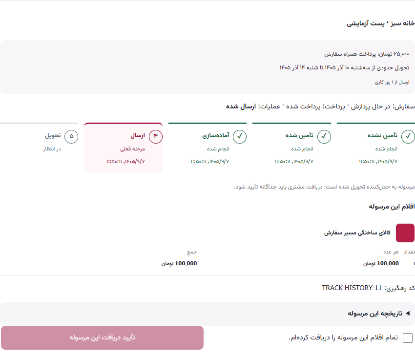

# اصلاح بازبینی مالک — #150

Issue: [#150](https://github.com/MohamadParsa/marketplace/issues/150) · مالک اجرای اصلاحات سایت و **بررسی** سه منوی بک‌آفیس را خواست. تغییر، حذف یا ادغام آن منوها در این درخواست انتخاب نشده است.

## قواعد صریح و نتیجه اجرا

| شناسه | خواسته مالک / نتیجه |
| --- | --- |
| FEAT-SF-ORDER-PRESENTATION-001-AC01 | تاریخ تحویل با ترتیب روز هفته، روز، ماه، سال؛ مانند «دوشنبه ۱۶ آذر ۱۴۰۵». قالب مشترک با formatToParts و چینش صریح، به‌جای ترتیب وابسته به مرورگر استفاده شد؛ slot و بازه تحویل در انتخاب حمل و جزئیات همان قالب را دارند. |
| FEAT-SF-ORDER-PRESENTATION-001-AC02 | عکس، نام/تنوع، تعداد و قیمت هر قلم فقط در مرسوله فروشگاه خودش باشد؛ هزینه، موعد و وقفه ارسال هم داخل همان کارت قرار گرفتند. اتصال با store_id است و نام مشابه فروشگاه باعث اختلاط نمی‌شود. فهرست کل اقلام و کارت‌های حمل تکراری از بالای جزئیات حذف شدند؛ خلاصه checkout حفظ شد. |
| FEAT-SF-ORDER-PRESENTATION-001-AC03 | جمع کالاها پیش از تخفیف مستقیم باشد؛ تخفیف کالا/کوپن/حمل مستقل و یک ردیف پرداخت واقعی کیف پول نمایش یابد. reference_subtotal_toman از snapshot سرور محاسبه شد؛ جمع نقدی کالاها به‌علاوه تخفیف مستقیم ثبت‌شده، پیش از افزایش روش فروش است. افزایش روش فروش همچنان ردیف جداست. اعتبار قبلی انتخاب‌شده و نمایش تکراری منابع بالای پروفایل حذف شدند؛ داده مالی، مصرف کیف پول، رزرو و مبلغ سفارش بازنویسی نمی‌شوند. |
| FEAT-SF-ORDER-PRESENTATION-001-AC04 | پشتیبانی/پرونده‌ها، تأمین جایگزین و عملیات مالی با سورس و شمارش read-only بررسی شوند؛ نتیجه و پیشنهاد بعدی از اجرای محصول جدا باشند. نتیجه پایین ثبت است. |

ورودی این اصلاح فقط snapshot خرید و شناسه مرسوله مجاز است؛ query مالکیت/مجوزهای موجود حفظ شده‌اند. نامعتبر بودن تاریخ به تاریخ ساختگی تبدیل نمی‌شود. جمع مرجع از قیمت جاری محصول بازسازی نمی‌شود؛ برای snapshot قدیمی بدون تخفیف مستقیم، همان مبلغ ثبت‌شده مبناست. جزئیات دریافت، لغو جزئی، مرجوعی و تاریخچه هر مرسوله حفظ شدند. وضعیت سند in-review از تکمیل اجرای انتخاب‌شده جداست.

## آزمون و شواهد

- سه تست نمایش: دوشنبه۱۶آذر۱۴۰۵، نوروز۱۴۰۴، slot/ساعت تهران و range و رد تاریخ نامعتبر؛ به CI سایت اضافه شدند.
- Go: جمع مرجع۵۴۰۰۰۰، تخفیف مستقیم۱۴۰۰۰۰، کوپن۴۰۰۰۰ و مبلغ نهایی۳۸۰۰۰۰ در fixture چندقلم/تعداد؛ تغییر بعدی قیمت محصول snapshot را عوض نکرد. PostgreSQL نیز جمع مرجع و store_id مجاز را پس از reopen بررسی کرد.
- `go test ./...` با PostgreSQL ایزوله/Redis DB15 و `go vet ./...` و build هر دو رابط موفق بودند. هیچ انتقال یا پرداخت واقعی برای بررسی منوها اجرا نشد.
- مرورگر fixture دو فروشگاهی: دو قلم فقط در دو مرسوله خودشان، یک وعده ارسال در هر کارت، یک ردیف کیف پول، ترتیب تاریخ و نمایش۳۹۰بدون overflow بررسی شدند. تصاویر فقط داده ساختگی دارند.

[نمای موبایل](assets/order-presentation-mobile.png). [سناریوهای طراحی](../../bdd/features/experiences/order-presentation-refinement.feature) با پذیرش‌ها ردیابی می‌شوند؛ وجود فایل feature ادعای اجرای runner نیست.

## بررسی پشتیبانی و پرونده‌ها — نتیجه قطعی سورس

این صفحه از `state.cases` و مدل قدیمی `support.Case` می‌خواند؛ درخواست‌های فعلی کنسلی/مرجوعی از `Commerce.OrderRequests` در جزئیات خرید و APIهای requests مدیریت می‌شوند. پس اضافه‌شدن درخواست جدید لزوماً ردیف این منو نمی‌سازد. در مسیر فعلی ایجاد سفارش جدید، تولید Case برای این صفحه پیدا نشد؛ دو Case نمونه در fixture قدیمی وجود دارند.

عمل بازپرداخت قدیمی `case.refund` برای سفارش دارای CheckoutID از سمت سرور ممنوع است؛ این محافظ اجازه ساخت بازپرداخت قدیمی موازی برای سفارش جدید نمی‌دهد. `case.assign` تنها واگذاری قدیمی می‌سازد. `orderHasSupplyHold` هنوز Case باز متصل به سفارش را بررسی می‌کند، بنابراین حذف مدل/داده بدون مهاجرت تصمیم مناسبی نیست.

منابع: [رابط پشتیبانی و واگذاری](../../../apps/backoffice-web/src/features/operations/operations-page.tsx)، [فرمان‌های پشتیبانی](../../../apps/api/internal/application/backoffice/support_commands.go)، [عملیات مرسوله](../../../apps/api/internal/application/backoffice/order_operations.go)، [درخواست‌های جدید](../../../apps/api/internal/application/backoffice/order_requests.go).

## بررسی تأمین جایگزین — نتیجه قطعی سورس

صفحه از `state.assignments` می‌خواند. `case.assign` رکوردی با وضعیت awaiting-confirmation می‌سازد، ولی در مسیرهای رابط/API فعلی، چرخه کامل قبول/رد فروشنده، ثبت ContractVersion، اتصال به موجودی و انتقال مراحل مرسوله پیدا نشد. متن رابط می‌گوید «نسخه قرارداد پس از تأیید فروشنده»، اما این ادامه در همین مسیر متصل نیست. این بخش اکنون یک فهرست واگذاری اولیه است و تحویل کامل تأمین جایگزین محسوب نمی‌شود.

منبع مدل: [support.Assignment](../../../apps/api/internal/domain/support/case.go). این مدل با انتساب نقش/عضویت کاربران که در access.go نام Assignment دارد متفاوت است.

## بررسی عملیات مالی — نتیجه قطعی سورس

`FinancePage` از `state.transfers` و `state.ledger` قدیمی می‌خواند و دکمه «تعیین نتیجه آزمون» دارد. `transfer.resolve` نتیجه را با مرجع TEST ثبت می‌کند. این داده‌ها همان دفتر کیف پول فعلی در `Commerce.Entries` یا `OrderRefunds` نیستند. پاسخ workspace نیز Commerce را حذف می‌کند؛ پس این صفحه از همان payload به پرداخت/کیف پول جدید وصل نمی‌شود.

واریز/برداشت و بررسی مالی جاری در `/wallet-operations` و وضعیت پرداخت، درخواست/استرداد هر سفارش در جزئیات `/orders/:id` متصل‌اند. بنابراین موفقیت شبیه‌سازی در منوی قدیمی، پرداخت یا استرداد سفارش جدید ایجاد نمی‌کند.

منابع: [فرم عملیات مالی قدیمی](../../../apps/backoffice-web/src/features/finance/finance-page.tsx)، [ثبت نتیجه آزمایشی](../../../apps/api/internal/application/backoffice/finance_commands.go)، [تفکیک payload workspace](../../../apps/api/internal/application/backoffice/service.go)، [فرم مالی فعلی](../../../apps/backoffice-web/src/features/commerce/commerce-page.tsx).

### شاهد read-only دیتابیس بررسی مالک

در نمونه۲۸نوامبر:۴سفارش قدیمی و۱۸سفارش checkout؛۲Case قدیمی با صفر اتصال به سفارش checkout؛ صفر Assignment؛۶Transfer قدیمی و صفر ثبت دفتر قدیمی، در برابر۱۳ورودی دفتر کیف پول فعلی. تعداد OrderRequest/OrderRefund در همین نمونه صفر بود. این شمارش وضعیت همین داده است و به معنی عدم نیاز کسب‌وکار به پشتیبانی یا تأمین جایگزین نیست. هیچ رکوردی در این بررسی اصلاح نشد.

## پیشنهاد قدم بعد — اجرا انتخاب نشده است

1. **پشتیبانی:** صف سراسری واقعی با تب کنسلی/مرجوعی و استثنای تأمین/وقفه؛ اتصال به APIهای موجود requests و supply-overdue، با همان تفکیک مجوز رسیدگی و اجرای مالی. سابقه Case قدیمی با برچسب روشن قابل دسترسی بماند.
2. **تأمین جایگزین:** تا تکمیل جریان واقعی از منوی اصلی خارج و در سابقه/بخش امکانات آتی نگهداری شود. طراحی اجرای بعدی باید قبول/رد فروشگاه، اقلام/تعداد، رزرو موجودی، حفظ مبلغ مشتری و مرز قرارداد/تسویه را روشن کند؛ تعویض صرف store_id سفارش راه‌حل این جریان نیست. حوزه قیمت/تسویه [#72](https://github.com/MohamadParsa/marketplace/issues/72) وابستگی جدا دارد.
3. **مالی:** یک سرمنوی مالی واقعی با واریز/برداشت، پرداخت سفارش، استرداد و بعداً تسویه؛ نمای یکپارچه از منابع فعلی با فیلتر سروری و مجوز مرتبط. انتقال‌های TEST قدیمی به سابقه روشن منتقل شوند؛ دفتر مالی دوم یا دکمه موفق‌سازی ساختگی برای تراکنش‌های جاری ساخته نشود.

این سه مورد نتیجه بررسی و پیشنهاد هستند؛ انتخاب چیدمان/دامنه اجرای بعدی با مالک است. اصل دسترسی فروشگاه به داده خودش، تفکیک شارژ از مصرف سفارش و محدودیت منابع استرداد مطابق [قرارداد جاری](../../architecture/contracts/order-lifecycle.md) باقی می‌مانند.
