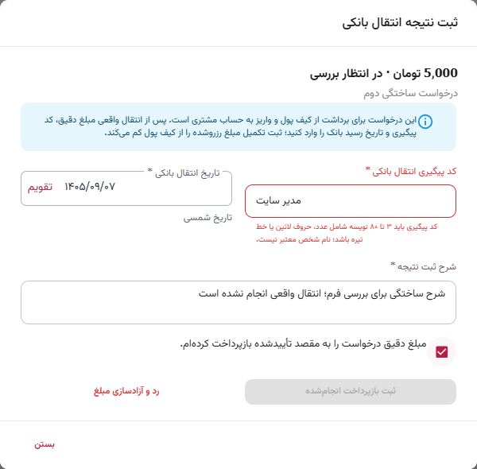

# اصلاح بازبینی کیف پول و سفارش — #151

Issue: [#151](https://github.com/MohamadParsa/marketplace/issues/151) · والد: [#95](https://github.com/MohamadParsa/marketplace/issues/95) · PR: [#106](https://github.com/MohamadParsa/marketplace/pull/106).

## مسئله و دامنه

مالک لینک نامشخص سفارش، نبود دسترسی روشن به گردش کیف پول، بزرگی مودال بازپرداخت و ابهام مرجع پرداخت/رویدادهای مالی را گزارش کرد. دامنه اصلاح، نمایش پروفایل مشتری و ثبت نتیجه برداشت بانکی توسط مالی/ادمین مجاز است. درخواست مستقیم، مجوز همین اجراست؛ وضعیت in-review سند از تکمیل اجرا و پذیرش دستی مالک جداست.

منابع: [کیف پول مشتری](../../experiences/storefront/wallet.md)، [قرارداد شارژ و مصرف](../../architecture/contracts/checkout-wallet-launch.md)، [اعتبار و منابع کیف پول](../../architecture/contracts/wallet-credit-policy.md)، [چرخه سفارش و استرداد](../../architecture/contracts/order-lifecycle.md) و [مرز نقش‌ها](../../product/roles.md). انتقال بانکی خودکار، درگاه تازه، تغییر مبلغ سفارش و بازطراحی منوهای قدیمی خارج از دامنه‌اند.

## خواسته صریح و نتیجه اجرا

| موضوع | نتیجه |
| --- | --- |
| مشاهده سفارش | عمل «مشاهده جزئیات سفارش» با زمینه برند، متن سفید و حالت hover/focus در فهرست سفارش‌ها قرار گرفت. |
| گردش کیف پول | لینک «مشاهده تراکنش‌ها» در کیف پول و لینک مستقل پروفایل به `/wallet?view=transactions` اضافه شد. فیلتر نوع و نمایش۲۰مورد با افزودن۲۰مورد قدیمی‌تر دارد؛ API موجود همه ورودی‌های مجاز همان مشتری را می‌دهد. |
| انواع گردش | واریز/شارژ، پرداخت سفارش، بازگشت وجه سفارش و برداشت بانکی از دفتر مالی موجود خوانده می‌شوند؛ افزایش/کاهش علاوه بر رنگ با متن مشخص است. درخواست انتظار/رد جداست و گردش قطعی محسوب نمی‌شود. |
| مودال | ثبت نتیجه انتقال بانکی حداکثر۶۰۰پیکسل، دو ستون دسکتاپ و یک ستون موبایل؛ بستن در پایین است. |
| مرجع مبهم | عنوان «کد پیگیری انتقال بانکی»، راهنمای قالب و خطای کنار فیلد جایگزین شدند. خطاهای API برای کد، تاریخ و شرح تفکیک شدند. |
| رویدادهای مالی | بخش بسته اولیه «تاریخچه عملیات مالی» با عنوان‌های قابل فهم شد؛ صرفاً سابقه قابل مشاهده طبق مجوز است. |

## مسیر اصلی و راهنمای اپراتور

این فرم **برداشت از کیف پول و پرداخت دستی به حساب مشتری** را ثبت می‌کند. در تصویر مالک، «مدیر سایت» نام شخص است و قالب کد پیگیری بانک را ندارد؛ علت خطا همین بود.

1. مالی مجاز مبلغ دقیق درخواست را به مقصد تأییدشده انتقال دهد.
2. کد پیگیری روی رسید بانک، تاریخ واقعی انتقال و شرح نتیجه را وارد کند.
3. پس از تطبیق مبلغ و مقصد، تأیید انجام انتقال را انتخاب و «ثبت بازپرداخت انجام‌شده» را بزند.
4. سامانه از مسیر موجود، مبلغ رزروشده را یک بار از کیف پول کم و سابقه را ثبت می‌کند.

اگر منظور **تأیید شارژ کیف پول** باشد، مسیر «اعلام واریز» و بررسی/تأیید همان واریز است. شارژ کیف پول و پرداخت سفارش طبق قرارداد دو عملیات مستقل‌اند. تاریخچه اقدام لازم برای تکمیل هیچ‌کدام نیست.

## ورودی و حالت‌های جایگزین

| ورودی / حالت | رفتار |
| --- | --- |
| کد پیگیری |۳تا۸۰نویسه شامل عدد، حروف لاتین یا خط تیره؛ ارقام فارسی/عربی نرمال و صفرهای ابتدا حفظ می‌شوند. نام شخص و قالب نامعتبر قبل از ارسال خطا دارند. |
| تاریخ انتقال | ورود/انتخاب شمسی، ارسال ISO؛ تاریخ نامعتبر یا آینده پذیرفته نمی‌شود. |
| شرح و تأیید | شرح غیرخالی و تأیید انجام انتقال برای تکمیل لازم‌اند. |
| بارگذاری و شکست خواندن | وضعیت بارگذاری/خطا و امکان به‌روزرسانی گردش؛ پاسخ قدیمی پس از تغییر نشست یا خروج اعمال نمی‌شود. |
| گردش خالی / فیلتر بدون نتیجه | پیام روشن نبود تراکنش؛ درخواست غیرقطعی به‌جای گردش قطعی جا زده نمی‌شود. |
| مالکیت و مجوز | گردش از `GET /storefront/wallet` طبق هویت سرور؛ ثبت نتیجه برداشت تابع مجوز مالی موجود است. |
| ورودی نامعتبر | خطای مشخص بدون تغییر hold، موجودی یا دفتر مالی. |
| ارسال تکراری / تغییر هم‌زمان | کنترل نسخه و idempotency موجود حفظ شدند؛ تکرار تکمیل، برداشت دوم نمی‌سازد. |

## پذیرش

| شناسه | نتیجه قابل مشاهده |
| --- | --- |
| FEAT-WALLET-REVIEW-001-AC01 | لینک سفارش در دسکتاپ/موبایل واضح و مسیر جزئیات آن درست باشد. |
| FEAT-WALLET-REVIEW-001-AC02 | مشتری گردش قطعی خودش را با مبلغ/جهت/تاریخ فارسی و فیلتر ببیند؛ درخواست غیرقطعی جدا و داده مشتری دیگر غایب باشد. |
| FEAT-WALLET-REVIEW-001-AC03 | مودال جمع‌وجور و بدون سرریز موبایل؛ نام اپراتور رد و کد با صفر اولیه پذیرفته شود؛ تاریخ آینده و شرح خالی رد شوند. |
| FEAT-WALLET-REVIEW-001-AC04 | درخواست نامعتبر اثر مالی نداشته و تکمیل معتبر/تکرار آن دقیقاً یک برداشت ثبت کند؛ تاریخچه مالی صرفاً سابقه روشن باشد. |

پرسش مسدودکننده جدید نیست؛ سیاست مالی همان قرارداد موجود است. [BDD طراحی](../../bdd/features/experiences/wallet-history-and-transfer-review.feature) برای ردیابی است؛ runner مستقل Gherkin اجرا نشده است.

## آزمون و شواهد

- `go test ./...` با PostgreSQL ایزوله و Redis DB15 و `go vet ./...` موفق‌اند. آزمون جدید نام/کد کوتاه/تاریخ آینده/شرح خالی را با عدم تغییر کل Commerce بررسی کرد؛ `۰۰۰۱۲۳۴۵۶` به `000123456` تبدیل و تکمیل تکراری فقط یک debit ساخت. موجودی ساختگی۵۰۰۰۰۰به۴۰۰۰۰۰ و hold به صفر رسید؛ مشتری دیگر ورودی یا درخواست آن مشتری را ندید.
- تست مشترک کد پیگیری و lint/build هر دو رابط موفق‌اند؛ تست مشترک به CI بک‌آفیس اضافه شد.
- مرورگر fixture جدا:۶ورودی از۵نوع ledger، فیلتر برداشت با۱نتیجه و پرداخت با۲نتیجه، تفکیک درخواست انتظار/رد و هدایت سفارش بررسی شدند. زمینه لینک سفارش `rgb(181,31,70)` و متن سفید بود. در۳۹۰پیکسل سرریز افقی نبود.
- ثبت نتیجه فقط روی برداشت۱۰۰۰۰ساختگی در حافظه ایزوله اجرا شد؛ hold۵۰۰۰دیگر باقی ماند. تصاویر نهایی روی همان fixture هستند. هیچ بازپرداخت واقعی یا تغییر مالی داده اصلی انجام نشد.
- نسخه محلی API و build هر دو رابط به‌روز شدند؛ `/health`، `/ready`، HTML و فایل JS واقعی هر دو پورت۸۰۹۸/۵۱۹۷ پاسخ200 دارند.۱۵خرید،۲۲سفارش،۳۵۳۴محصول،۴۸فروشگاه و۱۳ورودی دفتر مالی قبل/بعد یکسان‌اند؛ hash دفتر مالی `c344e44d03a88c6e101dab4930a699121f15a08c1d3a3233e05333fdce8448fc` تغییر نکرد. سرور fixture پس از بررسی بسته شد و دو سرویس اصلی روشن‌اند.
-۴۴۷پیوند نسبی در۶فایل Markdown تغییرکرده، یکتایی شناسه مشخصات و تطبیق۴پذیرش با۴سناریوی طراحی بررسی شدند؛ `git diff --check` موفق است.

[فرم موبایل](assets/refund-review-mobile.png) · [گردش دسکتاپ](assets/wallet-history-desktop.png) · [گردش موبایل](assets/wallet-history-mobile.png) · [دکمه سفارش](assets/order-list-action.png).

لینک CI و کامنت پایان پس از push به فهرست تحویل افزوده می‌شود؛ merge و انتشار عمومی مستقل‌اند.
