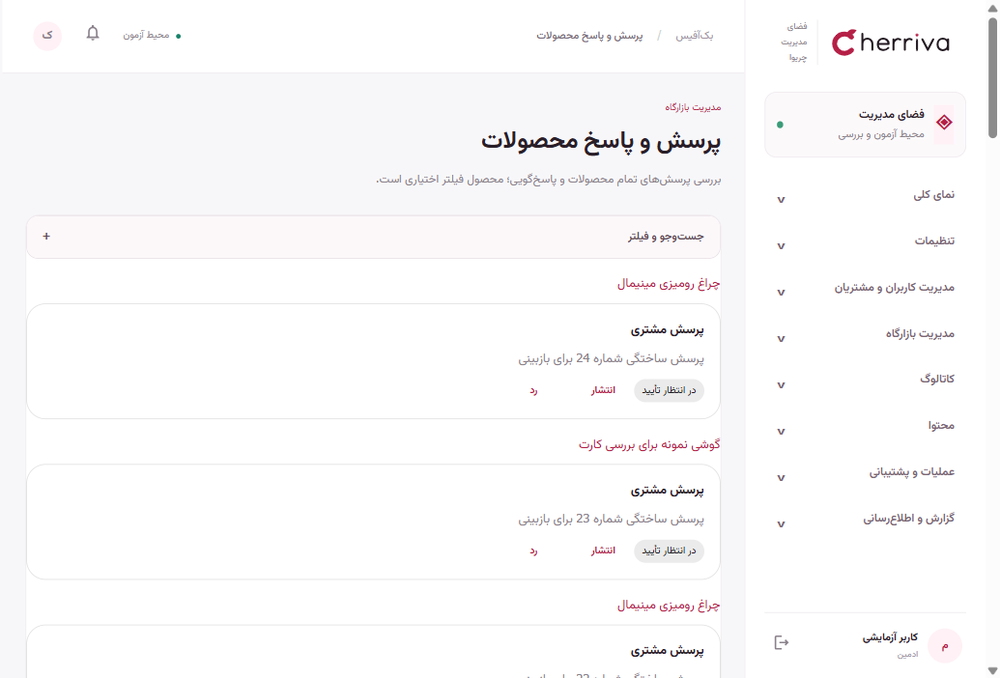
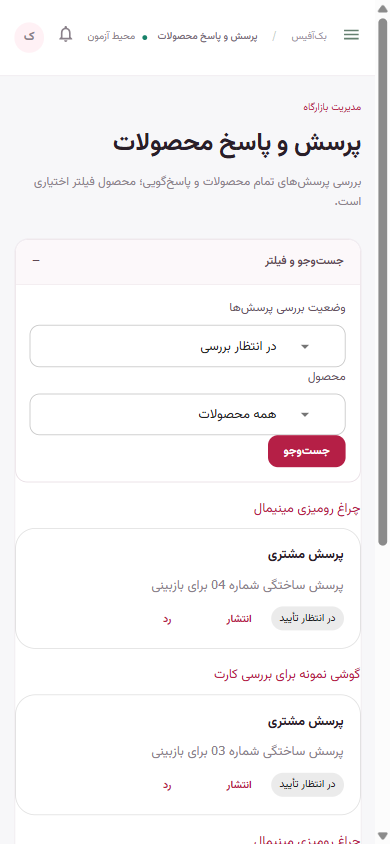
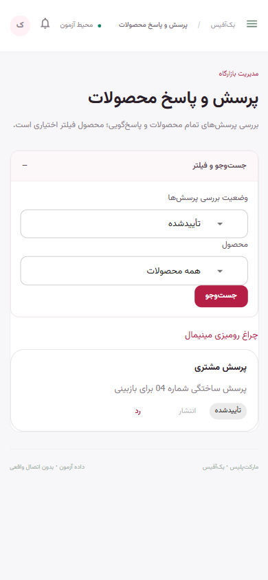

# نتیجه #131

صفحه پرسش‌وپاسخ بدون انتخاب اولیه محصول، پرسش‌های تمام محصولات را با فیلتر بررسی نشان می‌دهد؛ محصول فیلتر اختیاری است. فیلتر اولیه مانند نظرات «در انتظار بررسی» است و کنترل‌ها در ابتدا بسته‌اند. کارت هر پرسش نام/لینک محصول و کنترل مستقل بررسی پرسش/پاسخ دارد؛ امکان پاسخ‌گویی از تنظیم همان محصول می‌آید.

## قرارداد و پیاده‌سازی

`GET /backoffice/product-questions?product=&status=pending&after=` با Bearer بک‌آفیس ادمین؛ status خالی یعنی همه وضعیت‌ها و product خالی یعنی همه محصولات. صفحه۲۰تایی با cursor سراسری نزولی و فیلتر پیش از limit است. خروجی هر پرسش `product_id/product_name/can_reply` را دارد. cursor نامعتبر و status ناشناخته۴۰۰، بدون نشست۴۰۱ و بدون اختیار بررسی۴۰۳ است؛ پاسخ private/no-store. endpointهای عمومی و mutation محصول‌محور قبلی محفوظ‌اند.

query PostgreSQL با join به projection کاتالوگ و بارگذاری حداکثر۲۱پرسش کار می‌کند؛ fetch تک‌تک محصولات در client ندارد. محصول پنهان برای moderation تاریخی دیده می‌شود ولی اجازه پاسخ تازه ندارد؛ محتوای خصوصی وارد endpoint عمومی نمی‌شود. مسیر ساخت واریز/سفارش در این تغییر دست‌نخورده است.

## بررسی اجراشده

- `go test ./internal/bootstrap -run TestProductQA -count=1` با PostgreSQL محلی و schemaهای یک‌بارمصرف موفق شد؛ شامل قرارداد قبلی عمومی/مدیریتی و تست تازه حافظه/PG با۲۶پرسش، دو محصول،۲۰+۴صفحه pending، status قبل از limit، محصول اختیاری، دسترسی و سابقه محصول پنهان است.
- `npm run build` بک‌آفیس شامل TypeScript و Vite موفق؛ هشدار موجود اندازه bundle باقی است.
- مرورگر روی fixture مستقل۱۸۱۰۲ با۲۴پرسش دو محصول: ورود به صفحه بدون فیلتر محصول،۲۰+۴کارت، بازکردن فیلتر، انتشار یک پرسش و جست‌وجوی approved موفق بود. خطای console نداشت. در عرض۳۹۰، scrollWidth برابر۳۷۵و بدون overflow افقی است.
- تغییرات مرورگر فقط داده حافظه‌ای ساختگی fixture هستند؛ در داده اصلی ذخیره‌ای انجام نشد. بررسی دستی مالک بعد از کل صف مستقل است.

بستن Issue پس از push و موفقیت بررسی‌های CI با کامنت حاوی commit و این گزارش انجام می‌شود؛ موفقیت محلی شاهد انتشار عمومی نیست.
