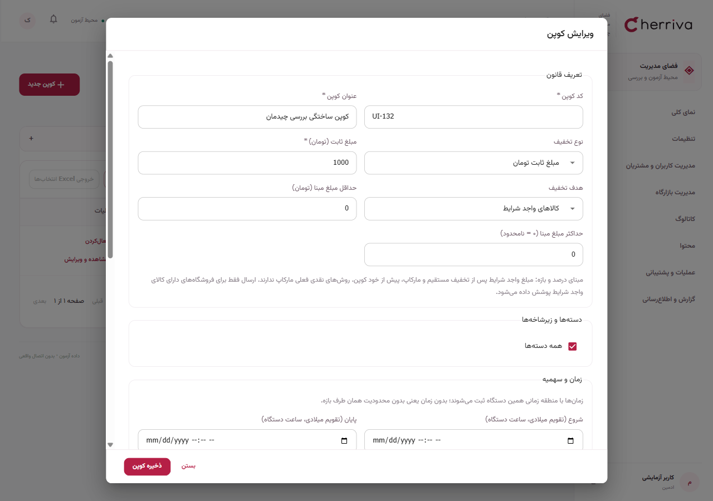
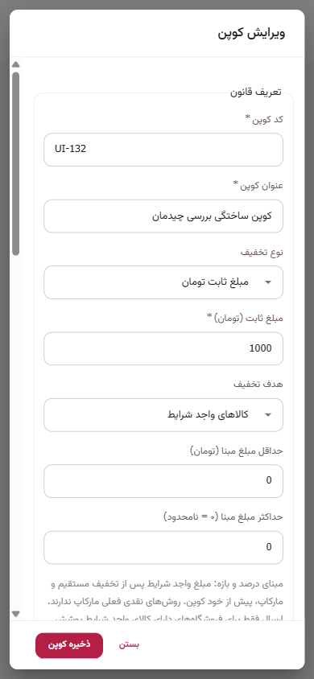

# نتیجه #132

مودال کد تخفیف از عرض xl به md تغییر کرد؛ کنترل‌های کوتاه در عرض دسکتاپ دو ستونه و در موبایل تک‌ستونه‌اند. گروه‌های فرم، انتخاب دسته و متن‌های توضیحی در جای مناسب حفظ شدند؛ دکمه‌های ذخیره/بستن پایین مودال ثابت و محتوای فرم جدا قابل اسکرول است. label «نوع تخفیف» و «هدف تخفیف» از هم متمایز و تأمین‌کننده هزینه نیز dropdown شده است؛ تغییر فرمول یا موتور کوپن نداریم.

در مرورگر یک ایراد موجود هم بازتولید شد: pattern کد کوپن با استاندارد Unicode sets جدید مرورگر، خط تیره escape‌نشده داشت. آن را اصلاح کردیم؛ کد `UI-132` در بررسی نهایی معتبر ذخیره و دوباره باز شد.

## بررسی اجراشده

- `npm run build` شامل TypeScript و Vite موفق؛ هشدار موجود bundle باقی است. تست جدید موتور کوپن برای این تغییر ظاهری ساخته نشد.
- مرورگر fixture مستقل۱۸۱۰۲: فرم درصدی/ثابت، نمایش دسته چندانتخابی، سهمیه محدود کل/مشتری، ذخیره با دسته خالی و خطای مورد انتظار۴۰۰، حفظ draft و اصلاح آن، ذخیره موفق کد دارای خط تیره و بازکردن ویرایش بررسی شدند. تنها console error بررسی نهایی همان درخواست۴۰۰عمدی است؛ SyntaxError مربوط به pattern برطرف شد.
- در۱۲۸۰×۹۰۰دو ستون و footer درون viewport بود؛ در۳۹۰×۸۴۴مودال حدود۳۶۶پیکسل، scrollWidth برابر۳۹۰و بدون overflow افقی بود. دکمه‌ها هنگام اسکرول قابل دسترس ماندند.
- تمام ذخیره‌ها روی داده حافظه‌ای ساختگی fixture هستند؛ داده اصلی/پایگاه عملیاتی تغییر نکرد. مجوز و رفتار API موجود حفظ شدند؛ پذیرش دستی مالک پس از کل صف مستقل است.

بستن Issue پس از push و موفقیت بررسی‌های CI با کامنت نتیجه انجام می‌شود؛ merge/deploy عمومی بخشی از این تحویل نیست.
