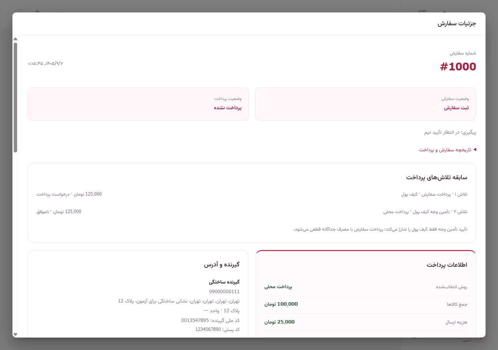

# نتیجه #135

تلاش‌های پرداخت در همان State خصوصی ذخیره می‌شوند و به خرید/quote و مرجع واقعی خود متصل‌اند. PlaceOrder یک درخواست مصرف سفارش ایجاد می‌کند؛ اعلام واریز، تلاش تأمین وجه جدا می‌سازد؛ رسید آن را در انتظار نتیجه و بررسی معتبر آن را موفق/ناموفق می‌کند. تأیید شارژ همچنان پرداخت سفارش نیست؛ تنها debit مستقل ConfirmPurchase پرداخت را قطعی می‌کند. retry سابقه تلاش قبل را نگه می‌دارد.

`payment_attempts` و `payment_stage` به DTO خرید افزوده شدند؛ amount در خروجی تومان رشته‌ای است و شناسه داخلی در UI چاپ نمی‌شود. هدف هر تلاش با عنوان «تأمین وجه کیف پول» یا «پرداخت سفارش» روشن است. کاربر سفارش بدون مجوز مالی تاریخچه تأمین وجه را نمی‌گیرد؛ customer فقط خرید خودش را می‌بیند. endpointهای mutation فعلی فیلد status دستکاری‌شده را رد می‌کنند.

انقضا درخواست پرداخت همان quote را ناموفق و خرید را نیازمند تأیید تازه می‌کند؛ وجه دیررس/اضافی فقط credit کیف پول است. لغو یا انقضا با تأیید دیررس احیا نمی‌شود. authorized صرفاً غیرقطعی است و بدون مانده/کسر واقعی کیف پول نمی‌تواند paid بسازد. درگاه/verify/capture واقعی یا BNPL فعال نشده؛ این‌ها از قرارداد برش دستی جدا هستند.

## بررسی اجراشده

- تست تازه چرخه requested → pending → awaiting-result → failed، retry با واریز دوم، شارژ موفق بدون paid سفارش و سپس debit مستقل؛ سابقه هر سه تلاش و منع افشای آن برای عملیات.
- تست تازه وجه دیررس پس از انقضا و پس از لغو، تأیید تکراری بدون credit دوم، آزاد ماندن رزرو/موجودی و حفظ نتیجه failed سفارش.
- تست authorized غیرقطعی: projection پرداخت‌نشده، رد تأیید بدون اعتبار و فقدان ledger جعلی.
- رگرسیون API/مالکیت/واریز و تزریق status نامعتبر، replay و باقی‌ماندن درخواست پرداخت پس از restart در PostgreSQL، با schema ایزوله موفق شد. مجموعه‌های Commerce/PlacedOrder/SelectedWallet/WalletCoverage/CouponCredit مرتبط موفق بودند.
- TypeScript/build بک‌آفیس موفق؛ هشدار موجود bundle باقی است. مرورگر fixture۱۸۱۰۲، سفارش ساخته‌شده با سرویس واقعی و تلاش تأمین وجه ردشده را با دو هدف جدا و پرداخت‌نشده نشان داد؛ console خطا نداشت. تصویر فقط داده ساختگی است.

رابط نهایی تب پرداخت در #140 یکپارچه می‌شود؛ این گزارش، موفقیت درگاه یا انتشار عمومی ادعا نمی‌کند. push/CI و کامنت بستن مستقل ثبت می‌شوند.
