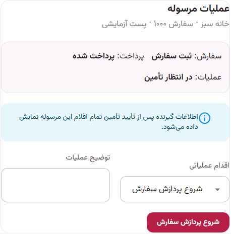
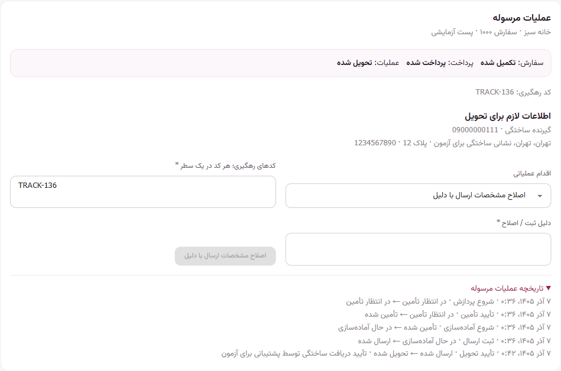
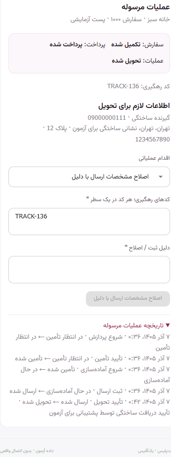

# نتیجه #136

سفارش پرداخت‌شده تا اقدام صریح در placed می‌ماند. ادمین/اپراتور مجاز یا عضو دارای مجوز scoped فروشگاه، مراحل start → supply → pack → ship را ثبت می‌کند؛ دریافت مشتری رویداد جدا و توسط مشتری همان خرید یا پشتیبانی مجاز با دلیل است. تحویل یک گروه، گروه فروشگاه دیگر را تحویل یا والد را کامل نمی‌کند. وضعیت/زمان/عامل و علت هر مرحله ذخیره می‌شود.

## قرارداد و دسترسی

- `GET/POST /backoffice/orders/{id}/operations` و همان مسیر با `/seller`؛ داده و actionهای مجاز از سمت سرور می‌آیند. mutation دارای version، action، reason، identifiers و تأیید تمام اقلام در ارسال/دریافت است. GET خواندن فقط برای نقش مجاز و محدوده همان فروشگاه/مالک؛ مالی به‌تنهایی اختیار عملیات ندارد.
- مشتری: `GET /storefront/account/orders/{purchase}/shipments/{order}` و `POST .../receive`؛ مسیر فقط دریافت را می‌پذیرد و جعل action یا شناسه بدنه/مسیر رد می‌شود.
- مجوزهای `orders.operate` برای global یا store، `orders.receive` برای پشتیبانی global و `orders.correct` مدیریتی به رجیستری و label نقش‌ها اضافه شدند. نقش عملیات بک‌آفیس عملیات عادی و پشتیبانی دریافت دارد؛ ادمین اختیار کامل دارد. اعضای فروشگاه باید نقش scoped مناسب بگیرند؛ عضویت یا مشاهده سفارش، خودکار مجوز عملیات نمی‌دهد.
- آدرس/تماس از API فروشنده قبل از تأیید تأمین همه اقلام باقی‌مانده حذف است؛ پس از تأمین فقط اطلاعات لازم ارسال، بدون کد ملی/شناسه دفترچه/شناسه مشتری برمی‌گردد. مشتری دیگر یا فروشگاه خارج محدوده نمی‌تواند اطلاعات/عملیات را بگیرد.
- on-hold، قلم دارای استثنای تأمین یا پرونده باز، با حرکت مرحله دور زده نمی‌شود. stage ناسازگار/version قدیمی۴۰۹، ورودی یا کد ناقص۴۰۰ و مجوز نامعتبر۴۰۳/مالکیت۴۰۴ است. replay نیز مجوز تازه را دوباره بررسی می‌کند.

## شناسه ارسال و تاریخچه

روش عمومی فیلد `dispatch_identifier` با tracking/delivery/none صریح دارد؛ در نسخه فروشگاه فقط‌خواندنی و ارثی و در سفارش snapshot است. تغییر تنظیم جاری، نوع شناسه سفارش قبلی را عوض نمی‌کند. روش قدیمیِ فاقد نوع، بدون تعیین صریح ادمین با دلیل قابل ارسال نیست؛ از نام روش کد حدس زده نمی‌شود.

ثبت ارسال، کد لازم و تأیید تمام اقلام گروه را می‌خواهد؛ کدهای تکراری پس از تبدیل عدد فارسی، خالی، کنترل‌کاراکتر و ورودی نامعتبر رد می‌شوند. چند کد برای گروه پذیرفته می‌شود. کد تحویل فعلاً فقط مشخصات واردشده اپراتور است، نه OTP یا اثبات خودکار دریافت. اصلاح فقط مدیریتی با دلیل است؛ کدهای قبلی و جدید در رویداد خصوصی حفظ و مرحله تحویل/مالی/ظرفیت بازنویسی نمی‌شوند. برگشت آزاد مرحله نداریم.

فرم واقعی در جزئیات سفارش بک‌آفیس و کارت سفارش فروشنده متصل شد؛ دکمه legacy دریافت برای checkout دیگر استفاده نمی‌شود. فرم RTL، کنترل تک‌انتخابی dropdown، دلیل/کد، تأیید تمام اقلام، primary مرحله بعد و تاریخچه شمسی با ساعت تهران دارد. نقش/مرحله بدون اختیار کنترل اجرایی نمی‌گیرد. API جدید داده کیف پول/رسید مالی برنمی‌گرداند.

## بررسی اجراشده

- تست مسیر کامل حافظه: دو فروشگاه، شروع دستی، نقش مالی بدون عملیات، محدوده سلر، عدم نمایش اطلاعات قبل از تأمین، وضعیت مستقل، replay و version قدیمی، شناسه الزامی/تکراری/عدد فارسی، منع ارسال ناقص، منع تأیید دریافت توسط فروشنده، دریافت مشتری، تحویل بخشی و تکمیل والد پس از همه گروه‌ها.
- تست لغو مجوز پیش از replay، توقف تأمین، روش legacy بدون نوع، تعیین صریح و اصلاح با حفظ تاریخچه، و رقابت هم‌زمان ارسال/لغو که هر دو commit نشوند.
- تست HTTP/PostgreSQL: نقش scoped، منع شروع قبل از پرداخت، نوع delivery در snapshot با وجود تغییر بعدی عمومی، کد اجباری، جعل مسیر/action، دریافت مشتری، restart و حفظ پنج رویداد و ظرفیت committed؛ دلیل داخلی برای مشتری افشا نشد.
- تست API enum روش و تست منع override نوع شناسه در نسخه فروشگاه و publish معتبر آن موفق بودند.
- `go test ./...` با PostgreSQL ایزوله و Redis آزمایشی DB15 و `go vet ./...` موفق؛ تست‌های تکمیلی policy نیز جدا موفق شدند. TypeScript/build بک‌آفیس موفق؛ هشدار موجود اندازه bundle باقی است. race محلی اجرا نشد و CI لینوکس آن را بررسی می‌کند.
- مرورگر fixture۱۸۱۰۲: فروشنده از start تا ship با کد TRACK-136، بازشدن گیرنده فقط پس از supply، disabled بودن ارسال بدون شروط، نداشتن دریافت خودکار/فروشنده، سپس دریافت جدا با دلیل ادمین و completed بررسی شد. console هر دو نشست خطا نداشت؛ عرض۳۹۰بدون overflow افقی بود. همه عملیات روی داده ساختگی حافظه‌ای است؛ داده اصلی ذخیره نشد.

کد رهگیری/تحویل تستی است؛ اتصال حمل‌کننده، پیام واقعی یا OTP تحویل فعال نشده. درخواست/استرداد و حساب مشتری در #137 تا #139 و ورودی واحد در #140 تکمیل می‌شوند؛ تاریخ‌گیرهای عمومی در #141 هستند. بستن پس از push/CI با کامنت نتیجه جداست.
