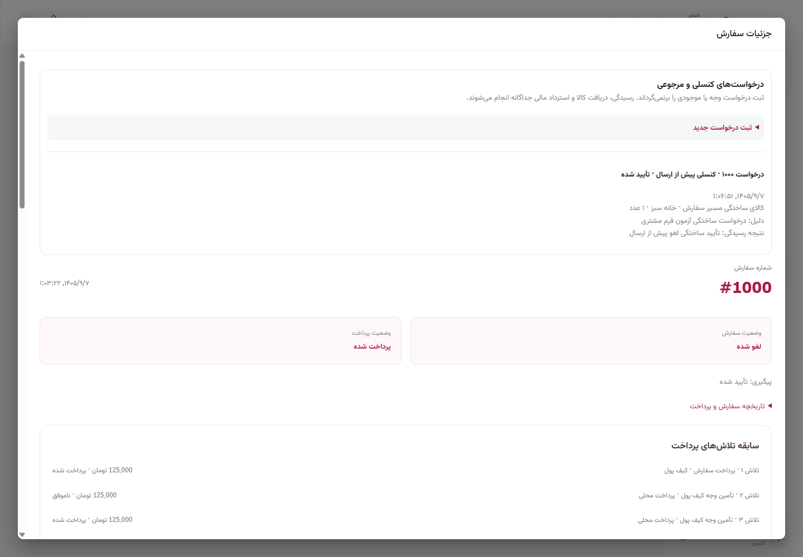
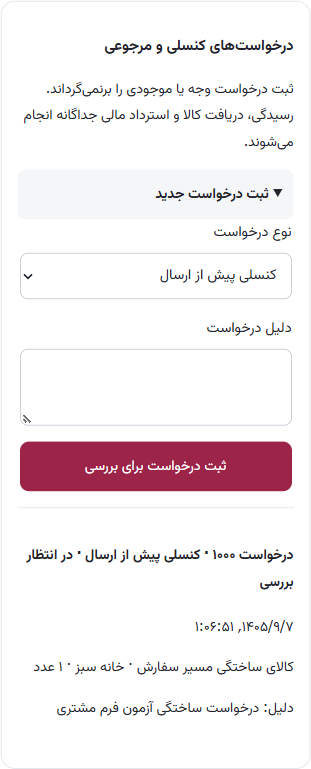
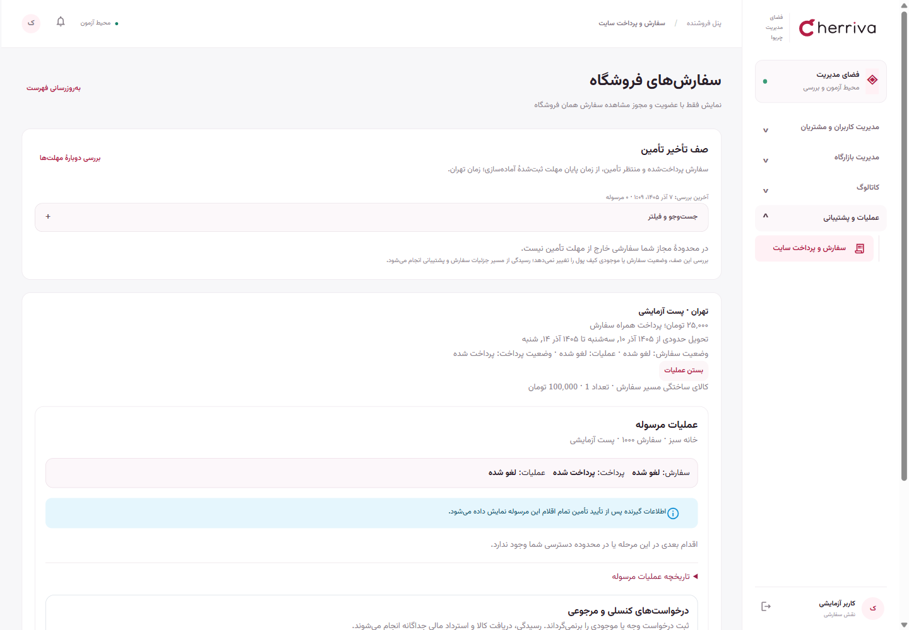

# نتیجه #137

درخواست اقلام/تعداد توسط مشتری مالک یا اپراتور از طرف او ثبت می‌شود؛ شماره عددی، عامل، دلیل، زمان و نسخه دارد. پشتیبانی/ادمین تأیید یا رد می‌کند؛ دریافت فیزیکی و نتیجه بازرسی مرجوعی مستقل‌اند. هیچ مرحله این تسک وجه را جابه‌جا نمی‌کند؛ استرداد در #138 است.

واحدهای اصلی قلم میان درخواست‌های باز/تأییدشده رزرو می‌شوند؛ رد، همان واحدها را آزاد می‌کند. پذیرش کنسلی قبل از ارسال فقط همان تعداد را به موجودی برمی‌گرداند؛ ظرفیت فقط با خالی‌شدن تمام مرسوله آزاد می‌شود. مرجوعی پس از ارسال بدون تغییر ظرفیت گذشته و فقط پس از تأیید، دریافت و سلامت به موجودی برمی‌گردد. تحویل/تکمیل قبلی حفظ می‌شود. مهلت یا پذیرش خودکار اضافه نشده است.

## قرارداد و رابط

- `GET/POST /backoffice/purchases/{id}/requests` و `/seller/purchases/{id}/requests` و `/storefront/account/orders/{id}/requests`؛ فروشنده فقط GET و داده فروشگاه مجاز، بدون دلیل مشتری/پشتیبانی یا کنترل رسیدگی.
- `POST /backoffice/order-requests/{request}/review` با version/action/reason و healthy اختیاری برای دریافت/اجباری برای بازرسی؛ مجوز global مستقل رسیدگی.
- `orders.requests.write` و `orders.requests.review` ثبت و رسیدگی را جدا می‌کنند. مشتری فقط مالک خرید و فروشنده فقط فروشگاه مجاز؛ مجوز در replay دوباره بررسی می‌شود.
- مسیر قدیمی درخواست لغو مشتری برای سفارش پرداخت‌شده پرونده واقعی اقلام می‌سازد؛ ترکیب مرسوله ارسال‌شده/نشده به مرجوعی/کنسلی تفکیک می‌شود. درخواست قدیمی boolean بدون ساخت تاریخ/عامل جعلی با توضیح legacy دیده می‌شود. لغو کامل قدیمی ادمین در حضور درخواست باز/تأییدشده رد می‌شود تا دوباره موجودی/وجه برنگردد.
- فرم مشترک در جزئیات بک‌آفیس، مشتری و نمای فقط‌خواندنی فروشنده؛ فرم جدید ابتدا بسته، انتخاب نوع dropdown، تعداد با سقف، دلیل و کارت وضعیت دارد. draft و کلید idempotency هنگام خطای mutation حفظ می‌شوند. دکمه لغو مالی قدیمی برای خرید پرداخت‌شده از رابط حذف شد.

## شواهد

- تست API حافظه: مالکیت، نقش عملیات بدون رسیدگی، مقدار بیش از خرید، version، replay، آزادشدن واحد پس از رد، موجودی/ظرفیت فقط همان مرسوله، بدون اثر مالی؛ دریافت قبل/بعد از تأیید، ناسالم بدون موجودی، سالم با موجودی یک‌بار و حفظ completed؛ رقابت پذیرش لغو/ارسال با فقط یک commit؛ لغو مجوز پیش از replay.
- HTTP/PostgreSQL: مشتری/فروشنده/ادمین، منع ایجاد فروشنده، مخفی‌بودن دلایل، منع بررسی مشتری، عدم تکرار، ذخیره اتمیک و بازیابی بعد از restart.
- `go test ./...` با PostgreSQL ایزوله و Redis DB15 و `go vet ./...` موفق. build/TypeScript بک‌آفیس و سایت موفق؛ هشدار قبلی اندازه bundle بک‌آفیس باقی است. race در CI لینوکس اجرا می‌شود.
- مرورگر fixture حافظه‌ای۱۸۱۰۲/۱۸۱۰۳: ثبت واقعی مشتری → تأیید ادمین → مشاهده مشتری و فروشنده بدون دلیل/فرم رسیدگی. console error هر دو مشتری/ادمین صفر؛ نمای موبایل مشتری نیز بررسی شد. داده اصلی تغییر نکرد.

PR #106 همچنان باز است؛ merge/deploy و اتصال واقعی مالی/حمل/پیام انجام نشده است. بستن پس از push و هر پنج CI با کامنت شاهد انجام می‌شود.
