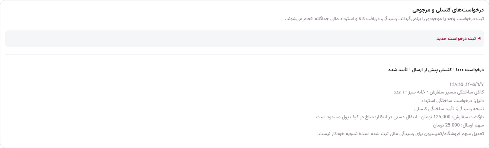
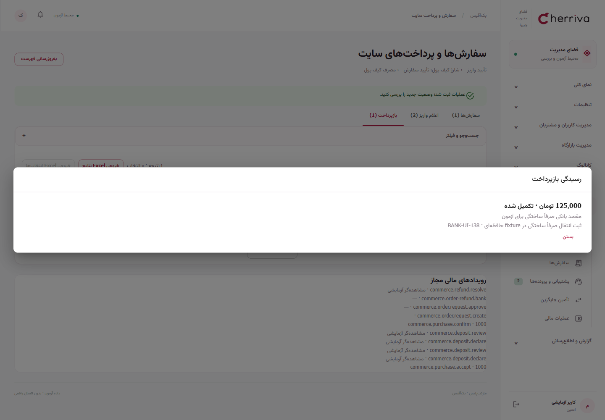

# نتیجه #138

استرداد پرونده تأییدشده با مجوز مستقل مالی، نسخه و تأیید مبلغ محاسبه‌شده سرور اجرا می‌شود. هر پرونده یک استرداد دارد؛ درخواست/پذیرش/برگشت فیزیکی به‌تنهایی استرداد مالی نیست. مبلغ اقلام از snapshot و allocation تخفیف هر واحد اصلی محاسبه می‌شود؛ قیمت جاری دخالت ندارد. حمل فقط در لغو کامل پیش از ارسال، با کسر تخفیف و یک‌بار برمی‌گردد؛ پس‌کرایه و حمل پس از ارسال بازگشت خودکار ندارند. سهمیه کوپن مصرف‌شده حفظ می‌شود.

## کیف پول و بانک

- `POST /backoffice/order-requests/{request}/refund` با version، method=wallet/bank، accepted_amount_toman، reason و مقصد خصوصی برای bank. همه محاسبات، سقف کل، بودجه هر منبع و پرونده‌های مستردشده در همان تراکنش کنترل می‌شوند؛ نسخه/مبلغ کهنه۴۰۹، ورودی ناقص۴۰۰ و بدون مجوز۴۰۳ است.
- بازگشت از همان منابع مصرف‌شده خرید، با همان محدودیت فقط‌خرید/قابل‌برداشت، origin و سن FIFO ثبت می‌شود؛ اصل lot مصرف‌شده و ledger بازنویسی نمی‌شوند. برای سازگاری قید فعلی پایگاه، نوع ledger موجود `order-cancel-credit` و source یکتای `order-refund:<request>` استفاده می‌شود؛ نوع/مرجع پرونده تفاوت مرجوعی را نگه می‌دارد. DDL تازه لازم نشد.
- bank فقط از منابع قابل‌برداشت مصرف‌شده و هنوز برنگشته همان خرید است. credit و hold برداشت موجود در یک تراکنش ثبت می‌شوند؛ مشتری نمی‌تواند آن مبلغ را خرج کند. نتیجه نامعلوم pending می‌ماند. تکمیل از endpoint موجود refunds/resolve، با مبلغ واقعی، مرجع، تاریخ و دلیل؛ سپس یک debit با همان تخصیص‌ها.
- انصراف/رد انتقال، مسیر بانکی را پایان می‌دهد و وجه برگشتی در کیف پول باقی می‌ماند؛ اجازهٔ بازگشت دوباره سفارش ایجاد نمی‌کند. مقصد فقط در مالی و حساب همان مشتری دیده می‌شود؛ فروشنده خلاصه استرداد یا مقصد نمی‌گیرد.
- مسیر legacy لغو کامل پرداخت‌شده علاوه بر اختیار سفارش، مجوز مالی می‌خواهد؛ وجود پرونده باز/تأییدشده و وجود credit لغو گذشته مانع استرداد مجدد است. داده قدیمیِ فاقد snapshot معتبر منابع، به‌صورت حدسی به نقد قابل‌برداشت تبدیل نمی‌شود.

## آمار و تسویه

فروش خالص از اتحاد واحدهای لغوشده و مستردشده کم می‌شود، بدون دوباره‌شمردن لغو+استرداد. تغییر در projection موجود کاتالوگ ذخیره و کش فروش بر اساس revision موجود تازه می‌شود. برای هر قلم/حمل، تعدیل immutable شامل ناخالص، سهم تخفیف پلتفرم/فروشنده، خالص، فروشگاه و واحدها با وضعیت `review-required` برای رسیدگی مالی ثبت می‌شود؛ کمیسیونِ نامشخص حدس زده نشده و موتور تسویه #72/انتقال واقعی ساخته نشده است.

## شواهد

- سه واحد با تخفیف۱۰٪، دو منبع محدود و نقد؛ دو استرداد جزئی و استرداد نهایی با هزینه حمل، جمع دقیق پرداخت؛ حفظ اصل lot، FIFO، محدودیت و سهمیه کوپن.
- pending بانک قابل خرج نیست؛ تکمیل با مبلغ غلط رد، تکمیل/replay یک‌بار؛ رد انتقال وجه را در کیف پول نگه می‌دارد و credit دوم نمی‌سازد. رقابت دو مأمور مالی فقط یک نتیجه موفق دارد.
- قبل از پرداخت پرونده/استرداد ایجاد نمی‌شود؛ نقش عملیات اختیار مالی نمی‌گیرد؛ منبع فقط‌خرید برای بانک رد می‌شود. مرجوعی پس از تحویل بدون بازگشت حمل/ظرفیت و بدون برگشت خودکار موجودی، با حفظ completed و تعدیل فروش خالص بررسی شد.
- HTTP/PostgreSQL: دو درخواست هم‌زمان با یک credit/hold، منع مشتری، restart و حفظ hold، اثبات مبلغ/مرجع و debit یک‌بار. آزمون PG ابتدا ناسازگاری نوع ledger با قید موجود را آشکار کرد؛ با استفاده از نوع معتبر موجود اصلاح و دوباره موفق شد.
- `go test ./...` با PG ایزوله و Redis DB15 و vet موفق؛ تست تکمیلی مرجوعی پس از تحویل نیز موفق. build/TypeScript هر دو رابط موفق، هشدار قبلی bundle بک‌آفیس باقی است.
- مرورگر: ادمین مقصد ساختگی را ثبت کرد، وضعیت bank-pending و مسدودبودن مبلغ نشان داده شد؛ سپس نتیجه انتقال ساختگی با مرجع BANK-UI-138 ثبت و completed دیده شد. console error صفر بود. همه روی fixture حافظه‌ای، بدون انتقال پول واقعی.

بستن پس از push و پنج CI با کامنت شاهد؛ PR #106 باز است. merge/deploy، DDL پایگاه اصلی، ریفاند آنلاین یا انتقال بانکی واقعی انجام نشده است.
