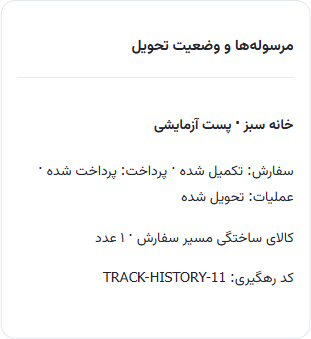
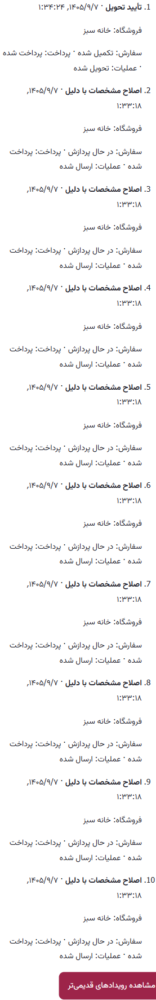

# نتیجه #139

در همان حساب سفارش مشتری، مرسوله‌های مستقل، وضعیت سفارش/پرداخت/عملیات، اقلام و مقدار لغو/برگشتی و کد جاری ارسال دیده می‌شوند. تأیید دریافت فقط برای مالک و همان مرسوله با تأیید دریافت اقلام، نسخه و کلید تکرارپذیر است. وضعیت والد از تمام گروه‌ها جمع می‌شود؛ پرداخت موفق به معنای شروع پردازش یا تحویل نیست. درخواست/استرداد پس از تکمیل، سابقه completed را پاک نمی‌کند.

## تاریخچه و حریم دسترسی

`GET /storefront/account/orders/{id}/history`، `/backoffice/purchases/{id}/history` و `/seller/purchases/{id}/history` با limit۱تا۵۰ و before، رویدادهای تازه‌تر را ابتدا برمی‌گردانند. cursor توالی ذخیره‌شده است؛ اضافه‌شدن رویداد تازه، صفحات قدیمی را جابه‌جا نمی‌کند. رابط۱۰رویداد و سپس «مشاهده رویدادهای قدیمی‌تر» دارد؛ loading/خالی/خطا و retry مستقل‌اند.

رویدادهای جدید شناسه پایدار و نسخه دارند؛ مرجع مرسوله/پرونده، مبدأ/مقصد و سطح عامل در projection مجاز وجود دارند. رویداد قدیمی بدون شناسه، شناسه مشتق‌شده با برچسب legacy می‌گیرد و تاریخ/عامل یا نسخه گذشته جعل نمی‌شود. رخداد همراه mutation موفق ذخیره می‌شود و replay تاریخچه دوم ایجاد نمی‌کند. ثبت عملیات برگشت موجودی و تصمیم پرونده، دو نوع رویداد مرتبط همان تراکنش‌اند.

مشتری فقط خرید خود؛ بدون actor داخلی، علت عملیاتی خصوصی، کدهای قبلی یا تخصیص مالی/مقصد بانکی در timeline. ادمین دارای اختیار رسیدگی/اصلاح/مالی نام عامل و دلیل داخلی را هم می‌بیند. فروشنده فقط رویدادهای مرسوله فروشگاه مجاز، بدون رویداد مالی والد یا دلیل خصوصی پرونده. همین حذف دلیل پرونده در نمای عملیات قبلی نیز اعمال شد. شناسه فنی lot از نمایش مشتری حذف شد. تاریخچه با اعداد فارسی، تقویم شمسی و ساعت تهران نمایش داده می‌شود.

## قرارداد مصرف اعلان آینده

منبع پایدار همان Purchase.Events در تراکنش جاری است، نه ارسال هم‌زمان به provider. مصرف‌کننده آینده با کلید ترکیبی purchase_id/event.id و نام مصرف‌کننده deduplicate کند؛ ترتیب sequence همان خرید را حفظ و checkpoint را پس از پردازش ثبت کند. retry/replay رویداد، mutation مالی یا عملیاتی را دوباره اجرا نکند. نسخه صفر/شناسه legacy فقط سابقه است و بدون تصمیم جدا پیام گذشته ارسال نشود. این تسک outbox عمومی، worker یا SMS/email واقعی فعال نکرده است؛ مالکیت #75/#77/#82 محفوظ است.

## بررسی

- تست دو فروشگاه، وضعیت مستقل و والد processing/mixed، مجوز مشتری/فروشنده/ادمین و نبود دلایل/منابع خصوصی؛ صفحه‌بندی بدون تکرار، ادامه cursor پس از ثبت رخداد تازه و شناسه پایدار.
- HTTP/PostgreSQL پس از restart: تاریخچه دو صفحه، حفظ دریافت مشتری و نوع ارسال snapshot، منع limit نامعتبر؛ تست‌های قبلی rollback/replay/هم‌زمانی نیز پاس شدند.
- `go test ./...` با PG ایزوله و Redis DB15 و vet موفق؛ build هر دو رابط موفق. هشدار قبلی bundle بک‌آفیس باقی است.
- مرورگر حساب مشتری روی fixture حافظه‌ای:۱۰رویداد → صفحه بعد، بدون متن خصوصی مدیر؛ تأیید دریافت مرسوله ارسال‌شده → completed؛ موبایل۳۹۰با کارت خوانا و تاریخ شمسی/ساعت تهران. نشست تازه console error نداشت. نشست قبلی پس از reset fixture، guest-cart منقضی و محدودیت OTP داشت؛ بررسی نهایی در نشست تازه و داده ساختگی انجام شد، نه داده اصلی.

بستن پس از push/CI با کامنت شاهد؛ PR #106 باز است و merge/deploy نشده است.
