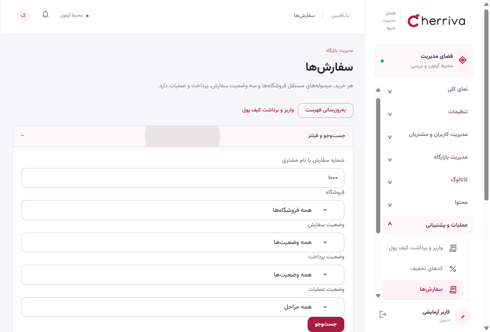
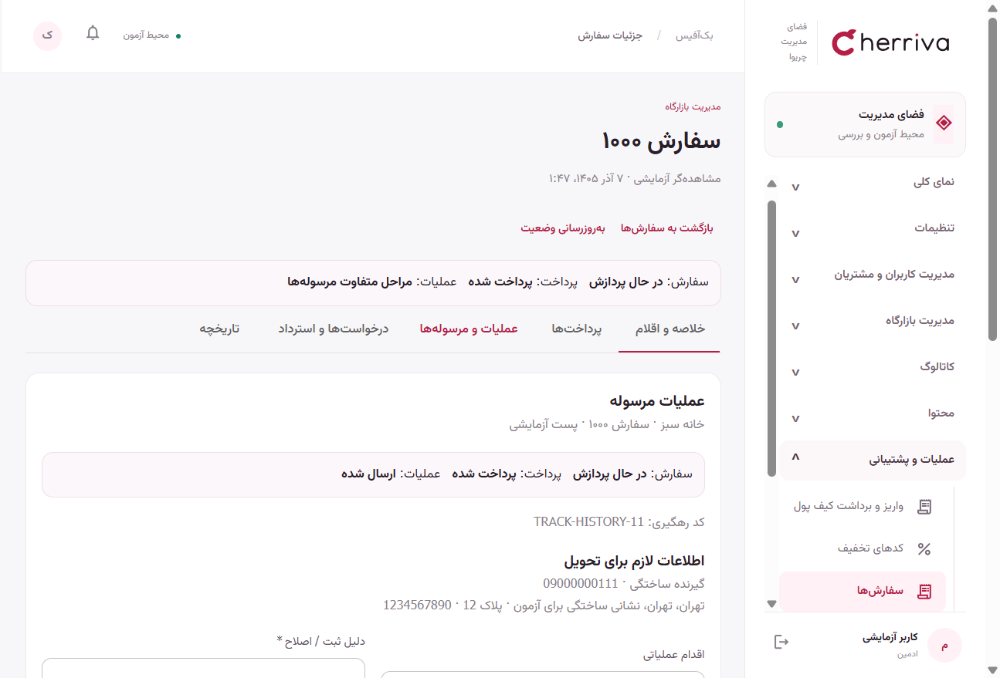
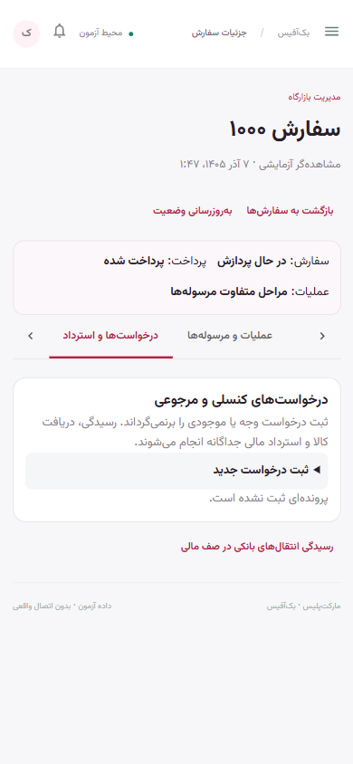

# نتیجه #140

یک ورودی «سفارش‌ها» در منو، خرید والد و مرسوله‌های فروشگاه‌ها را نمایش می‌دهد. جست‌وجو/فیلتر و صفحه‌بندی از endpoint سمت سرور است؛ لیست، کل کیف پول/رسید/آدرس یا داده بانک نمی‌گیرد. فیلترهای شماره/مشتری، فروشگاه، سفارش، پرداخت و عملیات مستقل، dropdown و در ابتدا بسته‌اند؛ جست‌وجو primary است. انتخاب‌ها در URL حفظ می‌شوند؛ بارگذاری، خطا، تلاش مجدد، صفحه خالی و خروجی با همان محدوده مجوز وجود دارند.

جزئیات در صفحه مستقل با تب‌های خلاصه/اقلام، پرداخت‌ها، عملیات/مرسوله‌ها، درخواست‌ها/استرداد و تاریخچه است. هر تب به API واقعی #134–#139 وصل است؛ پردازش/دریافت از پرداخت جداست و مرسوله‌ها مستقل‌اند. صف مهلت تأمین قبلی در بخش بسته حفظ شد.

## قرارداد و سازگاری

- `GET /backoffice/order-workspace?q=&store=&order=&payment=&fulfillment=&page=0&size=20`؛ size حداکثر۱۰۰ و enumها اعتبارسنجی می‌شوند. مبلغ/وضعیت‌ها از snapshot و مدل موجود؛ رکورد جدید برای واریز مستقل ساخته نمی‌شود.
- `GET /backoffice/order-workspace/{id}` شناسه خرید، شماره عددی یا شناسه مرسوله را به همان خرید حل می‌کند. timeline از endpoint صفحه‌بندی‌شده جدا دریافت می‌شود.
- `/orders` فهرست واحد؛ `/orders/:id` جزئیات خرید یا مرسوله و برای شناسه مرسوله به‌صورت پیش‌فرض تب عملیات. `/commerce` به `/orders` هدایت می‌شود. سابقه قدیمی با شماره نمایشی و برچسب روشن به جزئیات قدیمی می‌رسد؛ خرید/پرداخت جعلی ساخته و داده قبلی حذف نمی‌شود.
- `/wallet-operations` صف واریز/برداشت موجود است؛ واریز مستقل کیف پول در این صف می‌ماند. مالی سفارش به رسیدهای مرتبط لینک دارد و انتقال بانکی از همان صف برداشت تعیین تکلیف می‌شود.
- نمای فروشنده در `/orders` از endpoint scoped قبلی و کنترل عملیات/درخواست‌های واقعی استفاده می‌کند؛ عضویت مجوز مالی نمی‌سازد و `/commerce` قدیمی نیز به ورودی واحد می‌رسد.
- داده رسید/تلاش مالی، مقصد/توضیح بانکی و منابع/مانده کیف پول برای عملیات بدون اختیار مربوطه از پاسخ حذف می‌شوند؛ پنهان‌کردن صرف کنترل UI نیست. مجوزهای mutation موجود تغییر نکرده‌اند. شناسه فنی منابع در نمایش پرداخت نیز حذف شد.

## شواهد

- Go: فیلتر مستقل، شماره با ارقام فارسی، یک ردیف خرید دو فروشگاهی، صفحه‌بندی و سابقه قدیمی، resolve سه نوع شناسه، منع surface مشتری، محدودیت size و حذف داده مالی نقش عملیات.
- HTTP/PostgreSQL: query و detail از شناسه مرسوله بعد از restart، گروه‌های مستقل و مالی مخفی برای نقش عملیات، منع مشتری. `go test ./...` با PG ایزوله و Redis DB15 و vet موفق؛ تست تکمیلی endpoint نیز جدا موفق بود.
- TypeScript/build بک‌آفیس موفق؛ هشدار قبلی bundle باقی است. تغییر سایت مشتری در این تسک وجود ندارد؛ build آن در #139 موفق بوده است.
- مرورگر fixture دو فروشگاهی: فیلتر اولیه بسته و جست‌وجوی فارسی؛ دو کارت عملیات با shipped و awaiting-supply و والد processing/mixed؛ تب درخواست‌ها و نمای۳۹۰بدون آشفتگی؛ console error صفر. سابقه ORD-1045 با برچسب legacy باز شد و `/commerce` بعد از ورود به `/orders` هدایت شد. تمام داده‌ها ساختگی و حافظه‌ای بودند.

بستن پس از push/CI با کامنت شواهد؛ PR #106 همچنان باز است؛ merge/deploy نشده است. الزام تاریخ‌گیرهای شمسی در #141 ادامه دارد.
