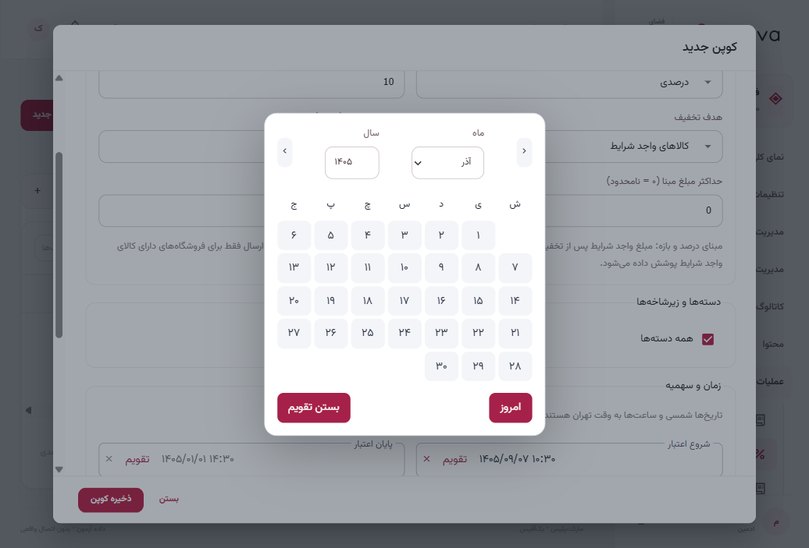
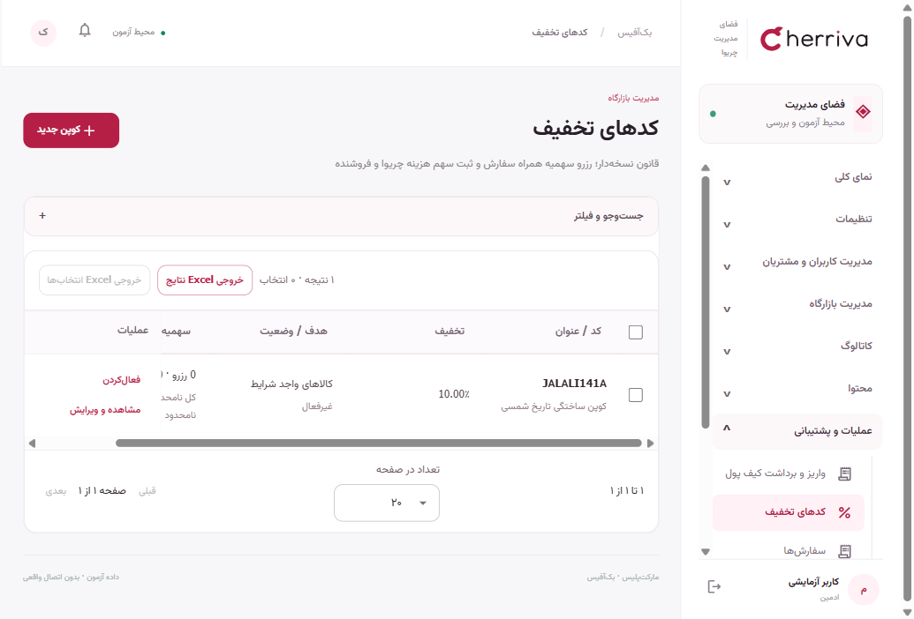
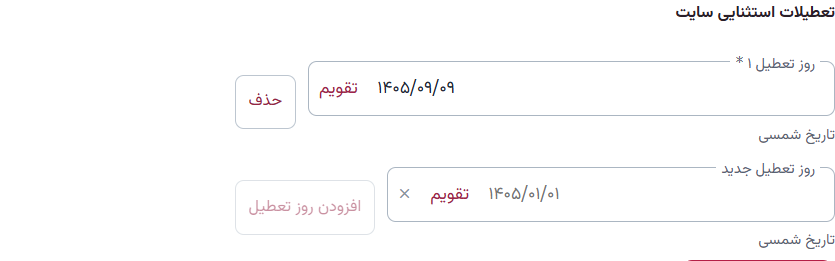

# نتیجه #141

انتخابگر مشترک شمسی به تمام ورودی‌های تاریخ/تاریخ‌وساعت جاری سایت و بک‌آفیس وصل شد. ورودی و تقویم با ارقام فارسی، پذیرش عدد انگلیسی/عربی، انتخاب ماه/سال/روز، صفحه‌کلید، Escape، پاک‌کردن، required/readonly/disabled و خطای فارسی دارند. تاریخ نامعتبر به مقدار خالی اختیاری تبدیل نمی‌شود و draft حفظ می‌شود.

API و داده ذخیره‌شده همان روز میلادی یا ISO موجود است؛ Date-only بدون جابه‌جایی timezone و Date-time با ساعت تهران تبدیل می‌شود. هیچ داده تاریخی یا قرارداد مالی بازنویسی نشده و وابستگی تقویمی جدیدی اضافه نشده است. رابط پنل فروشنده که با بک‌آفیس مشترک است، همین کنترل ظرفیت را دارد.

## ممیزی

| مسیر سورس | کنترل | نتیجه |
| --- | --- | --- |
| `apps/storefront-web/src/commerce-pages.tsx` | تاریخ اعلام واریز در خرید و شارژ کیف پول | جایگزینی date بومی؛ نمایش شمسی و hidden میلادی برای FormData؛ روز اولیه تهران |
| `apps/backoffice-web/src/features/commerce/commerce-page.tsx` | تاریخ واقعی تطبیق واریز | انتخابگر شمسی؛ تأیید با تاریخ نامعتبر فعال نمی‌شود |
| همان فایل | تاریخ انتقال دستی | انتخابگر شمسی؛ روز اولیه تهران و حفظ قرارداد برداشت موجود |
| همان فایل | تعطیلات تاریخ‌دار سایت | حذف textarea میلادی؛ فهرست روزهای شمسی با افزودن/حذف و همان ISO روزانه |
| `apps/backoffice-web/src/features/commerce/coupons-page.tsx` | شروع/پایان کوپن | حذف datetime-local/ساعت دستگاه؛ تاریخ شمسی و ساعت تهران، اختیاری/قابل پاک‌کردن |
| `apps/backoffice-web/src/features/commerce/shipping-capacity-dialog.tsx` | روز ظرفیت و انتخاب روزهای پیش‌نمایش | انتخابگر مشترک؛ روز نامعتبر query نمی‌سازد و label روزهای پیش‌نمایش فارسی است |
| `apps/backoffice-web/src/shared/components.tsx` | renderer فرم‌های دارای metadata | type تاریخ/تاریخ‌وساعت پیش از renderer معمول به کنترل شمسی هدایت می‌شود |
| `packages/date-controls` | تبدیل، کنترل‌ها و آزمون مشترک | یک مرجع مشترک؛ helper قبلی shipping-dates فقط re-export سازگار است |

جست‌وجوی سورس هر دو اپ و packages، کنترل مستقیم date/datetime-local میلادی یا ورودی YYYY-MM-DD باقی‌مانده پیدا نکرد. renderer پویای metadata به‌صورت صریح تاریخ را جدا می‌کند. فیلترهای موجودِ بدون ورودی تاریخ نیازی به کنترل جعلی نگرفتند. نمایش تاریخ واریز در لیست‌های مرتبط نیز شمسی شد؛ ساعت‌های مستقل آماده‌سازی، تقویم تاریخ محسوب نمی‌شوند.

## آزمون

- تست شناخته‌شده نوروز۱۴۰۴ و اسفند کبیسه۱۴۰۳، رد۳۰اسفند۱۴۰۴ و روزهای نامعتبر، ارقام فارسی/عربی/انگلیسی و۷۸۱نمونه اطراف مرز سال‌ها برای رفت‌وبرگشت دقیق.
- datetime نیمه‌شب تهران، حفظ ثانیه و زمان تابستان تاریخی ایران؛ چهار timezone دستگاه UTC/Tehran/Los_Angeles/Kiritimati خروجی یکسان دادند. مقدار خالی تاریخ ساختگی نمی‌سازد.
- تست‌های مشترک تاریخ در هر دو اپ، regression تاریخ حمل و نمایش عدد سایت موفق؛ TypeScript/build هر دو اپ موفق. CI هر دو اپ اکنون تست مشترک تاریخ را اجرا می‌کند؛ هشدار قبلی bundle بک‌آفیس باقی است.
- مرورگر واقعی بک‌آفیس: ذخیره کوپن با ورودی انگلیسی شروع و انتخاب روز پایان از تقویم؛ بدنه ISO دقیق `2026-11-28T07:00:00.000Z` و `2026-11-29T20:30:00.000Z` و بازکردن مجدد با ساعت۱۰:۳۰تهران و همان روز پایان. پاک‌کردن زمان اختیاری و disabled حین ذخیره بررسی شد. تاریخ نامعتبر در فرم تکمیل‌شده درخواست API نفرستاد و draft را پاک نکرد.
- بستن تقویم داخل مودال و Escape، ابتدا مودال میزبان را هم می‌بست؛ انتشار رویداد محصور و آزمون ذخیره/بازکردن و Escape دوباره موفق شد. حرکت سریع Arrow+Enter نیز اصلاح و در fixture مستقل موفق شد.
- مرورگر سایت در۳۹۰: تقویم فارسی داخل مودال شارژ، انتخاب۷آذر۱۴۰۵، ارسال تاریخ `2026-11-28` و ذخیره اعلام واریز ساختگی؛ خود مودال حفظ شد. console error هر دو اپ صفر بود.
- تعطیلات سایت: افزودن۹آذر۱۴۰۵، PATCH با `2026-11-30` و نمایش همان روز پس از ذخیره موفق.
- fixture مستقل کنترل: readonly/disabled قابل تغییر نبودند؛ خطای اسفند نامعتبر، min/max، FormData میلادی/ISO، پاک‌کردن، تغییر ماه/سال، Arrow+Enter و Escape بررسی شدند. این fixture صرفاً توسعه‌ای و ignored است؛ خطای favicon آن ارتباطی با محصول نداشت.

همه mutationهای مرورگر روی fixture حافظه‌ای۱۸۱۰۲/۱۸۱۰۳ بود؛ نه داده اصلی و نه انتقال واقعی. بستن پس از push و هر پنج CI با کامنت شواهد انجام می‌شود. PR #106 باز است؛ merge/deploy نشده است.
