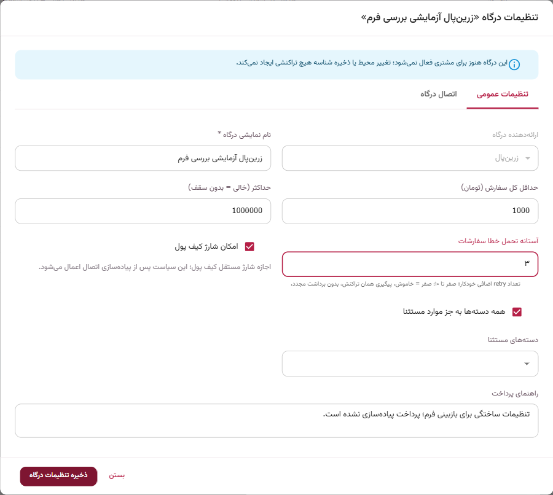

# تحویل قدم تنظیمات درگاه — #152

Issue: [#152](https://github.com/MohamadParsa/marketplace/issues/152) · والد: [#95](https://github.com/MohamadParsa/marketplace/issues/95) · شاخه PR [#106](https://github.com/MohamadParsa/marketplace/pull/106).

## مسئله و دامنه انتخاب‌شده

مالک پس از [بررسی اولیه](zarinpal-gateway-review-2026-11-28.md)، افزودن تنظیمات retry و اجازه شارژ کیف پول را خواست؛ سپس صریحاً انتخاب کرد که **ابتدا فقط تنظیمات ساخته شود** و پیاده‌سازی خود درگاه بعد از بررسی فرم باشد. در اصلاح بعدی، credential هر ارائه‌دهنده در تنظیمات خودش ذخیره و آدرس بازگشت از فرم حذف شد؛ تغییر local/staging/production نباید نیازمند ویرایش کد باشد.

این تحویل فقط مدیریت تنظیمات در بک‌آفیس است؛ request، هدایت، callback handler، verify، worker تلاش مجدد یا عملیات بانکی اضافه نشده‌اند. وضعیت done برای همین قدم است؛ پذیرش دستی مالک، پیاده‌سازی اتصال، نهایی‌شدن قرارداد تجاری و انتشار عمومی مستقل‌اند.

مرجع قواعد: [پرداخت، بخش تنظیمات درگاه](../domains/payments/README.md#gateway-settings-20261128)، [نقش‌ها](../product/roles.md)، [مرز شارژ/مصرف](../decisions/adr-001-pricing-and-payment-boundaries.md) و [قرارداد منابع کیف پول](../architecture/contracts/wallet-credit-policy.md).

## مسیر بررسی فرم

از [اجرای محلی بک‌آفیس](http://localhost:8098/commerce-settings)، تب «پرداخت و مقصد وجه» را باز کنید. بخش «درگاه‌های بانکی و آنلاین» بالای روش‌های فعلی است؛ «افزودن درگاه» یا «ویرایش تنظیمات» پنجره دو تب دارد:

| تب | فیلدها و رفتار |
| --- | --- |
| تنظیمات عمومی | ارائه‌دهنده، نام، حداقل/حداکثر تومان، آستانه تحمل خطا سفارشات، امکان شارژ کیف پول، دسته‌های مجاز/مستثنا و راهنمای پرداخت. |
| اتصال درگاه | فقط schema همان provider؛ برای زرین‌پال Merchant ID، محیط Sandbox/واقعی، Base URL، واحد ارسالی IRR، شرح و auto_verify. آدرس بازگشت در این فرم وجود ندارد. |

فیلدهای متنی و dropdownها label یکسان دارند؛ دسته‌های چندتایی با multi-select انتخاب می‌شوند. فرم دو ستون دسکتاپ/یک ستون موبایل و ذخیره primary است. provider رکورد ذخیره‌شده قابل تعویض به نوع دیگر نیست؛ برای نوع متفاوت رکورد جدا ساخته می‌شود. شناسه داخلی به کاربر نمایش داده نمی‌شود.

## ورودی‌ها و پیش‌فرض‌ها

| ورودی | اعتبارسنجی / معنا |
| --- | --- |
| `max_automatic_retries` | عنوان «آستانه تحمل خطا سفارشات»؛ عدد صحیح۰تا۱۰، پیش‌فرض۰. تعداد تلاش **اضافی** خودکار است و۰یعنی خاموش. اجرای retry متعلق به قدم اتصال است؛ برداشت تازه یا retry کور برای نتیجه مالی نامشخص از این عدد نتیجه نمی‌شود. |
| `allow_wallet_topup` | پیش‌فرض خاموش؛ اجازه شارژ **مستقل** کیف پول، از مصرف داخلی سفارش جداست. این سیاست در قدم اتصال روی عرضه روش شارژ اعمال می‌شود؛ اکنون صرفاً ذخیره می‌شود. |
| مبلغ و دسته | کف نامنفی، سقف خالی یا مثبت و حداقل برابر کف، شناسه دسته معتبر و غیرتکراری؛ مبلغ با ورودی فارسی به عدد استاندارد تبدیل می‌شود. |
| Merchant ID | UUID۳۶نویسه‌ای؛ در پیش‌نویس می‌تواند خالی باشد. ذخیره credential فقط با کلید رمزنگاری آماده در سرور مجاز است. مقدار قبلی در خواندن برنمی‌گردد؛ ورودی خالی در ویرایش آن را حفظ می‌کند؛ پاک‌کردن صریح جداست. |
| محیط و Base URL | پیش‌فرض Sandbox؛ تغییر محیط آدرس رسمی متناسب را پر می‌کند. مقصد خارجی/ناهمخوان رد می‌شود. برای هر استقرار تنظیمات و credential در دیتابیس همان محیط قرار می‌گیرد. |
| واحد و auto_verify | IRR فقط‌خواندنی؛ auto_verify انتخابی و مستقل از تأیید نتیجه توسط سرور است. ذخیره این گزینه عملیات درگاه را اجرا نمی‌کند. |
| فعال‌سازی | هنوز پشتیبانی نمی‌شود؛ مقدار `active=true` در API هم رد می‌شود و هیچ رکورد این بخش به گزینه پرداخت مشتری تبدیل نمی‌شود. |

فیلدهای retry و اجازه شارژ در مدل عمومی رکورد درگاه‌اند؛ فهرست credential/تنظیم اختصاصی از schema هر provider می‌آید. فعلاً فقط زرین‌پال در registry معرفی شده است؛ افزودن نام دلخواه به معنی پشتیبانی پروتکل آن درگاه نیست.

## نگهداری credential و دسترسی

مقادیر credential در `Commerce.GatewaySettings` همان دیتابیس محیط، با AES-256-GCM و nonce تصادفی و اتصال رمز به شناسه/provider رکورد ذخیره می‌شوند. این مدل از `PaymentMethod` عمومی و snapshot سفارش جداست. API خواندن فقط نام credential تنظیم‌شده و مقادیر غیرمحرمانه را می‌دهد؛ ciphertext هم به پاسخ مدیریت/عمومی فرستاده نمی‌شود. audit ورودی خام ندارد و نتیجه عملیات idempotency نیز نسخه پوشیده است.

مشاهده تابع `commerce.settings.read` و تغییر تابع `commerce.payment.settings.write` در surface بک‌آفیس است؛ عضویت فروشگاه یا حساب مشتری مجوز ایجاد نمی‌کند. کاربر فقط‌خواندنی می‌تواند بین تب‌ها جابه‌جا شود ولی تغییر/ذخیره ندارد. نسخه رکورد، ویرایش هم‌زمان را کنترل می‌کند؛ کلید idempotency در retry همان ورودی حفظ می‌شود. از دست رفتن/تغییر کلید رمزنگاری اجازه بازنویسی credential قبلی را نمی‌دهد.

## محیط‌ها و مسیر بازگشت در کد

Credential مثل Merchant ID **در تنظیمات همان درگاه** ذخیره می‌شود. `PAYMENT_GATEWAY_ENCRYPTION_KEY` credential پذیرنده نیست؛ کلید رمزنگاری پایدار۳۲بایتی با قالب Base64 و خارج از دیتابیس است. همه پردازه‌های API متصل به یک دیتابیس باید همان کلید را داشته باشند و همراه backup محافظت شود. کلید با هر build یا deploy دوباره تولید نشود.

در اجرای Windows، `Start-Cherriva.ps1` کلید محلی را در مسیر خصوصی کاربر خارج از git، `C:\Users\Elias\.codex\local-runtimes\cherriva\payment-gateway.key`، می‌سازد/بازاستفاده و دسترسی فایل را به همان کاربر محدود می‌کند. در staging/production کلید پایدار را از secret store محیط تزریق کنید؛ مقادیر واقعی در مخزن یا لاگ نوشته نمی‌شوند.

مسیر ثابت در [کد ساخت callback](../../apps/api/internal/application/backoffice/gateway_callback_config.go) برابر `/storefront/payments/zarinpal/callback` است. origin فقط از `PAYMENT_PUBLIC_BASE_URL` محیط می‌آید و از Host درخواست یا تنظیم درگاه/ورودی مشتری گرفته نمی‌شود:

| محیط | نمونه ساختگی origin | مسیر نهایی |
| --- | --- | --- |
| local/test | `http://localhost:5197` | همان origin + مسیر ثابت بالا |
| staging | `https://stage.example.test` | همان مسیر، بدون تغییر کد |
| production | `https://shop.example.test` | همان مسیر، بدون تغییر کد |

HTTP فقط برای loopback در local/test پذیرفته می‌شود؛ origin دارای credential، query، fragment یا مسیر دلخواه رد است. origin خالی فعلاً مانع ذخیره draft نیست و ساخت callback خطای مشخص می‌دهد. **فقط URL ساز تعریف شده؛ handler این مسیر هنوز پیاده‌سازی نشده است.** [نمونه متغیرهای محیطی](../../apps/api/.env.example) و [راهنمای محیط‌ها](environments.md).

## پذیرش و شواهد

| شناسه | نتیجه بررسی |
| --- | --- |
| FEAT-BO-PAYMENT-GATEWAY-SETTINGS-001-AC01 | ایجاد/ویرایش تنظیمات عمومی و schema زرین‌پال؛ ذخیره retry۳و اجازه شارژ روشن با ورودی عدد فارسی، بازیابی بعد از رفرش، تغییر preset محیط و رد retry۱۱ و Merchant ID نامعتبر در مرورگر اثبات شد. |
| FEAT-BO-PAYMENT-GATEWAY-SETTINGS-001-AC02 | عدم ذخیره/بازگشت plaintext، حفظ credential با ورودی خالی، حذف صریح، خطای کلید مفقود/نادرست، رد مجوز مشتری/فروشگاه/کاربر فاقد write، نسخه stale و تکرار درخواست در unit/HTTP بررسی شدند. کاربر مالی فقط‌خواندنی در مرورگر امکان تغییر نداشت و تب اتصال قابل مشاهده بود. |
| FEAT-BO-PAYMENT-GATEWAY-SETTINGS-001-AC03 | PostgreSQL ایزوله: ذخیره رمز‌شده، reopen و replay، شکست تزریقی ذخیره و rollback و retry موفق؛ روش‌های موجود، مقصد کارت، ورودی‌های دفتر مالی، سفارش و خرید تغییر نکردند. رکورد draft در config عمومی یا روش‌های شارژ مشتری دیده نشد؛ درخواست active و callback سفارشی نیز در API رد شدند. |
| FEAT-BO-PAYMENT-GATEWAY-SETTINGS-001-AC04 | ساخت callback با originهای local/test/staging/production و مسیر یکسان در تست بررسی شد؛ UI فیلد callback ندارد. فرم۳۹۰پیکسل سرریز افقی نداشت و هیچ درخواست بیرونی به زرین‌پال در سناریوی مرورگر ایجاد نشد. |

`go test ./...` با PostgreSQL و Redis DB15 و `go vet ./...`، TypeScript/build بک‌آفیس و parse راه‌انداز PowerShell موفق‌اند. [BDD طراحی](../bdd/features/experiences/payment-gateway-settings.feature) با۴پذیرش منطبق است؛ runner مستقل Gherkin اجرا نشده است. تست مرورگر با Playwright و fixture حافظه‌ای جدا اجرا شد؛ هیچ credential واقعی یا پرداخت زنده برای آزمون لازم نبود.

۶۳۱پیوند نسبی در۱۱فایل Markdown مرتبط، یکتایی شناسه مشخصات، تطبیق۴پذیرش با۴سناریوی طراحی و `git diff --check` بررسی و موفق بودند.

[تب اتصال بدون فیلد callback](payment-gateway-settings-assets/gateway-connection-desktop.png) · [عمومی موبایل](payment-gateway-settings-assets/gateway-general-mobile.png) · [اتصال موبایل](payment-gateway-settings-assets/gateway-connection-mobile.png) · [فهرست درگاه‌ها](payment-gateway-settings-assets/gateway-list-desktop.png).

## اجرای محلی و باقی‌مانده

API و build محلی به‌روزند. health/ready و HTML هر دو پورت۸۰۹۸/۵۱۹۷ پاسخ200 داشتند. پیش/پس از جایگزینی API،۱۵خرید،۲۲سفارش،۳۵۳۴محصول،۴۸فروشگاه و۱۴ورودی دفتر مالی حفظ شدند؛ fingerprint دفتر مالی `4eef5db469592d7c060f730f49e8ce7e5fdf417c01667707ac12f6dd9768862b` یکسان بود. هیچ رکورد درگاه ساختگی به دیتابیس اصلی اضافه نشد.

پس از بررسی فرم توسط مالک، اتصال واقعی، پیگیری امن retry و اعمال سیاست شارژ مستقل در مرحله بعد ساخته می‌شوند؛ [GATEWAY-Q01 تا03](../product/open-questions.md#zarinpal-gateway-review-20261128) برای همان مرحله باقی‌اند.

سورس و شواهد با کامیت [c21c76d](https://github.com/MohamadParsa/marketplace/commit/c21c76d0c8121f7c47602f0dd18f0a8a94c327b5) پوش شدند؛ هر۵بررسی [CI](https://github.com/MohamadParsa/marketplace/actions/runs/46137004269)، شامل تست race و vet سرور، موفق‌اند و #152 با [کامنت شواهد](https://github.com/MohamadParsa/marketplace/issues/152#issuecomment-7238178495) بسته شد. fixture پس از تست بسته و سرویس اصلی روشن است؛ PR #106 باز و merge/deploy انجام نشده است.
