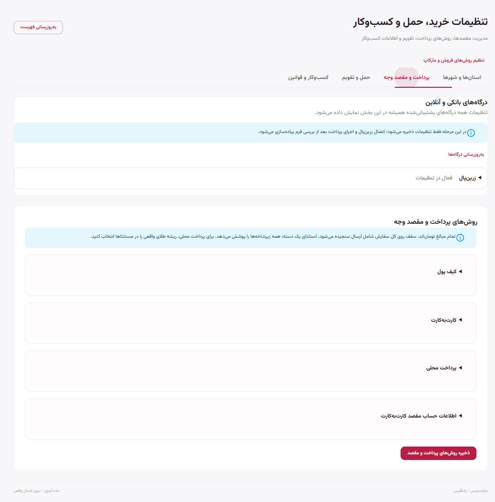

# اصلاح بازبینی تنظیمات — #153

بازبینی بعدی سوییچ‌ها و انتخاب واحد/ضریب در [تحویل #154](gateway-currency-and-switches-2026-11-28.md) ثبت شده است؛ شرح IRR در جدول این گزارش، شاهد نسخه قبلی است.

Issue: [#153](https://github.com/MohamadParsa/marketplace/issues/153) · والد [#95](https://github.com/MohamadParsa/marketplace/issues/95) · PR [#106](https://github.com/MohamadParsa/marketplace/pull/106). این تحویل ادامه [قدم تنظیمات #152](payment-gateway-settings-2026-11-28.md) است؛ مالک همچنان بررسی فرم را پیش از اجرای خود درگاه انتخاب کرده است.

## قواعد صریح و نتیجه اجرا

- Merchant ID الزام مشترک همه درگاه‌ها نیست. Client ID و Client Secret زرین‌پال طبق سند احراز هویت معرفی‌شده اضافه شوند و credential بر اساس schema همان provider نگهداری شود.
- تنظیمات هر درگاه پشتیبانی‌شده همیشه موجود باشد؛ دکمه افزودن حذف و فعال/غیرفعال با سوییچ انجام شود. هر provider یک رکورد تنظیمات دارد؛ ایجاد رکورد دوم با کلید متفاوت نیز رد می‌شود.
- بخش‌های درگاه و همه روش‌های فعلی، از جمله محلی، کارت‌به‌کارت، کیف پول و حساب مقصد، کشویی و در بارگذاری اولیه بسته باشند. بخش‌های داخل تب اتصال هم بسته شروع می‌شوند.
- تغییر مقادیر تنظیمات از پنل با ذخیره در دیتابیس و بدون build/publish اعمال شود. این قاعده، افزودن adapter ناشناخته صرفاً با ورود نام نیست.
- شرح از عملیات خرید یا شارژ همان درخواست ساخته شود؛ متن ثابت تنظیمات نباشد. callback هم ورودی تنظیمات نیست و طبق تصمیم قبل از مسیر کد و origin محیطی ساخته می‌شود.
- مشتری روال عادی پرداخت را ببیند؛ دسترسی API، تأیید نتیجه و پیگیری مجاز روی سرور طراحی شوند. اجرای این عملیات هنوز متعلق به قدم بعد از بررسی فرم است.

قواعد مشترک در [پرداخت](../domains/payments/README.md#gateway-settings-20261128)، مجوز در [نقش‌ها](../product/roles.md) و مرز شارژ/مصرف در [ADR-001](../decisions/adr-001-pricing-and-payment-boundaries.md) است. وضعیت done فقط به این اصلاح تنظیمات اشاره دارد؛ پذیرش دستی، اتصال بانکی و انتشار عمومی مستقل‌اند.

## بازخوانی مستندات رسمی

[احراز هویت API](https://www.zarinpal.com/docs/apiDocs/auth) جریان OAuth با client_id/client_secret و حساب پذیرنده را توضیح می‌دهد. initialize و دریافت توکن به حساب و کد یک‌بارمصرف مربوط‌اند؛ password این مرحله OTP است و نباید رمز ثابت تنظیمات باشد. Access/Refresh Token خروجی احرازند و مدیریت آن‌ها در مرحله اتصال روی سرور خواهد بود. Client ID/Secret به‌تنهایی اثبات ورود یا دریافت وجه نیستند.

[راهنمای API](https://www.zarinpal.com/docs/apiDocs/guide) کاربرد توکن در GraphQL را شرح می‌دهد. این مسیر از [پرداخت V4](https://www.zarinpal.com/docs/paymentGateway/connectToGateway) جداست؛ اختیاری‌بودن Merchant ID در **فرم تنظیمات**، الزام مستند آن برای عملیات مستقیم V4 را لغو نمی‌کند. Sandbox جداگانه OAuth از سند معرفی‌شده احراز نشده و Sandbox پرداخت نباید به آن تعمیم داده شود.

[تأیید نهایی تراکنش](https://www.zarinpal.com/docs/paymentGateway/moreFeatures/session-validation) مربوط به نهایی‌شدن پرداخت نزد بانک است. auto_verify مشخص می‌کند آغاز این فرایند با زرین‌پال باشد یا با درخواست سرور سایت؛ با ورود OAuth یا OTP مشتری یکی نیست. در هر حالت، ثبت نتیجه مالی چریوا نیازمند بررسی سروری است.

## فرم و نگهداری داده

مسیر [اجرای محلی](http://localhost:8098/commerce-settings) ← پرداخت و مقصد وجه ← بازکردن زرین‌پال ← ویرایش تنظیمات ← اتصال درگاه.

| بخش | تنظیمات |
| --- | --- |
| احراز هویت API | Client ID، Client Secret، حساب پذیرنده، کانال SMS/USSD و آدرس رسمی API؛ credentialها در پیش‌نویس می‌توانند خالی باشند. |
| تنظیمات پرداخت | Merchant ID با عنوان اختیاری، محیط و آدرس سرویس پرداخت و واحد IRR. |
| تنظیمات پیشرفته تأیید پرداخت | عنوان روشن «تأیید نهایی تراکنش» و توضیح جدایی از OAuth؛ هر دو شیوه، کار سرورند و مشتری مرحله اضافه ندارد. |

schema نوع و حداکثر طول هر credential را تعیین می‌کند. Client ID عدد مثبت و ارقام فارسی قابل تبدیل است؛ UUID فقط برای Merchant ID در صورت ورود بررسی می‌شود. Client Secret تا۴۰۹۶نویسه با حفظ دقیق حروف و فاصله پشتیبانی می‌شود؛ این حد حفاظتی ورودی برنامه است، نه طول قراردادی اعلام‌شده زرین‌پال. آزمون schema دارای فقط api_key نیز کلید بلند را بدون Merchant پذیرفت؛ provider ساختگی به محصول اضافه نشد.

credentialها رمزنگاری‌شده می‌مانند و در خواندن، audit یا خروجی عمومی مقدار خام نمی‌آید. ویرایش خالی، مقدار قبلی را حفظ می‌کند؛ حذف هر credential مستقل است. رکورد قدیمی با Merchant ID هنگام افزودن OAuth حفظ می‌شود. شرح ثابت قدیمی از view حذف و در ذخیره بعدی کنار گذاشته می‌شود.

خواندن تنظیمات، مقادیر پیش‌فرض providerهای فاقد رکورد را بدون نوشتن در دیتابیس برمی‌گرداند. سوییچ وضعیت را ذخیره و پس از refresh حفظ می‌کند؛ **فعال در تنظیمات** تا آماده‌شدن adapter به معنی عرضه درگاه به مشتری نیست. روش‌های فعلی و دفتر مالی از این تغییر وضعیت تأثیر نمی‌گیرند.

## شرح عملیات

[سازنده شرح](../../apps/api/internal/application/backoffice/gateway_description.go) برای استفاده adapter مرحله بعد آماده شد: شارژ مستقل «شارژ کیف پول چریوا» و سفارش۱۰۱۴ «پرداخت سفارش شماره 1014» دارد. purpose/شماره نامعتبر رد می‌شود. در این قدم تراکنش بیرونی اجرا نشده تا شرح به آن ارسال شود؛ «راهنمای پرداخت» نمایشی فرم با شرح تراکنش تفاوت دارد و حفظ شده است.

## پذیرش و شواهد

| شناسه | نتیجه |
| --- | --- |
| FEAT-BO-GATEWAY-SETTINGS-REVISION-001-AC01 | ذخیره OAuth بدون Merchant، Client ID فارسی، secret بلند با حفظ حروف/فاصله، ویرایش خالی، تغییر/حذف مستقل و حفظ credential قدیمی در تست رمزگشایی fixture اثبات شدند. |
| FEAT-BO-GATEWAY-SETTINGS-REVISION-001-AC02 | schema صرفاً API key، رد ورودی نامرتبط/OTP، عدم plaintext، PostgreSQL/reopen و ویرایش خالی؛ پیش‌فرض بدون write، یک رکورد برای provider و سوییچ روشن/خاموش بدون اثر روی روش پرداخت/پول بررسی شدند. |
| FEAT-BO-GATEWAY-SETTINGS-REVISION-001-AC03 | مرورگر: پنج بخش روش پرداخت بسته در شروع، نبود افزودن، سوییچ و refresh، بسته‌بودن بخش‌های اتصال، OAuth-only و ویرایش بدون build، پوشیدگی secret، نبود description/callback و موبایل۳۹۰بدون سرریز موفق بودند. |
| FEAT-BO-GATEWAY-SETTINGS-REVISION-001-AC04 | شرح خرید و شارژ متفاوت، شرح ثابت قدیمی حذف از view و حفظ Merchant قدیمی هنگام افزودن OAuth اثبات شد؛ صرف تنظیمات و سوییچ، درگاه اجرا‌نشده را برای مشتری فعال نکرد. |

`go test ./...` با PostgreSQL ایزوله و Redis DB15 و `go vet ./...` و TypeScript/build بک‌آفیس موفق‌اند. [BDD طراحی](../bdd/features/experiences/payment-settings-revision.feature) با پذیرش‌ها ردیابی می‌شود؛ runner مستقل آن اجرا نشده است. مرورگر فقط fixture حافظه‌ای داشت؛ هیچ OAuth، OTP یا پرداخت واقعی زرین‌پال فراخوانی نشد.

[موبایل بسته](payment-settings-revision-assets/payment-settings-collapsed-mobile.png) · [OAuth دسکتاپ](payment-settings-revision-assets/gateway-oauth-final-desktop.png) · [OAuth موبایل](payment-settings-revision-assets/gateway-oauth-final-mobile.png) · [Merchant اختیاری و توضیح تأیید](payment-settings-revision-assets/gateway-payment-help-final.png). داده‌ها ساختگی‌اند.

اجرای محلی به‌روز شد؛۱۵خرید،۲۲سفارش،۳۵۳۴محصول،۴۸فروشگاه،۱۴ورودی دفتر مالی و fingerprint `4eef5db469592d7c060f730f49e8ce7e5fdf417c01667707ac12f6dd9768862b` پیش/پس از جایگزینی API یکسان‌اند. تنظیمات واقعی کاربر توسط agent تغییر نکردند. کنترل ۹ سند Markdown، ۵۳۸ پیوند نسبی، یکتایی شناسه و تطبیق چهار سناریوی BDD با چهار معیار پذیرش و `git diff --check` موفق بود. [کامیت سورس b72f8ed](https://github.com/MohamadParsa/marketplace/commit/b72f8ed6a5284c6c0c42308f07bffce387d327ef) پوش و [هر پنج بررسی CI](https://github.com/MohamadParsa/marketplace/actions/runs/46140334524) موفق شد. #153 با [کامنت شواهد](https://github.com/MohamadParsa/marketplace/issues/153#issuecomment-7238649881) بسته و والد #95 به‌روز شد؛ والد و PR #106 باز می‌مانند. health/ready هر دو برنامه و فایل‌های نهایی JS/CSS کد۲۰۰دارند. fixture آزمون و مرورگر بسته شدند؛ اجرای اصلی محلی روشن است. merge/deploy عمومی انجام نشده است.
