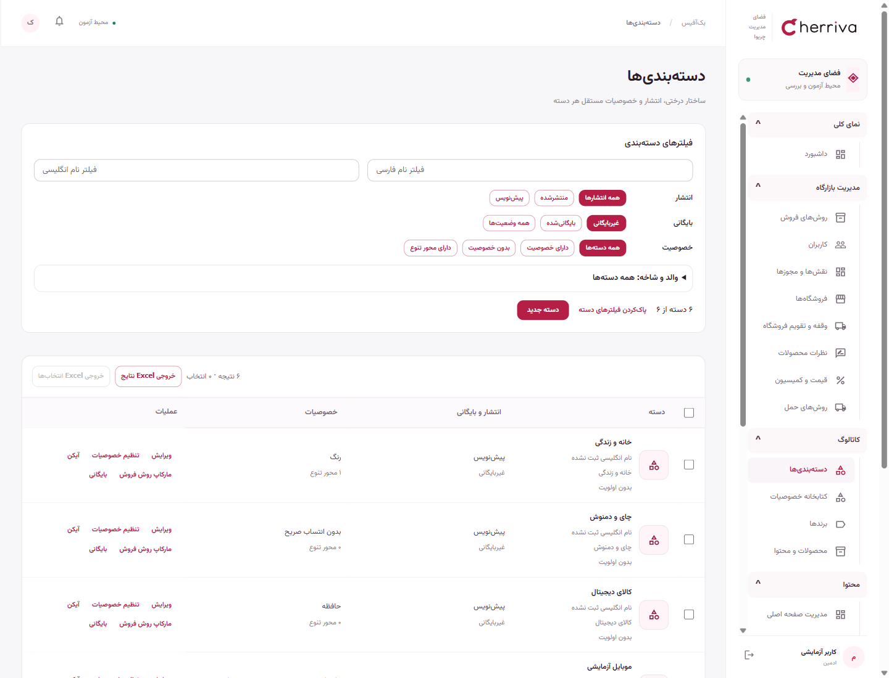
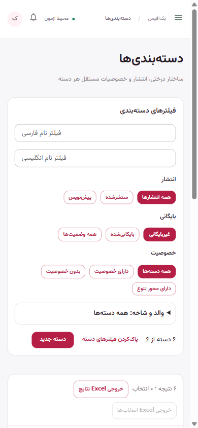

# هماهنگی پنل، فیلتر و گرید بک‌آفیس — ۲۰۲۶-۱۱-۲۶

این اصلاح، درخواست تکمیلی مستقیم مالک در حین اجرای #121 است: ناهماهنگی استایل‌ها، فیلترهای شبیه Excel و تفاوت منوی کاتالوگ باید رفع شوند. به‌روزرسانی همین اجزای مشترک، task جدید یا گسترش اختیار کاربران ایجاد نمی‌کند.

## رفتار جاری

- فیلتر ستونی عمومی از `DataTable` حذف شده است. فرم فیلتر صفحه بالای نتایج قرار دارد؛ محصول/دسته/برند جست‌وجوی دوم داخل گرید ندارند. برای فهرست فاقد فرم جست‌وجوی اختصاصی، یک جست‌وجوی متنی در نوار نتایج باقی است.
- گرید، فاصله و رنگ سربرگ/ردیف، ستون عملیات، نوار نتایج/خروجی و صفحه‌بندی در `panel-system.css` هماهنگ‌اند. خروجی مجاز XLSX، انتخاب ردیف و کنترل مجوز موجود حفظ می‌شوند.
- فرم‌های فیلتر محصول، دسته، برند، کاربران، فروشگاه و روش حمل عنوان و قاب مشترک دارند؛ فاصله فیلدها و دکمه‌ها در عرض محدود می‌شکند. فرم روش حمل یک صفحه‌بندی سرور دارد و export تمام نتایج از صفحات مجاز خوانده می‌شود.
- همهٔ گروه‌های سایدبار از یک panelbar استفاده می‌کنند؛ کاتالوگ نیز فرزندانش را داخل همان جریان سایدبار باز/بسته می‌کند. مسیر فرزند فعال، گروه را باز می‌کند؛ `aria-expanded` و رابطهٔ عنوان/گروه ثبت‌اند. منوی شناور برای کاتالوگ ساخته نمی‌شود.
- قواعد CSS گروه‌های فرم از `fieldset` داخلی MUI مستثنا هستند؛ کادر ورودی تنظیمات و دیالوگ‌ها پنهان یا به گروه flex تبدیل نمی‌شود. خطای render هر صفحه نیز در بخش محتوای همان صفحه مهار می‌شود و سایدبار/نشست را unmount نمی‌کند. [تست پاسخ قدیمی، خطای عمدی و بازیابی](issue-121-verification.md#local-runtime-recovery).

## قرارداد و سابقه

[قرارداد جاری گرید](../../architecture/contracts/backoffice-grids.md) و [طرح پنل](../../experiences/backoffice/panel-design.md) اصلاح شدند. [ممیزی قبلی #81](../next-phase/backoffice-grid-audit.md) شاهد تاریخی خود را نگه می‌دارد و یادداشت دستور جدید مالک به آن اضافه شده است. این تغییر، ادعای انتقال همهٔ فهرست‌های قدیمی به API جدید نیست.

## بررسی

Build TypeScript/Vite پاس شده است. در مرورگر، panelbar کاتالوگ باز شد، تمام گروه‌ها `position:static` داشتند و هیچ عنصر `role=menu` برای آن ساخته نشد. صفحات حمل، دسته، برند، کاربران و فروشگاه با یک صفحه‌بندی و صفر فیلتر ستونی بررسی شدند. در داده ساختگی۲۵ردیفی حمل، صفحه اول۲۰ و صفحه دوم۵ردیف داشت.

در نسخه نهایی، دسته و محصول جست‌وجوی موازی داخل گرید نداشتند؛ صفحه‌بندی آن‌ها و فروشگاه تک‌نوار بود. موبایل۳۹۰پیکسل، عرض محتوای۳۷۵ و قاب فیلتر حدود۳۴۷ داشت؛ overflow افقی صفحه دیده نشد. console مرور نهایی بدون خطا/هشدار بود. [گزارش کامل #121](issue-121-verification.md) تست‌های API و فرم حمل را جدا نگه می‌دارد.

