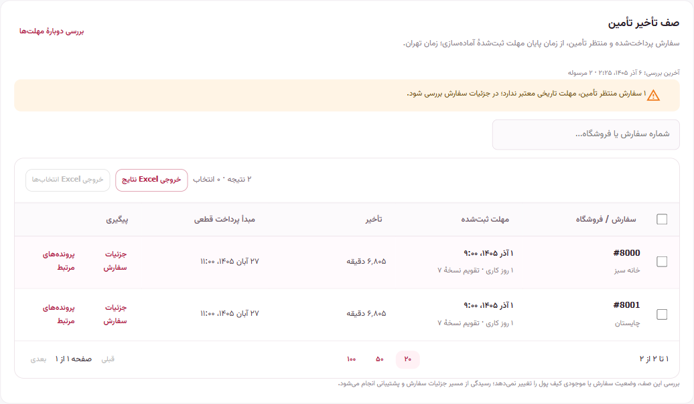
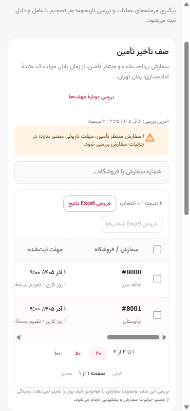
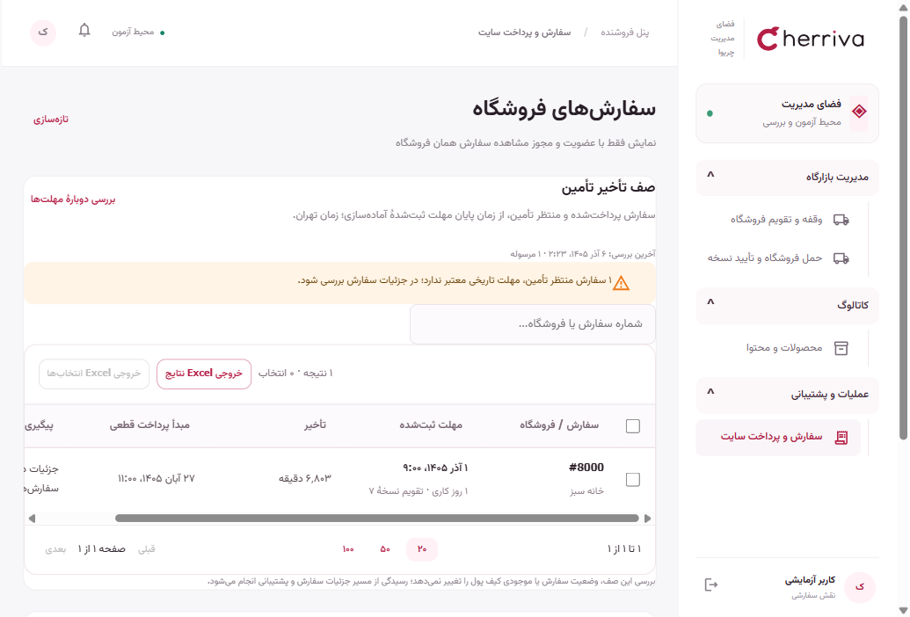

# تحویل صف پایش مهلت تأمین — #10

تاریخ: ۲۰۲۶-۱۱-۲۷. این تحویل فقط باقی‌ماندهٔ پایش عدم تأیید تأمین است؛ مشخصات `in-review` حفظ شده و ادغام/استقرار عمومی انجام نشده‌اند.

## رفتار و مرز

صف «تأخیر تأمین» در سفارش‌های ادمین و سفارش‌های فروشگاه، سفارش دارای `payment=paid` و `status=awaiting-supply` را از لحظهٔ `now >= Preparation.ReadyAt` نشان می‌دهد. مبدأ، `Preparation.SourceAt` ثبت‌شده هنگام قطعیت پرداخت است؛ واحد وقفه، تقویم و ساعت مهلت از همان snapshot خوانده می‌شوند. هیچ محاسبهٔ تازه با تقویم/وقفهٔ جاری روی سفارش قدیمی انجام نمی‌شود. سفارش بدون snapshot معتبر، با شمار جدا برای بررسی مشخص و موعد فرضی برایش ساخته نمی‌شود.

جدول، شماره و فروشگاه، موعد شمسی با ساعت تهران، مدت تأخیر، مبدأ پرداخت و نسخهٔ تقویم را نشان می‌دهد. جست‌وجوی فروشگاه/شماره و ارقام فارسی، صفحه‌بندی، تازه‌سازی و پیوند جزئیات سفارش/پرونده‌های همان سفارش وجود دارند. در صفحهٔ باز، صف هر۶۰ثانیه دوباره خوانده می‌شود؛ دکمهٔ بررسی فوری نیز دارد. روز کاری/تعطیل و cutoff قبلاً در #120 حل شده‌اند و این صف همان deadline نهایی را مصرف می‌کند.

این پایش یک query خواندنی روی مخزن موجود است؛ هیچ صف اعلان یا عملیات مالی تولید نمی‌کند. تکرار بررسی، تأیید تأمین، لغو، refund یا هشدار مضاعف نمی‌سازد. هشدارهای پیش‌موعد تاریخی حذف یا دوباره زمان‌بندی نشده‌اند؛ دامنهٔ این برش رسیدگی از پایان وقفه است. عملیات رسیدگی از جزئیات و مسیر پشتیبانی موجود انجام می‌شود؛ workflow یا provider تازه اضافه نشده است.

## قرارداد و دسترسی

`GET /{backoffice|seller}/orders/supply-overdue` با query اختیاری `store_id` و `search`، `checked_at`، `rows` و `missing_deadline_count` برمی‌گرداند؛ پاسخ خصوصی `no-store` است. ادمین نیازمند `commerce.orders.read` و فروشنده نیازمند عضویت و `orders.read` همان فروشگاه است. شمار فاقد مهلت نیز داخل همین scope محاسبه می‌شود. فیلتر مستقیم فروشگاه غیرمجاز403؛ نشست نامعتبر401؛ جست‌وجوی بیش از۱۶۰حرف400 است. اطلاعات گیرنده، رسید و کیف پول در پاسخ این صف نیستند.

## شواهد پذیرش

| مسیر | نتیجه |
| --- | --- |
| مبدأ واقعی | خرید دو مرسوله، تأمین وجه و قطعیت واقعی در service؛ پیش از deadline خالی، دقیق deadline دو مرسوله و صفر دقیقه تأخیر |
| تعطیلی | پرداخت چهارشنبه، تعطیلی پنج‌شنبه/جمعه و تعطیلی اضافهٔ شنبه؛ موعد یکشنبه از snapshot ارزیابی شد |
| تغییر تنظیم | تغییر روزهای کاری، تعطیلی، version و وقفهٔ جاری پس از پرداخت، موعد تاریخی صف را تغییر نداد |
| تکرار | چند بررسی متوالی، کل workspace از جمله سفارش/اعلان/مالی را بدون تغییر باقی گذاشت |
| خروج از صف | سفارش تأمین‌شده، لغوشده یا پرداخت‌نشده وارد صف نمی‌شود؛ دادهٔ قدیمی فاقد مهلت جدا گزارش می‌شود |
| scope | فروشنده فقط فروشگاه خودش و شمار فاقد موعد همان فروشگاه؛ فیلتر فروشگاه دیگر403، لغو grant مانع دادهٔ تازه |
| HTTP/PostgreSQL | boundary، no-store، منع viewer/نشست فروشنده در مسیر ادمین، restart و برابری کل state پس از بررسی‌های تکراری پاس |
| مجموعه | `go test ./... -count=1` با PostgreSQL و `go vet ./...` پاس؛ TypeScript/Vite بک‌آفیس پاس |
| مرورگر | ادمین دو فروشگاه، seller فقط یک فروشگاه؛ جست‌وجوی «۸۰۰۰»، انتقال به پرونده با فیلتر order درست، موبایل۳۹۰ و بدون overflow صفحه؛ console نهایی صفر |

AC01..03 تاریخیِ وقفهٔ واحد، محاسبهٔ حمل و حفظ وعده با شواهد #120/#16/#123 پوشش دارند؛ این برش AC04 و سه معیار فعال ممیزی #10 را تکمیل می‌کند. دادهٔ مرورگر مصنوعی و schema مستقل است؛ موعدهای نمایش‌داده‌شده تعهد واقعی حمل نیستند.

[شرح #10](../review-v1-1/tasks/cv-r2-10-seller-lead-snapshot.md) · [تقویم #120](issue-120-verification.md) · [انتخاب/وعده #123](issue-123-verification.md).
