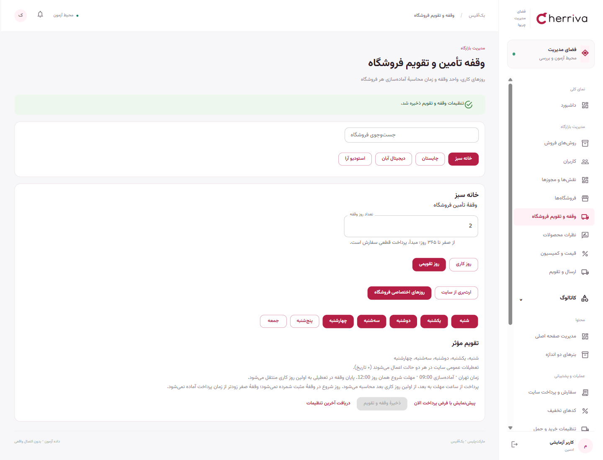
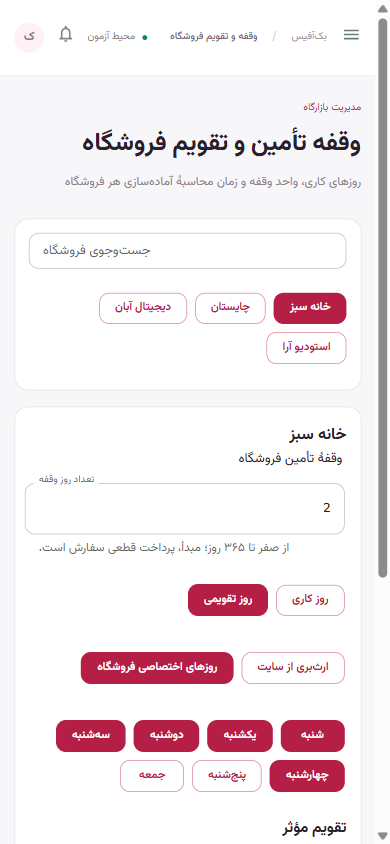
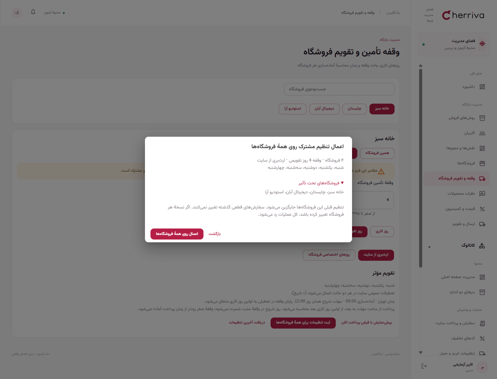

# تحویل #120 — تقویم، وقفه و موتور زمان

تاریخ: ۲۰۲۶-۱۱-۲۶ · [ایشو](https://github.com/MohamadParsa/marketplace/issues/120) · [مشخصات و پذیرش](tasks/store-preparation-calendars.md) · شاخه `codex/local-parsa-integration-20261124`، PR موجود #106. اجرای ترتیبی با دستور مستقیم کاربر انتخاب شد؛ ادغام و استقرار جزو این تحویل نیست.

## نتیجه قابل مشاهده

در بک‌آفیس و پنل فروشنده، منوی «وقفه و تقویم فروشگاه» در مسیر `/store-preparation` باز می‌شود. مقدار وقفه، روز کاری/تقویمی و ارث‌بری/روزهای اختصاصی با باکس‌های قابل انتخاب ثبت می‌شوند؛ تقویم مؤثر و پیش‌نمایش با فرض پرداخت الان قابل مشاهده است. مجوز مشاهده/ویرایش فروشگاه در نقش‌های فروشگاه جداست؛ حق عمومی تغییر حمل به فروشنده داده نمی‌شود. از جزئیات فروشگاه نیز پیوند تنظیم وقفه وجود دارد.

روزهای تعطیل و تاریخ‌های عمومی در تنظیمات موجود خرید و حمل حفظ شده‌اند؛ همان فرم واحد مدت حمل و ساعت‌های عمومی را نیز ثبت می‌کند. SHIP-Q05 تقویم مؤثر فروشگاه را مبنای حمل کاری قرار داد. مقدار اولیهٔ SHIP-Q06 با اختیار کاربر: آماده‌سازی۹، cutoff۱۲، فرصت اسلات۱۲۰دقیقه و مجازبودن همان روز با رعایت فرصت؛ [قاعده دقیق شمارش](../../domains/shipping/method-policies.md).

موتور ابتدا آماده‌سازی و سپس حمل را با واحدهای مستقل حساب می‌کند. پیش‌نمایش پیش از پرداخت تخمینی است؛ مبدأ قطعی با پرداخت سفارش و با قواعد/تقویم snapshot محاسبه می‌شود. مقدار/واحد، نسخه، تقویم حل‌شده، ساعت‌ها و آماده‌شدن در مرسوله و سفارش می‌مانند. تغییر تنظیمات پس از قطعیت، مبلغ یا وعدهٔ همان سفارش را بازنویسی نمی‌کند. snapshot قدیمی فاقد این اطلاعات از محاسبه تازه عبور نمی‌کند. #10 همین `Order.preparation` را مصرف خواهد کرد؛ پایش تأخیر در این ایشو ساخته نشده است.

## شواهد پذیرش

تکمیل پس از تأکید کاربر: ادمین می‌تواند محدودهٔ «همین فروشگاه / همهٔ فروشگاه‌ها» را انتخاب کند. اعمال روی همه، خلاصهٔ مقادیر و فهرست فروشگاه‌های تحت تأثیر را پیش از ثبت نشان می‌دهد؛ فروشگاه غیرفعال هم جزو «همه» است. نسخهٔ تمام ردیف‌ها و خود فهرست «همه» بررسی می‌شود؛ conflict یک ردیف کل تراکنش را رد می‌کند. عضو فروشگاه به این مسیر گروهی دسترسی ندارد. تست گروهی service/HTTP/PostgreSQL و حفظ پس از بازسازی سرویس پاس شده است.

| معیار | بررسی انجام‌شده |
| --- | --- |
| AC01 | ذخیره از API و فرم، دریافت دوباره از سرور، حفظ working/calendar و inherit/override در بازسازی repository و HTTP روی PostgreSQL؛ فروشگاه غیرمجاز و سطح ورود اشتباه رد شدند. |
| AC02 | تست وقفه۲روزکاری با تعطیلی وسط: آماده۲۴نوامبر، حمل۱تا۳روزتقویمی: ۲۵تا۲۷نوامبر. تغییر هفته سایت فقط روزهای inherited را عوض می‌کند؛ تعطیلات عمومی در هر دو حالت مشترک‌اند. |
| AC03 | رد روز تکراری/خارج محدوده، صفر روز کاری، تقویم/ساعت نامعتبر، تعداد منفی/بیش از۳۶۵ و فیلد جعلی؛ race دو ذخیره فقط یک موفقیت و یک409؛ retry همان کلید و رد reuse متفاوت/مجوز لغوشده؛ حفظ سفارش قبلی. |
| AC04 | مرز هفته/سال، تعطیلی، تهران، وقفه صفر، دقیقاً cutoff، هفته کم‌روز و تأخیر طولانی؛ پیش‌نمایش و checkout از یک موتور استفاده کردند؛ snapshot سفارش برای مصرف #10 موجود است؛ پرسش‌های Q05/Q06 تعیین تکلیف شدند. |

تست‌های مرتبط در `internal/domain/shipping/{calendar,timing}_test.go`، `internal/application/backoffice/store_preparation_test.go` و `internal/bootstrap/store_preparation_test.go` قرار دارند. تست PostgreSQL schema موقت مستقل می‌سازد و پاک می‌کند؛ payload سفارش/مالی موجود حفظ می‌شود. ذخیرهٔ فیلدهای افزایشی در JSON فعلی است و migration SQL تازه لازم نبود.

```powershell
# در apps/api، با MARKETPLACE_TEST_POSTGRES_URL خصوصی و محلی
go test ./... -count=1
# در هر دو apps/backoffice-web و apps/storefront-web
npm run build
```

مجموعه کامل Go با PostgreSQL محلی پاس شد، از جمله تست جدید restart. Build TypeScript/Vite هر دو رابط پاس شد؛ هشدار اندازه chunk موجود در بک‌آفیس باقی است و شکست build نیست.

JSON فهرست و `git diff --check` بررسی شدند؛ ۴۱۹ پیوند نسبی فایل‌های Markdown تغییرکرده بدون مقصد گمشده بودند. شناسه تازهٔ تکراری ایجاد نشد؛ نسخه‌های تاریخی CV-R2 در review-package از قبل شناسهٔ متناظر با سند delivery دارند و در این برش بازنویسی نشدند.

## بررسی مرورگر

با Playwright CLI و مهارت `playwright`، روی پورت مستقل۱۸۰۹۸ و schema جدا از داده بررسی فعلی:

- انتخاب روز تقویمی، وقفه۲روز، روزهای اختصاصی، پیش‌نمایش، ذخیره و دریافت مجدد از سرور موفق بود.
- عرض۱۴۴۰×۱۱۰۰ و موبایل۳۹۰×۸۴۴ بازبینی تصویری شدند؛ عرض محتوای صفحه۳۷۵ در viewport۳۹۰ و تعداد select/combobox تازه در فرم صفر بود.
- در حالت offline، ذخیره خطای قابل فهم داد و مقدار پیش‌نویس۳حفظ شد؛ پس از online، retry موفق و فرم دوباره در وضعیت ذخیره‌شده قرار گرفت. خطای شبکهٔ عمدی همین آزمون از خطای برنامه جداست؛ پیش از آزمون قطع شبکه، console بدون خطا/هشدار بود.





ثبت مشترک وقفه۴روزتقویمی با ارث‌بری روی چهار فروشگاه در مرورگر انجام شد؛ با انتخاب فروشگاه دوم نیز همان مقادیر ذخیره‌شده مشاهده شد. کل مجموعه Go با PostgreSQL و Build بک‌آفیس پس از افزودن عملیات گروهی دوباره پاس شدند.



## مرز تحویل

روش‌های عمومی و هزینه/پوشش در #121، تأیید نسخه فروشگاه در #122، اعمال فرصت زمانی روی اسلات و رزرو ظرفیت در #16 و اتصال کامل wizard در #123 تکمیل می‌شوند. ثبت مقدار اولیهٔ فرصت اسلات در این تحویل شاهد اجرای ظرفیت نیست. حمل واقعی و انتشار عمومی انجام نشده‌اند.

## تکمیل رفتار رزرو در #16

پس از افزودن ظرفیت، عبور زمان پرداخت از cutoff اجازهٔ جابه‌جایی خودکار روز رزروشده را نمی‌دهد: رزرو آزاد و خرید نیازمند تأیید تازه می‌شود. تست مرز cutoff با quote/accept تازه و سپس قطعیت پاس شد؛ موتور تقویم #120 تغییر نکرده است. [شاهد #16](issue-16-verification.md).
