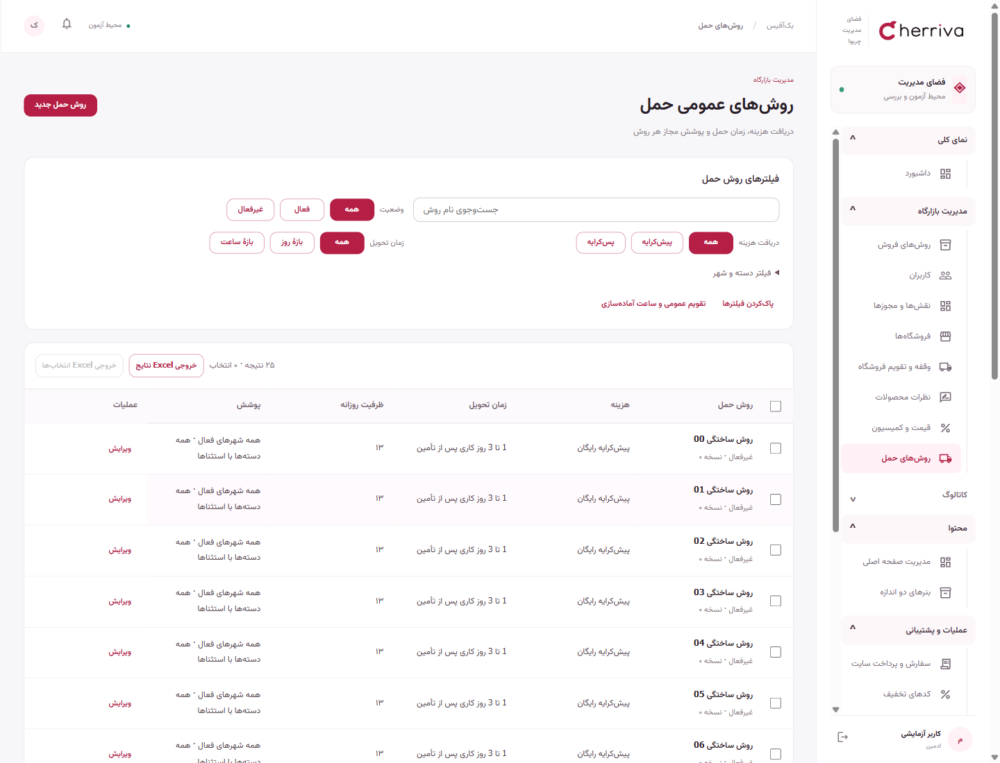
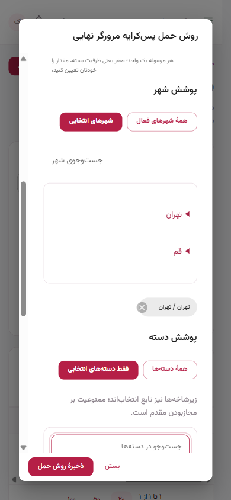

# تحویل #121 — روش عمومی حمل و دریافت هزینه

تاریخ: ۲۰۲۶-۱۱-۲۶ · [ایشو](https://github.com/MohamadParsa/marketplace/issues/121) · [معیارها](tasks/system-shipping-methods.md) · شاخه `codex/local-parsa-integration-20261124` و PR موجود #106. این برش پس از بسته‌شدن #120 اجرا شد؛ ادغام/استقرار درخواست نشده است.

## نتیجه

صفحهٔ `/shipping` روش عمومی را با نام، active، پیش‌کرایه/پس‌کرایه، range/slots، واحد مستقل مدت حمل، ظرفیت روزانهٔ صریح، شهرهای canonical و دستهٔ مجاز/ممنوع مدیریت می‌کند. فرم و فیلترها از درخت/چیپ/باکس انتخابی استفاده می‌کنند و dropdown تازه ندارند. تنظیم تقویم عمومی در صفحهٔ تنظیمات خرید باقی است و ویرایش موازی روش‌ها از آن صفحه جمع شد.

مدل قدیمی به prepaid/range/working و دستهٔ all تفسیر می‌شود؛ ظرفیت قدیمیِ فاقد مقدار «تعیین نشده» است و مقدار نمونه به آن تزریق نمی‌شود. ظرفیت تازه عدد صحیح نامنفی با سقف فنی۱میلیون است؛ مصرف و رزرو واقعی متعلق به #16 است. روش ساعت‌دار تا آماده‌شدن سرویس برنامه/ظرفیت، گزینهٔ خرید قابل انتخاب ندارد؛ ساعت‌های نمونه برنامهٔ ثابت نیستند.

`city_ids` از جغرافیای موجود می‌آیند. شهر تازهٔ فعال در حالت «همه» مجاز است؛ شهر متنی قدیمی فقط با نگاشت یکتا پذیرفته می‌شود و موارد مبهم برای اصلاح نمایش داده می‌شوند. دستهٔ انتخابی شامل زیرشاخه‌هاست و deny در هر والد مقدم است. وجود یک قلم نامجاز، روش را برای مرسولهٔ همان فروشگاه رد می‌کند.

پس‌کرایه با عبارت پرداخت به حمل‌کننده نمایش داده می‌شود، fee نمایشی خالی دارد و به مبلغ وصولی/کیف پول چریوا افزوده نمی‌شود. پیش‌کرایهٔ صفر رایگان است. quote، پذیرش و پرداخت نهایی محدودیت جاری ارسال را کنترل می‌کنند؛ تغییر روش پس از قطعیت سفارش، snapshot و دفتر قبلی را بازنویسی نمی‌کند.

## شواهد پذیرش

| معیار | شاهد |
| --- | --- |
| AC01 | CRUD و active با نسخهٔ مستقل روش، افزایش نسخهٔ تنظیمات، مجوز تازه و retry؛ race دو ویرایش یک موفقیت/یک409؛ ورودی منفی/اعشاری/ناقص/جعلی و نامعتبر رد شد. |
| AC02 | شهر canonical مجاز/نامجاز و شهر هم‌نام مبهم؛ allow/deny والد/فرزند، مرسوله با یک قلم ممنوع؛ رد تغییر ممنوعیت در پذیرش و پرداخت قطعی. |
| AC03 | prepaid صفر از collect جداست؛ تست خرید پس‌کرایه، shipping_total صفر و دریافت فقط بهای کالا؛ تغییر نام/نوع هزینه پس از قطعیت، سفارش/quote/entries را عوض نکرد. |
| AC04 | فیلتر API، count/page/size و شهر/دسته؛ strict JSON و fields فارسی؛ خواندن پس از بازسازی repository/HTTP در PostgreSQL و حفظ نسخه/ظرفیت/واحد/شهر/دسته؛ بررسی مرورگر و موبایل پایین. |

تست‌های جدید در `internal/application/backoffice/shipping_methods_test.go` و `internal/bootstrap/shipping_methods_test.go` هستند. مسیر تنظیمات قدیمی نیز همان validator را مصرف می‌کند؛ تزریق هزینهٔ collect از آن مسیر رد شد. حذف روش موجود پذیرفته نیست و توقف با غیرفعال‌کردن انجام می‌شود. retry بعد از غیرفعال‌شدن عامل، مجوز قبلی را دور نمی‌زند.

```powershell
# apps/api، با PostgreSQL خصوصی محلی و schemaهای موقت تست
go test ./... -count=1
# هر دو frontend
npm run build
```

مجموعه کامل Go با PostgreSQL محلی پاس شد. تست retry مجوز و تست transport پس از آخرین تغییر مربوط دوباره پاس شدند. Build هر دو frontend پاس شد؛ هشدار موجود اندازهٔ chunk در بک‌آفیس شکست build نیست.

`go vet ./...`، lint هر سه frontend و Build پوستهٔ مستقل seller نیز پاس شدند. گیت Linux همین PR، `go test -race ./...` و vet با PostgreSQL/Redis را اجرا می‌کند؛ نتیجهٔ نهایی CI پیش از بستن ایشو بررسی و در کامنت تحویل ثبت می‌شود.

## بررسی مرورگر

در پورت جدا۱۸۰۹۸ و schema آزمون، با Playwright CLI و مهارت `playwright`:

- دادهٔ ساختگی۲۵روش: صفحه اول۲۰ و صفحه دوم۵ردیف؛ تنها یک نوار صفحه‌بندی و صفر فیلتر ستونی. خروجی همهٔ نتایج از صفحه‌بندی API خوانده می‌شود، نه فقط صفحهٔ روی صفحه.
- روش پس‌کرایه با ظرفیت انتخابی۷، بازه۲تا۴روزتقویمی، یک شهر و یک دسته از فرم ثبت شد؛ پس از دریافت دوباره، نسخه۱ و اطلاعات درست در گرید دیده شد. این اعداد دادهٔ آزمون‌اند، نه مقدار ثابت سیستم.
- تغییر نام در حالت offline خطای قابل فهم داد و پیش‌نویس را حفظ کرد؛ online و retry موفق، همان روش را به نسخه۲ رساند و دیالوگ بسته شد. خطای console این آزمون، خطای شبکهٔ عمدی بود.
- موبایل۳۹۰×۸۴۴: فرم با عرض حدود۳۲۶ و صفحه با عرض محتوای۳۷۵/۳۹۰، بدون overflow افقی صفحه؛ select/combobox تازه در فرم صفر و دکمه ثبت در دسترس بود.

## اصلاح تکمیلی رابط به درخواست مالک





فیلتر ستونی شبیه Excel حذف، فرم‌های فیلتر و گرید مشترک هماهنگ و کاتالوگ هم‌الگوی panelbar سایر گروه‌ها شد. [گزارش و مرز این اصلاح](backoffice-ui-consistency.md) · [قرارداد جاری گرید](../../architecture/contracts/backoffice-grids.md).

پس از reload مرورگر و ورود دوباره، روش با نسخه۲ و همان پوشش/مقدارها از سرور خوانده شد. در بررسی نهایی دسته و محصول، جست‌وجوی موازی داخل گرید نیز صفر بود؛ صفحات فروشگاه/محصول/دسته هر کدام یک صفحه‌بندی داشتند. console مرور نهایی بدون خطا/هشدار بود؛ خطای شبکهٔ عمدی آزمون offline پیش‌تر جدا ثبت شده است.

## مرز تحویل

انتساب و نسخهٔ فروشگاه با تأیید در #122، برنامه و اعمال اتمیک ظرفیت روز/اسلات در #16 و wizard کامل در #123 هستند. کنترل نامعتبرشدن روش در خرید، مجوز اعلام اتصال واقعی حمل یا استقرار عمومی نیست. این برش، تعریف روش و resolver مشترک را تحویل می‌دهد.
