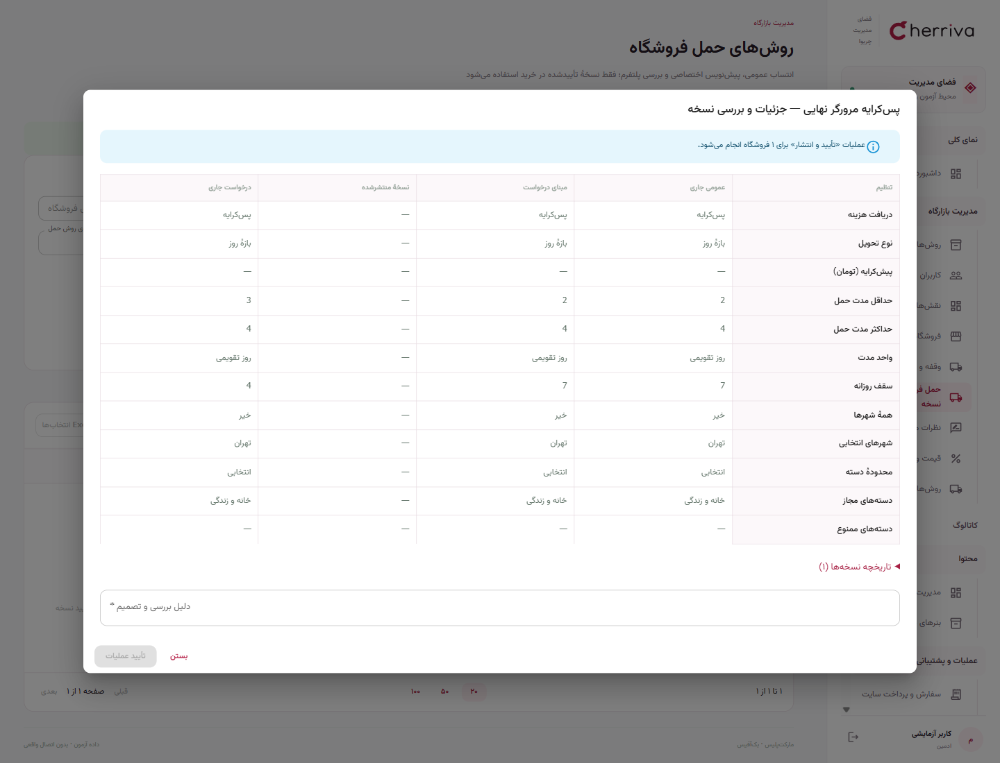
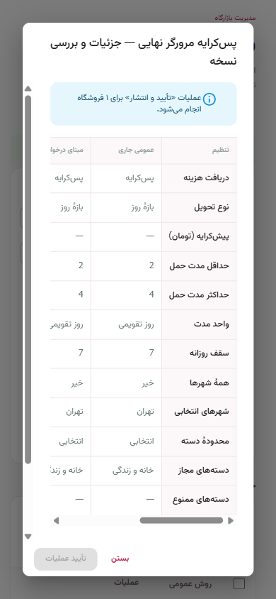

# تحویل انتساب و نسخهٔ اختصاصی حمل فروشگاه — #122

تاریخ بررسی: ۲۰۲۶-۱۱-۲۷. اجرای این برش به دستور مالک مجاز است؛ وضعیت مشخصات همچنان `in-review` و مستقل از تکمیل پیاده‌سازی است. ادغام و استقرار عمومی انجام نشده‌اند.

## رفتار تحویل‌شده

صفحهٔ `/store-shipping` در همان پنل مشترک، روش عمومی جاری، انتساب فروشگاه، نسخهٔ منتشرشده و درخواست جاری را جدا نمایش می‌دهد. ادمین می‌تواند انتساب/غیرفعال‌سازی، ساخت پیش‌نویس و ارسال درخواست را برای یک یا همهٔ فروشگاه‌ها انجام دهد؛ بررسی و تصمیم هر فروشگاه با جدول تفاوت‌ها و دلیل مستقل است. عضو فروشگاه فقط فروشگاه‌های مجاز خودش را می‌بیند و مجوز انتشار ندارد.

- انتساب عمومی بدون ساخت کپی، تنظیم جاری عمومی را مصرف می‌کند. دادهٔ قدیمی فاقد انتساب صریح، همان رفتار عمومی قبلی را نگه می‌دارد.
- اولین نسخهٔ اختصاصیِ بدون live، تا تأیید قابل خرید نیست. ذخیره، ارسال، تأیید و رد نسخه‌ها تاریخچه دارند. ویرایش دوباره پیش‌نویس تازه می‌سازد؛ نسخهٔ قبلی تا تأیید بعدی باقی می‌ماند. رد نسخهٔ جدید، live قبلی را تغییر نمی‌دهد.
- نام/هویت روش و پیش‌کرایه/پس‌کرایه از عمومی ارث می‌رسند و از API نیز قابل جعل نیستند. اگر نوع دریافت عمومی عوض شود، نسخهٔ اختصاصی ناسازگار تا بازبینی و تأیید تازه ارائه نمی‌شود؛ پس‌کرایه بی‌خبر به پیش‌کرایهٔ رایگان تبدیل نمی‌شود.
- پوشش شهر و کل درخت دسته در ذخیره/ارسال/تأیید کنترل می‌شود؛ در خرید نیز هر دو شرط عمومی و اختصاصی هم‌زمان برقرارند. تغییر عمومی، ممنوعیت تازه یا غیرفعال‌سازی پایه از نسخهٔ اختصاصی دور زده نمی‌شود.
- درخواست به نسخهٔ معلوم عمومی متصل است؛ تغییر پایه قبل از بررسی، conflict و بازبینی تازه می‌خواهد. تغییر draft/live، snapshot سفارش تاریخی را بازنویسی نمی‌کند.
- version، کلید تکرار و ممیزی داخل تراکنش مخزن موجودند. bulk همه، فهرست کامل شناسه/نسخهٔ فروشگاه‌ها را بررسی می‌کند؛ stale یک مورد کل عملیات را برمی‌گرداند. مجوز تازه حتی برای replay کلید قبلی کنترل می‌شود.
- دادهٔ خصوصی نسخه‌ها در `Commerce.StoreShipping` نگهداری و از workspace عمومی پنل حذف می‌شود؛ تاریخچه و دلیل بررسی فقط از endpoint دارای scope خوانده می‌شوند. migration جدید لازم نیست؛ persistence JSON و تراکنش PostgreSQL موجود استفاده شده‌اند.

## قرارداد و مجوز

`GET /{backoffice|seller}/stores/shipping` فهرست فروشگاه‌های مجاز، روش عمومی، effective/live/draft/history و مجوزهای همان فروشگاه را برمی‌گرداند. `POST` همان مسیر، command با action، method_id، base_version، stores شامل id/version، all و reason می‌گیرد؛ فقط action=draft فیلد method دارد. اقدام‌های public/disable/draft/submit/approve/reject صریح‌اند. بدنهٔ ناشناخته و نسخهٔ حذف‌شده رد می‌شوند؛ پاسخ خصوصی `no-store` است.

مجوزهای `stores.shipping.read` و `stores.shipping.write` در scope فروشگاه و سراسری، و `stores.shipping.review` فقط در scope سراسری قابل انتساب‌اند. review از write مستقل است؛ کاربر دارای فقط review و read می‌تواند بررسی کند ولی پیش‌نویس و انتساب را تغییر نمی‌دهد. نام فارسی این مجوزها در فرم نقش ثبت شده است.

## شواهد آزمون

| مسیر | نتیجه |
| --- | --- |
| Go application | محدودهٔ دو فروشگاه، نبود مجوز، جدایی review/write، تکرار، دو تصمیم هم‌زمان، stale پایه، شهر/دسته، رد تغییر collection_mode و اعمال گروهی اتمیک پاس |
| مصرف در quote | هزینهٔ نسخهٔ تأییدشده در خرید مصرف شد؛ draft و روش عمومی غیرفعال وارد resolver نمی‌شوند |
| HTTP | OTP/نشست و scope، بدنهٔ سخت‌گیر، چرخهٔ seller→admin و منع تأیید از seller پاس |
| PostgreSQL | پس از ساخت/ارسال/تأیید و بازسازی repository، نسخه/تعرفه/پوشش باقی ماند؛ تنظیم عمومی، دفتر مالی و سفارش‌های قبلی تغییر نکردند |
| حفاظت داده | درخواست/دلیل بررسی از workspace کاربر فاقد مجوز نشت نکرد |
| مجموعهٔ کامل | `go test ./... -count=1` با PostgreSQL محلی و `go vet ./...` پاس؛ race در CI لینوکس پیش از بستن بررسی می‌شود |
| رابط | TypeScript/Vite پاس؛ انتخاب عمومی، ساخت draft، diff، تأیید، رد نسخهٔ بعد و حفظ live قبلی در مرورگر بررسی شدند |
| خطای ارتباط | offline هنگام ذخیرهٔ draft، مقدار ظرفیت۳ را حفظ کرد؛ online و retry همان فرم ذخیره شد |
| موبایل۳۹۰ | عرض دیالوگ حدود۳۲۶؛ جدول تفاوت داخل قاب خودش اسکرول می‌کند، عرض سند۳۹۰ و dropdown تازه صفر |
| مرور نهایی پس از restart سرویس | نسخهٔ ردشدهٔ۲ و live۱ از PostgreSQL برگشتند؛ منو و صفحه‌بندی واحد باقی ماندند؛ console صفر خطا/هشدار |
| پنل فروشنده در مرورگر | فقط خانه سبزِ مجاز نمایش داده شد؛ محدودهٔ همه و دکمه‌های تأیید/رد وجود نداشتند؛ console صفر خطا/هشدار |

در مرورگر، روش ساختگی پس‌کرایه با ظرفیت عمومی۷ و مدت۲تا۴ روز، در فروشگاه به ظرفیت۴ و مدت۳تا۴ پیشنهاد و تأیید شد. درخواست بعدی ظرفیت۳ رد شد و نسخهٔ منتشرشدهٔ۱ باقی ماند. ساعت/عدد نمونهٔ این آزمون قانون ثابت محصول نیست.

اجرای مرورگر روی۱۸۰۹۸ و schema آزمون، با build مستقل در `apps/api/tmp/shipping-review/web` انجام شد؛ build اصلی۸۰۹۸ در حین کار بازنویسی نشد. خطای شبکهٔ عمدی offline جدا از مرور نهایی گزارش می‌شود. تصاویر با دادهٔ ساختگی‌اند.

## مرز و ادامه

برنامهٔ ساعت و اعمال ظرفیت به همین نسخهٔ روش در #16 اضافه می‌شوند؛ انتخاب روز/ساعت، رضایت کامل از تغییر terms و نمایش جامع سفارش در #123 ادامه دارند. این برش، انتساب و چرخهٔ انتشار نسخهٔ فروشگاه را تحویل می‌دهد. [شرح و معیارهای پذیرش](tasks/store-shipping-approval.md) · [قرارداد مشترک](../../architecture/contracts/shipping-methods-plan.md).
