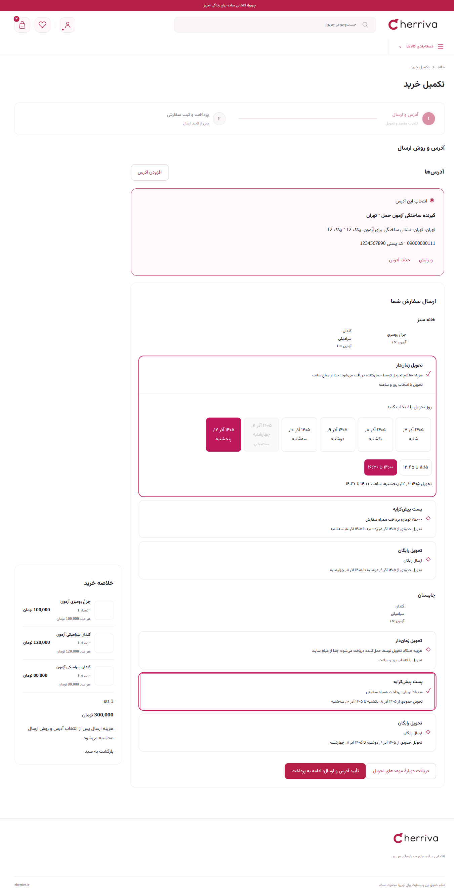
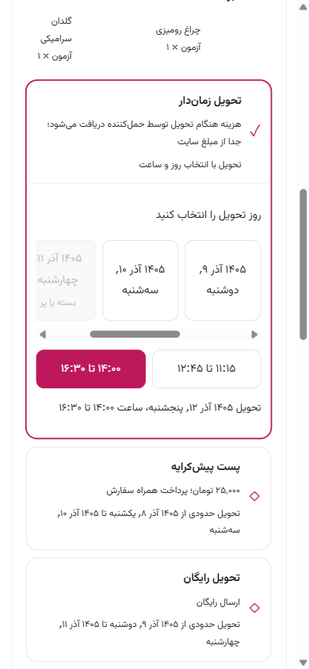
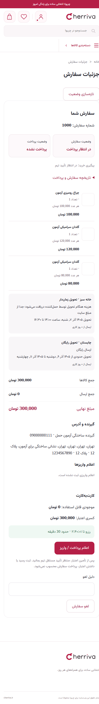
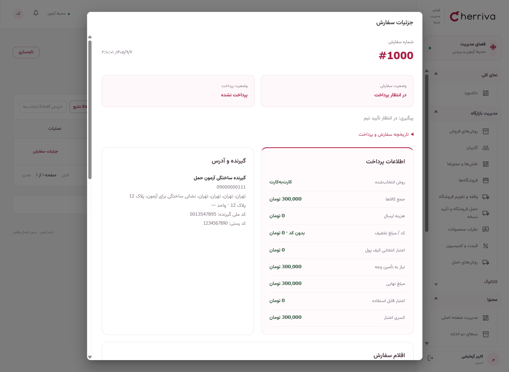

# تحویل انتخاب حمل و وعدهٔ سفارش — #123

تاریخ: ۲۰۲۶-۱۱-۲۷. اجرای این برش با دستور مالک است؛ مشخصات همچنان `in-review` هستند. تست‌ها با دادهٔ ساختگی محلی‌اند؛ بانک/حمل‌کنندهٔ واقعی و استقرار عمومی بررسی نشده‌اند.

## رفتار تحویل‌شده

wizard زنده در قدم آدرس، گزینه‌های هر مرسوله را از `shipping-options` می‌خواند؛ فیلتر مستقل و ناقص مرورگر جای resolver نیست. کارت روش، اقلام همان مرسوله، نوع هزینه و وعده را نشان می‌دهد. روش range فقط بازهٔ تحویل شمسی دارد؛ روش slots شش تاریخ D..D+5 و ساعت‌های آزادِ قابل انتخاب با wrap دارد. روز بسته/پر غیرفعال است؛ تغییر روز، ساعت قبلی را پاک می‌کند. هیچ ساعت یا رضایت مشتری خودکار انتخاب نمی‌شود. dropdown تازه اضافه نشد.

پیش‌کرایهٔ مثبت همراه سفارش و صفر آن «ارسال رایگان» است؛ پس‌کرایه صریحاً به حمل‌کننده هنگام تحویل و جدا از مبلغ سایت است. جمع ارسال، کوپن حمل، کیف پول و بازپرداخت فقط مبلغ وصول‌شدهٔ سایت را مصرف می‌کنند.

انتخاب روز/ساعت در preview، quote و accept حفظ می‌شود. خطای ظرفیت یا تغییر شرایط، رضایت قبلی را باطل، موعدها را تازه و کاربر را به انتخاب مجدد برمی‌گرداند. خطای شبکه فرم را نگه می‌دارد و retry دارد؛ loading روی فضای ثابت و skeleton اولیه است. ادامهٔ خرید قبلی، انتخاب هنوز معتبر را بازیابی می‌کند و موعد نامعتبر را خودکار جایگزین نمی‌کند.

کنترل نهایی سرور، علاوه بر eligibility و ظرفیت، نام/هزینه/نوع دریافت/نوع تحویل/min/max/واحد حمل و قواعد تقویم/آماده‌سازی جاری را با شرایط پذیرفته‌شده می‌سنجد. تفاوت پیش از قطعیت، نیازمند تأیید تازه و آزادسازی رزرو است؛ debit جدید ایجاد نمی‌شود. تغییر عدد ظرفیت یا شمارندهٔ نسخه به‌تنهایی hold معتبر را لغو نمی‌کند. بعد از قطعیت، تنظیم تازه snapshot سفارش را بازنویسی نمی‌کند.

روش کامل و برنامه، تقویم/واحدهای آماده‌سازی، نسخهٔ روش/فروشگاه، تاریخ و ساعت در quote/order نگهداری می‌شوند. نمای مشتری، جزئیات ادمین، عملیات سفارش و پنل scoped فروشگاه از snapshot می‌خوانند. دادهٔ خصوصی مشتری/فروشگاه دیگر در projection فروشنده وارد نمی‌شود. persistence موجود JSON و تراکنش PostgreSQL استفاده شده و migration تازه لازم نیست.

## شواهد

| معیار | نتیجه |
| --- | --- |
| AC01 | تست‌های روش/نسخه/شهر/دسته و دستکاری مستقیم در مجموعهٔ Go/HTTP پاس؛ wizard از resolver مشترک استفاده می‌کند |
| AC02 | دو مرسولهٔ مختلط، پیش‌کرایهٔ مثبت/صفر و collect، کوپن سفارش/حمل، کیف پول انتخابی، قطعیت و لغو با بازپرداخت دقیق پاس |
| AC03 | آزمون‌های #16 برای روز کاری/تقویمی، شش تاریخ و ظرفیت جعلی/پر/گذشته به همراه کل مجموعه دوباره پاس |
| AC04 | تغییر هر شرط پیش از accept و payment نیازمند رضایت تازه؛ PostgreSQL دو مرسوله، restart و تغییر تنظیم پس از قطعیت، وعده/مالی تاریخی را حفظ کرد |
| AC05 | `go test ./... -count=1` با PostgreSQL و `go vet ./...` پاس؛ build و TypeScript دو رابط پاس؛ scope فروشنده و منع خواندن سفارش فروشگاه دیگر پاس |
| AC06 | مرورگر: دو مرسوله/سه قلم/دو دسته، ساعت با Enter، D+5 قابل انتخاب و فقط۶روز، نبود ساعت در پست، تغییر روز و پاک‌شدن ساعت، عرض۳۹۰ و نبود overflow صفحه/dropdown |

مرورگر روی schema مستقل `shipping123_review_20261127` و پورت‌های۱۸۰۹۸/۱۸۰۹۹ اجرا شد. در خرید نمایشی، ابتدا پس‌کرایه+پست۲۵هزار نشان داده شد؛ در ثبت نهایی پس‌کرایه+رایگان، جمع ارسال صفر و مبلغ کالاها۳۰۰هزار تومان بود. سفارش۱۰۰۰ با موعد انتخابی و دو مرسوله ثبت شد؛ جزئیات ادمین همان موعد/نوع هزینه را نشان داد.

آزمون خطای رابط با تزریق عمدی409 `slot_full`، انتخاب‌ها و رضایت را پاک کرد و ادامه غیرفعال شد. قطع عمدی درخواست موعدها، فرم را حفظ و ادامه را بست؛ retry موفق همان انتخاب معتبر را برگرداند. این‌ها تست خطای رابط‌اند؛ رقابت واقعی و expiry در Go/HTTP/PostgreSQL #16 اجرا شده‌اند. پس از build نهایی، reload صفحهٔ سفارش بدون خطای console بود؛ خطاهای شبکهٔ عمدی جدا هستند.

[معیارهای پذیرش](tasks/checkout-shipping-terms.md) · [برنامه](README.md) · [ظرفیت #16](issue-16-verification.md). ادامهٔ ترتیب، #10 برای صف عدم تأیید تأمین است.
