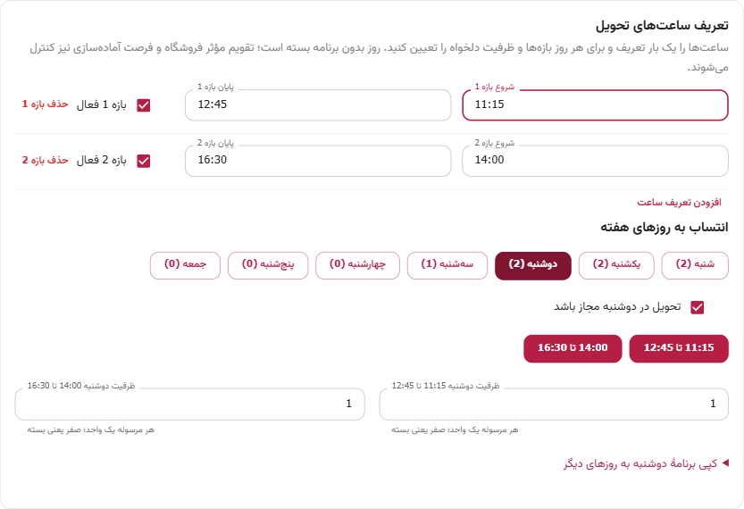
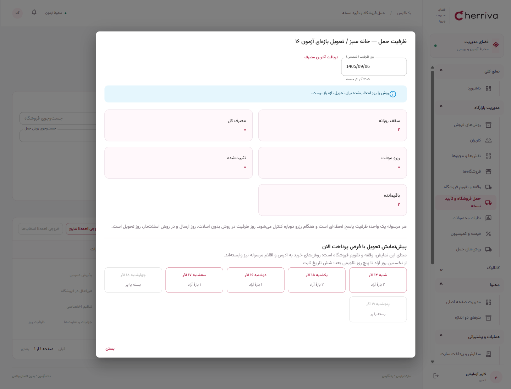
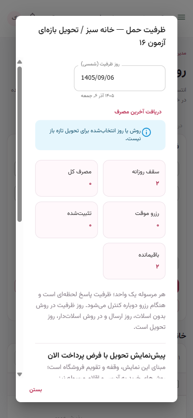

# تحویل برنامه و ظرفیت حمل — #16

تاریخ: ۲۰۲۶-۱۱-۲۷. اجرای این برش طبق دستور مالک است؛ وضعیت مشخصات `in-review` حفظ شده است. ادغام و استقرار عمومی انجام نشده‌اند.

## رفتار و حفاظت

ادمین ساعت شروع/پایان دلخواه ۲۴ساعته را یک بار تعریف و به چند روز منتسب می‌کند؛ هر روز برنامه و ظرفیت خودش را دارد و برنامهٔ یک روز قابل کپی است. فروشگاه عمومی را می‌پذیرد یا همان چرخهٔ نسخهٔ اختصاصی #122 را مصرف می‌کند. هیچ ساعت یا ظرفیت نمونه‌ای مقدار ثابت محصول نیست. نبود سقف صریح، روش را از خرید تازه خارج می‌کند.

هر مرسوله یک واحد از مخزن مستقل فروشگاه/روش مصرف می‌کند؛ برای اسلات، سقف روز و بازه هم‌زمان کنترل می‌شوند. تغییر شهر، revision یا نام ساعت مصرف را صفر نمی‌کند؛ هم‌پوشانی زمان واقعی نیز حساب می‌شود. روش بدون اسلات، ظرفیت روز ارسال و سپس بازهٔ تحویل دارد. روش اسلات‌دار پس از آماده‌شدن و فرصت حمل، D را پیدا و دقیقاً شش تاریخ D..D+5 می‌دهد؛ روز بسته یا پر داخل پنجره غیرفعال است و D+6 وارد آن نمی‌شود.

رزرو سی‌دقیقه همراه رزرو خرید/موجودی، بدون تمدید خودکار؛ تثبیت هنگام قطعیت سفارش و آزادسازی یک‌بار در انقضا یا لغو است. پس از قطعیت فقط پیش از ارسال آزاد می‌شود. قفل `FOR UPDATE` روی workspace موجود PostgreSQL، ظرفیت و موجودی و مالی را در یک تراکنش نگه می‌دارد؛ خطای مالی همه را rollback می‌کند. migration جدید لازم نیست. کاهش سقف تعهد قبلی را لغو نمی‌کند؛ حذف/جابه‌جایی ساعت واقعی یا عبور پرداخت از امکان وعده، نیازمند رضایت و رزرو تازه است.

ظرفیت و preview فقط با مجوز scoped خوانده می‌شوند؛ seller دادهٔ فروشگاه دیگر را نمی‌بیند. تاریخ ظرفیت در پنل شمسی و ساعت‌ها HH:mm هستند؛ ارقام فارسی/عربی پذیرفته و normalize می‌شوند. preview فرض پرداخت الان، رزرو واقعی نیست. قرارداد در [طرح API](../../architecture/contracts/shipping-methods-plan.md) ثبت است.

## شواهد آزمون

| بررسی | نتیجه |
| --- | --- |
| Go کامل با PostgreSQL | `go test ./... -count=1` پاس، شامل HTTP و restart persistence |
| رقابت | آخرین واحد روز/اسلات با دو درخواست فقط یک برنده؛ مخزن مستقل دو فروشگاه و تعداد۳کالا فقط یک ظرفیت |
| lifecycle | replay بدون تمدید، انقضای دقیق۳۰دقیقه، تأیید دیرهنگام، لغو یک‌بار و منع لغو پس از ارسال پاس |
| سازگاری | تغییر نام/revision بدون ظرفیت تازه؛ کاهش سقف و حفظ hold؛ تغییر فیزیکی برنامه نیازمند انتخاب تازه |
| مالی | شکست نهایی مالی برای دو مرسوله همهٔ تثبیت‌ها را rollback کرد |
| افق | D+5 حاضر، D+6 غایب؛ روز بسته/پر پنجره را تمدید نکرد؛ range با سقف۵۰۰ و اسلات۳×۱۰۰/روز۳۰۰ پاس |
| تقویم | آماده‌سازی/حداقل فرصت، حفظ دقت ساعت در روزافزایی، cutoff و نیازمند رضایت تازه پاس |
| frontend | lint/TypeScript/Vite پاس؛ سه تست تبدیل شمسی، کبیسه و مرز تهران پاس و به CI متصل شدند |
| مرورگر | ساخت ساعت دلخواه، کپی روز، draft فروشگاه→submit→تأیید ادمین؛ نسخهٔ اختصاصی دوشنبه فقط یک ساعت حفظ شد |
| شش تاریخ واقعی | preview پنل شنبه۱۴تاپنجشنبه۱۹آذر؛ چهارشنبه/پنجشنبه بسته، بدون روز هفتم |
| موبایل و خطا | عرض۳۹۰، ورودی شمسی نامعتبر مشخص، retry و حفظ نسخه؛ مرور نهایی بدون خطای console |

مرورگر روی۱۸۰۹۸ و schema مصنوعی مستقل بود؛۸۰۹۸ تا پایان چهار تسک به نسخهٔ جدید منتقل نمی‌شود. تصاویر و اعداد زیر دادهٔ آزمون‌اند.

## ادامه

[معیارهای #16](../review-v1-1/tasks/cv-r2-14-shipment-slots.md) تکمیل شدند. اتصال انتخاب مشتری به همین API، رضایت تغییر تمام شرایط حمل و نمایش کامل snapshot سفارش در #123 ادامه دارد. اتصال واقعی حمل‌کننده و استقرار عمومی جزء این تحویل نیستند.
