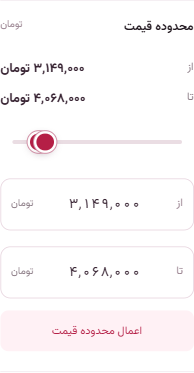
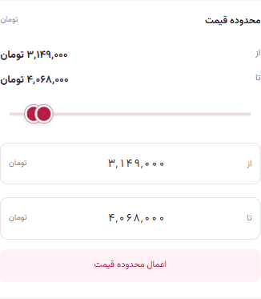
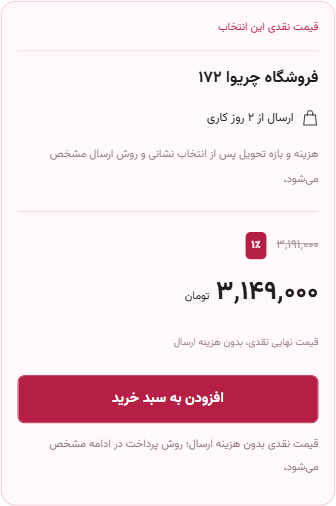
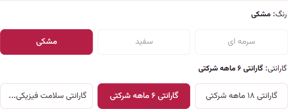
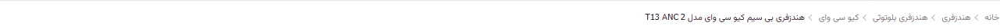
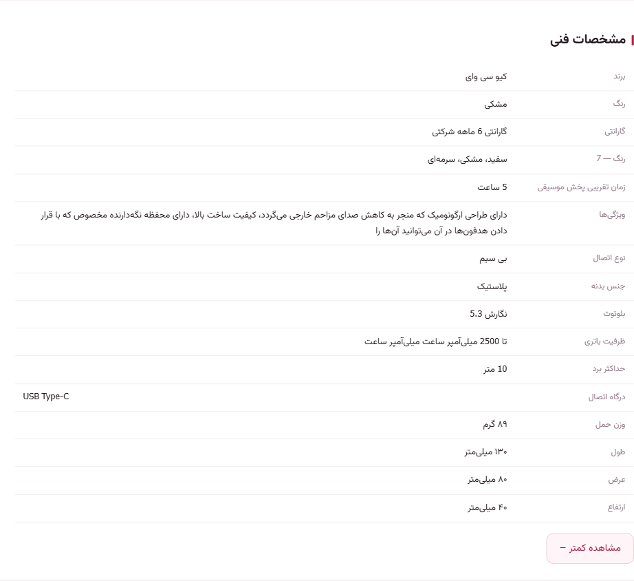
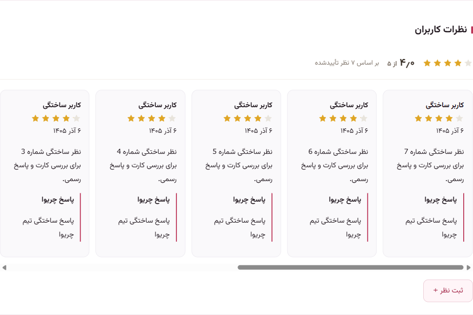
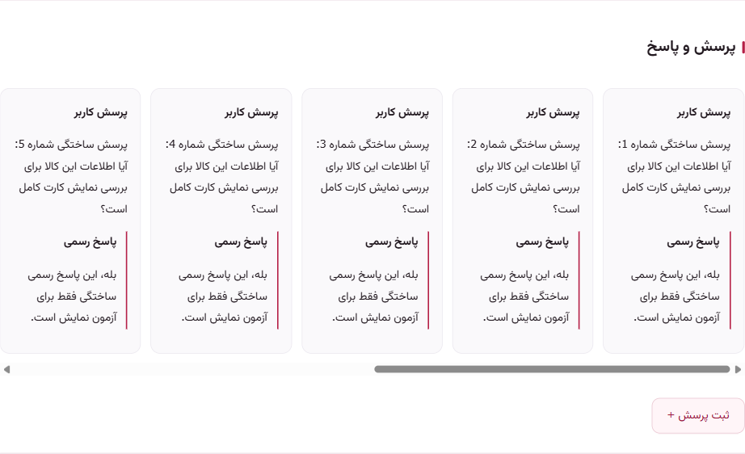
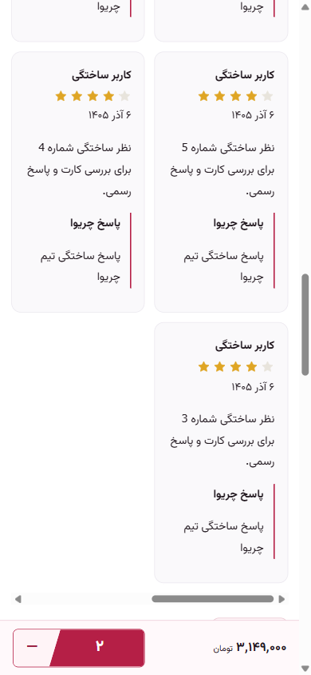

# خوانایی قیمت و اصلاح تعامل‌های PDP — ۲۰۲۶-۱۱-۲۷

این گزارش، ادامهٔ [بازبینی قبلی سایت](storefront-review-fixes-2026-11-27.md) و شاهد اجرای درخواست مستقیم مالک است. وضعیت تأیید مشخصات محصول تغییر نمی‌کند. نسخهٔ محلی سایت روی [۵۱۹۷](http://localhost:5197) به‌روز شده است.

## رفتار نهایی

| مورد | نتیجه |
| --- | --- |
| محدوده قیمت | حداقل و حداکثر بالای اسلایدر واضح‌اند؛ دو ورودی تمام‌عرض، ارقام فارسی، جداکننده هزارگان و واحد تومان دارند. ارقام فارسی، عربی و انگلیسی پذیرفته می‌شوند؛ عدد هنگام فوکوس بازنویسی نمی‌شود و پس از خروج از ورودی مرتب می‌شود. |
| صحت قیمت | تبدیل تومان به واحد API، دقیق و با حداکثر یک رقم اعشار است. مقدار منفی، اعشار اضافه، نمایش علمی، سرریز و حداقل بیشتر از حداکثر اعمال نمی‌شوند. خالی‌کردن ورودی محدودیت را حذف می‌کند؛ اسلایدر با صفحه‌کلید نیز کار می‌کند. |
| فرم نظر و پرسش | هر دو پیش‌فرض بسته‌اند؛ با کلیک، Enter یا Space باز می‌شوند. بستن فرم پیش‌نویس را پاک نمی‌کند. دکمه‌های ارسال خالی فعال‌اند و با ارسال، required و بررسی متن خالی/فاصله اجرا می‌شود؛ هنگام ارسال غیرفعال می‌شوند. دکمه‌های بازکردن و ارسال با «مشاهده بیشتر مشخصات» هم‌استایل‌اند. |
| کروسل نظر و پرسش‌وپاسخ | هر کدام ابتدا ۵ کارت دارند؛ «مشاهده بیشتر» در انتهای همان کروسل، هر بار حداکثر ۵ مورد اضافه می‌کند. کارت‌های قبلی حفظ می‌شوند؛ پس از آخرین مورد دکمه حذف می‌شود. دکمهٔ «رفتن به نظرات بیشتر»، بارگذاری خودکار با اسکرول و صفحهٔ قبل/بعد پرسش‌وپاسخ حذف شدند. گروه تازه برای صفحه‌کلید و دید کاربر در دسترس قرار می‌گیرد. |
| مشخصات فنی | padding سطرها از ۱۹ به ۸ پیکسل کاهش یافت؛ همهٔ مقادیر و متن بلند حفظ شدند و باز/بسته‌کردن مشخصات باقی است. |
| قیمت و گارانتی PDP | فاصله قیمت خط‌خورده و نشان تخفیف ۱۰ پیکسل است. درصد و اعداد چیپ/گزینه گارانتی فارسی‌اند؛ مقدار اصلی انتخاب و query به API عوض نشده است. نام مدل‌هایی مانند T13 حفظ می‌شود. |
| breadcrumb | فاصله تکراری flex و جداکننده حذف شد؛ در دو طرف chevron فاصله ۶ پیکسل و جهت چپ در RTL باقی است. مسیر فرم‌های خرید نیز جمع‌وجور شد. |

## شواهد آزمون

- `npm run lint`، `npm run test:display-numbers` با ۳ آزمون و `npm run build` موفق‌اند. آزمون اعداد به job سایت در CI اضافه شده است.
- مرورگر PLP واقعی: ورود `۳٬۱۴۹٬۰۰۰` و `۴٬۰۶۸٬۰۰۰` به queryهای `31490000` و `40680000` تبدیل شد. عدد عربی `١٢٫٣` مقدار API برابر `123` داشت. محدوده وارونه، اعشار اضافه و سرریز رد شدند؛ پاک‌کردن هر دو محدودیت و تغییر یک واحد API با ArrowRight موفق بود.
- جایگزینی مقدار ورودی پس از فوکوس نیز بررسی شد؛ مشکل چسبیدن مقدار تازه به قبلی هنگام تغییر قالب برطرف شد. در عرض۳۹۰، مقدار `۱۲۵٬۲۸۶٬۰۰۰` داخل ورودی با عرض۲۵۹پیکسل بدون بریدگی جا شد.
- فرم‌ها در محیط مستقل: ابتدا بسته، بازشدن با Enter/Space، حفظ پیش‌نویس، عدم ارسال درخواست برای متن خالی/فاصله، غیرفعال‌شدن هنگام ارسال و ثبت موفق نظر و پرسش برای بررسی آزموده شدند. رنگ، padding `8px 18px`، شعاع۱۰ و حداقل ارتفاع۴۴ برای چهار دکمهٔ بازکردن/ارسال یکسان بود.
- کروسل‌ها با داده ساختگی: نظرات `۵ ← ۷` و پرسش‌ها `۵ ← ۱۰ ← ۱۵ ← ۲۰ ← ۲۲` شدند؛ موارد تکراری صفر و پس از پایان دکمهٔ بیشتر صفر بود. خطای عمدی HTTP503 برای دریافت بعدی در هر دو مسیر، کارت‌های قبلی را حفظ کرد و تلاش مجدد موفق شد. این دو خطای عمدی، شکست سرویس اصلی نبودند.
- API عمومی پرسش‌وپاسخ همچنان بستهٔ۲۰تایی می‌دهد؛ رابط آن را در حافظه نگه می‌دارد و فقط با انتخاب کاربر ۵تایی نمایش می‌دهد. پس از مورد۲۰، بستهٔ بعدی از سرور دریافت می‌شود. قرارداد API و صفحه‌بندی بک‌آفیس تغییر نکردند.
- PDP واقعی `chr-11006`: درصد `۱٪`، فاصله واقعی۱۰پیکسل، سطر ساده مشخصات حدود۴۰٫۲پیکسل و تمام۱۶سطر پس از بازکردن موجود بودند. انتخاب چیپ فارسی «گارانتی ۶ ماهه شرکتی» variant صحیح را فعال کرد. عرض‌های۳۹۰و۳۲۰ بدون overflow صفحه/مقدار مشخصات بررسی شدند.
- فیلتر فارسی گارانتی در PLP، مقدار انگلیسی اصلی `18` را در query حفظ کرد؛ جای گزینه پس از دریافت نتایج فقط۰٫۴پیکسل تغییر کرد و چیپ حدود۱۱۳×۲۸بود.
- console نسخه production محلی در بررسی نهایی PLP صفر خطا و صفر هشدار داشت.

ثبت نظر و پرسش فقط روی دادهٔ ساختگی schema مستقل `shipping123_review_20261127` در۱۸۰۹۹ انجام شد؛ داده حساب مالک تغییر نکرد. خواندن کاتالوگ/PDP اصلی فقط عمومی بود. سرویس API اصلی و بک‌آفیس restart نشدند؛ این اصلاحات مربوط به رابط سایت‌اند. انتشار عمومی و ادغام PR مستقل‌اند.

## تصاویر

