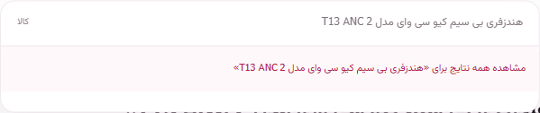
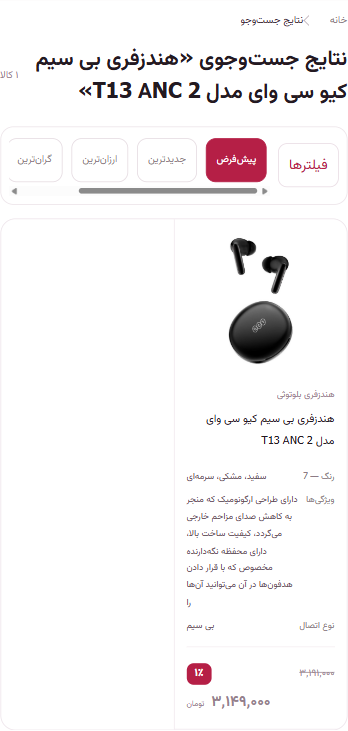
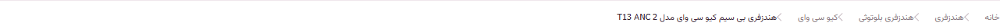
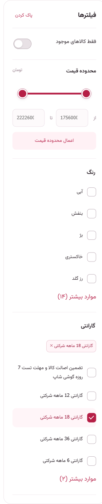
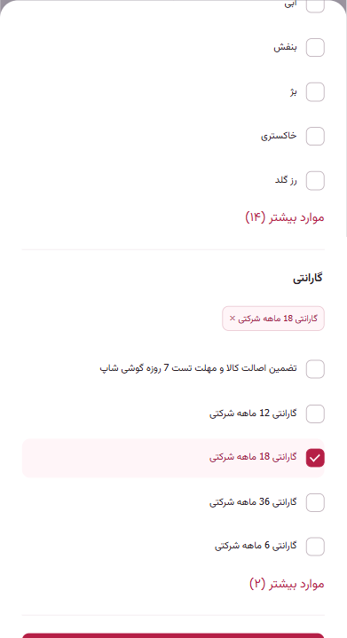
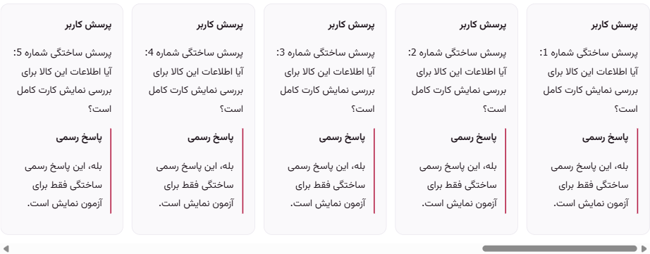
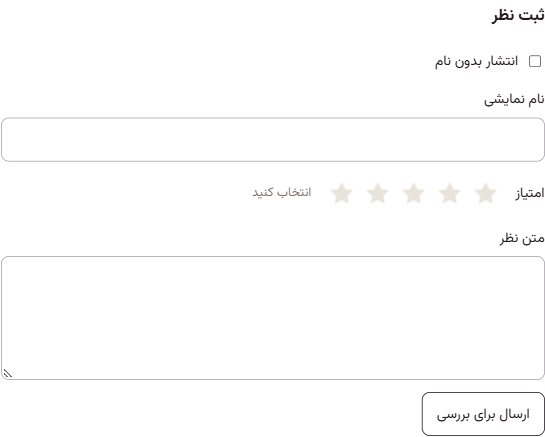
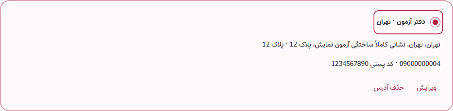
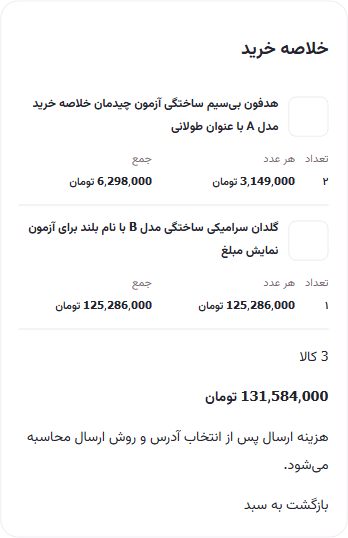

# رفع موارد بازبینی سایت — ۲۰۲۶-۱۱-۲۷

درخواست مالک پس از بررسی محلی سایت، با هفت مورد اصلاح جست‌وجو، PDP، PLP و خرید انجام شد. این گزارش شاهد پیاده‌سازی و تست است؛ وضعیت تأیید مشخصات محصول را تغییر نمی‌دهد.

## اصلاحات

| مورد گزارش‌شده | نتیجه |
| --- | --- |
| کلیک پیشنهاد جست‌وجو | منوی دسته‌ها با z-index۳۵ بالاتر از جست‌وجوی۳۰ بود و کلیک ردیف پیشنهاد را می‌گرفت. پنجرهٔ باز جست‌وجو اکنون بالاتر از منوست؛ ردیف پیشنهاد نیز مسیر محصول را صریح باز می‌کند. حالت بسته، لینک با کلیدهای Ctrl/Command و انتخاب صفحه‌کلید حفظ شدند. |
| دستهٔ نتایج جست‌وجو | بخش رادیویی «دسته نتایج جست‌وجو» از صفحهٔ نتایج حذف شد؛ مرتب‌سازی و فیلترهای موجود باقی‌اند. |
| کارت پرسش‌وپاسخ | پرسش و پاسخ رسمی داخل کارت‌های هم‌سبک نظرات، با همان شبکهٔ واکنش‌گرا و ریل افقی نمایش داده می‌شوند؛ صفحه‌بندی API موجود مصرف می‌شود. کلیدهای React نظرات و پرسش‌ها نیز مستقل شدند. |
| دکمهٔ نظر | «ارسال برای بررسی» و «ثبت پرسش» کلاس نمایشی مشترک دارند: ارتفاع۴۴، padding۶×۱۴ و شعاع۸پیکسل؛ حالت انتظار/غیرفعال و روال بررسی محتوا حفظ است. |
| breadcrumb | جداکنندهٔ CSS به‌سمت چپ در مسیر RTL جای کاراکتر متنی جهت‌پذیر را گرفت؛ PDP، PLP و فرم‌های خرید هماهنگ‌اند. |
| چیپ و پرش PLP | چیپ دسکتاپ جمع‌وجور شد؛ لمس در pointer:coarse حداقل۳۶پیکسل دارد. تغییر فیلتر/مرتب‌سازی موقعیت اسکرول را در history نگه می‌دارد و پس از پاسخ، جای گزینهٔ فعال در viewport یا پنل موبایل بازیابی می‌شود. اگر عنصر دیگر وجود نداشته باشد، موقعیت ذخیره‌شده مبناست؛ محدودیت طبیعی ارتفاع صفحه اعمال می‌شود. |
| آدرس و خلاصهٔ خرید | عنوان آدرس در همان label رادیوی استایل‌دار قرار گرفت و عنوان جدا حذف شد. خلاصهٔ اقلام در خرید: عکس۴۰×۴۰ و نام روبه‌رو؛ زیر آن تعداد، قیمت واحد و جمع هر قلم، با فضای قابل استفاده برای نام/مبلغ بلند. |

## بررسی اجراشده

- `npm run lint` و `npm run build` سایت پاس شدند؛ تغییرات اجرایی این برش در React/CSS سایت‌اند.
- علت کلیک ناموفق ابتدا در مرورگر بازتولید شد: nav دسته‌ها pointer را می‌گرفت. پس از اصلاح، کلیک عادی روی نتیجهٔ نام کامل «هندزفری بی سیم کیو سی وای مدل T13 ANC 2» در۵۱۹۷، `/product/chr-11006` را باز کرد. انتخاب ArrowDown/Enter در عرض۳۹۰ نیز همان محصول را باز کرد.
- «همهٔ نتایج» در نسخهٔ اصلی، پس از پایان دریافت API، یک محصول و صفر کنترل «دسته نتایج» نشان داد. این شمارش بعد از بارگذاری واقعی است؛ skeleton محصول محسوب نشده است.
- فیلتر گارانتی در PLP واقعی۱۱۶کالایی: در دسکتاپ، جای گزینه از y=۳۳۰٫۷ به۳۳۰٫۳پیکسل رسید؛ اسکرول به‌جای صفرشدن برای حفظ همان گزینه تنظیم شد. چیپ انتخابی۱۱۵×۲۸بود. Back موقعیت قبلی۸۱۵٫۲پیکسل را برگرداند.
- همان انتخاب در پنل موبایل از y=۵۵۷٫۷ به۵۵۸٫۱پیکسل رسید و پنل باز ماند؛ جابه‌جایی کمتر از یک پیکسل بود.
- پرسش‌وپاسخ با۲۲پرسش/پاسخ ساختگی:۲۰کارت در صفحهٔ اول،۲در بعدی و بازگشت به۲۰کارت؛ چیدمان دسکتاپ/موبایل بررسی شد. ثبت یک نظر و یک پرسش با حساب آزمون موفق و منتظر تأیید باقی ماند؛ محتوای تازه خودکار منتشر نشد.
- استایل محاسبه‌شدهٔ دو دکمهٔ ثبت پرسش/نظر یکسان بود: ارتفاع۴۴، padding۶×۱۴، حاشیهٔ یکسان و border-radius۸.
- رادیوی عنوان آدرس با Space و ArrowDown انتخاب را عوض کرد؛ نشانگر۲۱×۲۱ و تعداد heading تکراری داخل کارت انتخابی صفر بود.
- دو قلم با نام بلند و مبلغ‌های۳٬۱۴۹٬۰۰۰ و۱۲۵٬۲۸۶٬۰۰۰تومان: عکس‌ها۴۰×۴۰؛ برای قلم اول تعداد۲ و جمع۶٬۲۹۸٬۰۰۰درست نمایش داده شد. در عرض۳۹۰، عرض سند۳۷۵ و بدون overflow افقی صفحه بود.
- نسخهٔ production محلی روی۵۱۹۷ بعد از build بررسی شد؛ console نهایی صفر خطا/هشدار بود. در محیط Vite توسعه، هشدار قدیمی React۱۸ دربارهٔ fetchPriority دیده می‌شود؛ در نسخهٔ production تکرار نشد. هشدار کلید تکراری دو بخش PDP در همین اصلاح برطرف شد.

جست‌وجو و PLP با دادهٔ عمومی کاتالوگ اصلی و فقط خواندن بررسی شدند. ثبت نظر/پرسش، سبد و آدرس‌ها در schema مستقل `shipping123_review_20261127` با دادهٔ ساختگی و پورت۱۸۰۹۹ بودند. دادهٔ حساب مالک برای تست تغییر نکرد. بک‌آفیس و سرویس‌های اصلی روشن ماندند؛ build رابط سایت به۵۱۹۷ منتقل شد.

## تصاویر

[نسخهٔ لوکال سایت](http://localhost:5197) · [فهرست پیگیری‌های سایت](README.md). مرحلهٔ بعد، بررسی بک‌آفیس توسط مالک است؛ ادغام و استقرار عمومی جدا هستند.
