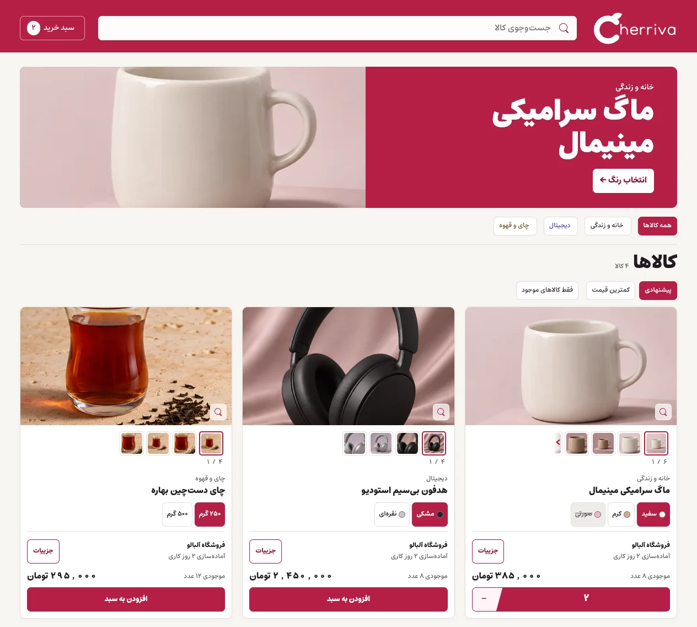
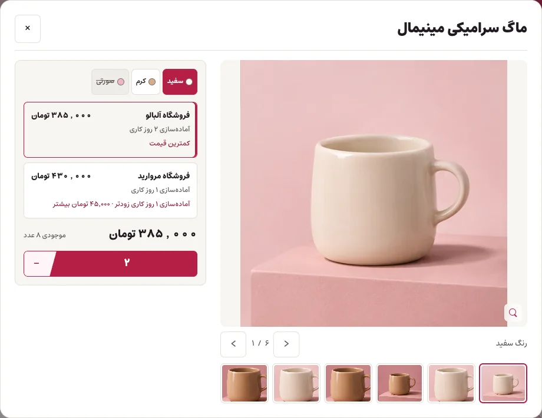
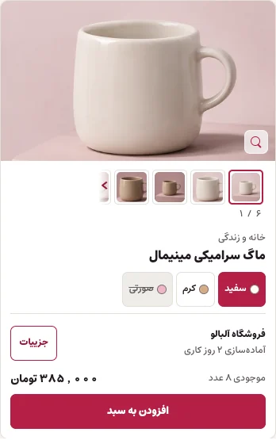

# طراحی بصری سایت فروش چریوا

نسخه طراحی ۲۰۲۶-۱۱-۱۶ در وضعیت `in-review` است. این راهنما ظاهر و تعامل‌های نمونه هدر، کاتالوگ، کارت کالا و [مودال کشف کالا](discovery.md) را ثبت می‌کند. تصاویر این صفحه از پیش‌نمایش طراحی گرفته شده‌اند و عکس کالا، فروشگاه، موجودی و مبلغ در آن‌ها نمونه‌اند. وضعیت پیاده‌سازی در [گزارش نسخه بررسی سایت مشتری](../../delivery/storefront-review.md) ثبت می‌شود.

## پیش‌نمایش کاتالوگ

## هویت و تایپوگرافی

| نقش | انتخاب در طرح |
| --- | --- |
| هویت و اقدام اصلی | گیلاسی `#B51F46` برای هدر، بنر اصلی، اقدام خرید و وضعیت انتخاب‌شده. حالت اشاره‌گر `#941637` است. |
| متن و سطوح | متن اصلی `#231A21`، متن فرعی `#655D60`، زمینه گرم `#F7F5F1`، خط جداکننده `#E3DFD8` و سطح کارت و مودال سفید. |
| نشان | [Open C](../../../apps/storefront-web/public/brand/open-c-main-symbol.svg) جای حرف اول [لوگوتایپ Cherriva](../../../apps/storefront-web/public/brand/open-c-main.svg) را می‌گیرد. قاب نشان در هدر ۶۴ پیکسل است و نشان ۳ پیکسل پایین‌تر می‌نشیند. حرف `h` با فاصله کم کنار دهانه نشان قرار می‌گیرد. |
| جست‌وجو | ذره‌بین ساده تک‌رنگ در سمت راست فیلد فارسی. |
| فونت | [استعداد](https://github.com/aminabedi68/Estedad) برای همه متن‌های رابط، از عنوان و جست‌وجو تا قیمت، فیلتر، مودال و سبد. عنوان بنر ۲۵ تا ۵۲، عنوان کارت ۱۶، متن پایه ۱۵ و متن فرعی ۱۲ پیکسل است. مبلغ با وزن درشت و اندازه ۱۴ تا ۱۶ پیکسل در کارت و ۱۹ پیکسل در مودال نمایش داده می‌شود. شمارنده و مبلغ از رقم‌های فارسی استفاده می‌کنند. |

## چیدمان و کنترل‌ها

- صفحه فارسی و راست‌به‌چپ است. هدر، نشان، جست‌وجو و سبد را کنار هم می‌آورد و جست‌وجو در نمایش باریک به ردیف دوم می‌رود. بنر گیلاسی کنار عکس کالا، اقدام «انتخاب رنگ» را نشان می‌دهد.
- دسته‌ها دکمه‌های جدا از هم در سمت راست‌اند. فیلتر و مرتب‌سازی همیشه دیده می‌شوند. «فقط کالاهای موجود» سمت چپ دکمه‌های مرتب‌سازی قرار دارد و با فشردن دوباره پاک می‌شود. دکمه‌های دسته و فیلتر در پیش‌نمایش ۳۴ پیکسل ارتفاع دارند و اندازه و جای آن‌ها هنگام انتخاب ثابت می‌ماند. نمونه دیداری برچسب «پیشنهادی» را نشان می‌دهد. قاعده مرجع پیش‌فرض مرتب‌سازی در `FEAT-SF-001-R03` ثبت شده است.
- شبکه از ۶۸۰ پیکسل سه ستون، از ۴۹۱ تا ۶۷۹ پیکسل دو ستون و در عرض کمتر یک ستون دارد. کارت‌های یک ردیف هم‌ارتفاع‌اند و جای قیمت و اقدام خرید هم‌تراز است. فاصله اصلی بخش‌ها ۱۶ پیکسل و فاصله بخش‌های داخل کارت ۸ پیکسل است. زیر خط جداکننده فروشگاه دست‌کم ۱۲ پیکسل فضا در نظر گرفته شده است. نام فروشگاه، بازه آماده‌سازی، موجودی و مبلغ هرکدام تک‌خطی‌اند.
- گزینه‌های ویژگی کالا، مثل رنگ و وزن، به شکل دکمه انتخاب نمایش داده می‌شوند. تصویر، مبلغ و موجودی با [ترکیب](../../product/glossary.md) جاری هماهنگ‌اند. انتخاب اولیه از `FEAT-SF-001-AC08` پیروی می‌کند. «جزییات» با حاشیه گیلاسی در ردیف فروشگاه، بالای قیمت قرار دارد.

## گالری و مودال کالا

- در کارت، اولین تصویر بندانگشتی سمت راست است و مرور از راست به چپ پیش می‌رود. حداکثر چهار تصویر کامل دیده می‌شوند. با وجود تصویر بعدی، بخشی از آن در لبه محو سمت چپ دیده می‌شود. لمس، کشیدن و کنترل لبه تصاویر بعدی را آشکار می‌کند. لبه بازگشت پس از رسیدن به انتها سمت راست است.
- «جزییات» یک مودال مشترک برای گالری کامل و مقایسه [پیشنهادهای فروش](../../product/glossary.md) باز می‌کند. تصویر اصلی بزرگ و همه بندانگشتی‌ها در گالری هستند. مرور با بندانگشتی، پیکان، کشیدن و کلیدهای جهت انجام می‌شود. انتخاب ترکیب، فروشگاه، قیمت، زمان آماده‌سازی، موجودی و اقدام خرید در نمایش عریض کنار گالری و در عرض ۷۶۰ پیکسل و کمتر زیر آن می‌آیند.
- ذره‌بین گیلاسی روی زمینه سفید نیمه‌شفاف در گوشه پایین راست تصویر کارت و مودال قرار دارد. لمس تصویر یا ذره‌بین بزرگ‌نمایی را همان‌جا فعال می‌کند. حرکت اشاره‌گر یا کشیدن تصویر، جزئیات دیگر را نشان می‌دهد. لمس دوباره، `Esc` یا تعویض تصویر، حالت بزرگ‌نمایی را پایان می‌دهد. در مودال، اولین `Esc` هنگام بزرگ‌نمایی به نمای عادی برمی‌گردد.

## کنترل تعداد

پس از «افزودن به سبد»، همان جای دکمه در کارت و مودال به شمارنده تبدیل می‌شود. بخش بزرگ گیلاسی فقط عدد را نشان می‌دهد و لمس هر نقطه آن یک واحد اضافه می‌کند. بخش کوچک با نشان «−» یک واحد کم می‌کند. مرز دو ناحیه مورب است. شمارنده برای هر ترکیب و پیشنهاد فروش با سبد هماهنگ است. در صفر، دکمه افزودن برمی‌گردد و در سقف موجودی، افزایش غیرفعال می‌شود. مرجع رفتار خرید و اعتبارسنجی [تجربه سبد و خرید](checkout.md) است.

## کارت در نمایش باریک

