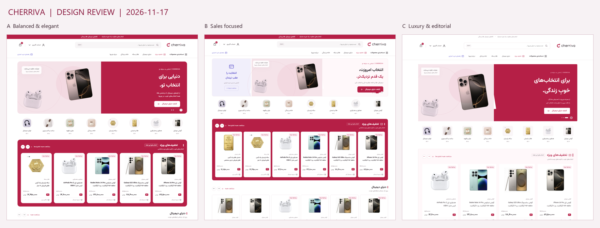
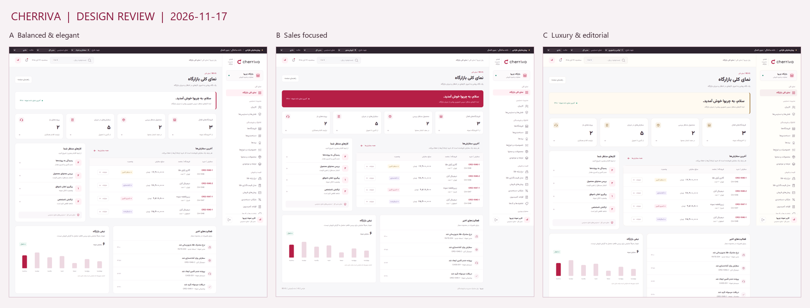

# بسته‌های طراحی و تحلیل برای بازبینی مشترک

**پاسخ جدید مالک،۲۰۲۶-۱۱-۲۰:** [پاسخ تسک #13 و دامنه شروع](../decisions/adr-005-review-v1-1-product-responses.md). A پنل انتخاب شد؛ CMS و زیرسایت‌ها معوق‌اند. snapshot زیر به نسخه زمان تهیه تعلق دارد؛ تصمیم‌های جدید از سند پاسخ و اسناد جاری خوانده شوند.

تاریخ انتشار در گیت: ۲۰۲۶-۱۱-۱۹ | وضعیت: in-review | مالک تصمیم محصول: الیاس؛ بازبینان: الیاس و پارسا، بدون ثبت تأیید به‌جای افراد

این بخش برای دیدن طرح‌ها و همفکری پیش از شفاف‌سازی و اولویت‌بندی نهایی تسک‌هاست. انتشار بسته، تأیید طراحی، نهایی‌شدن ترتیب اجرا یا شروع پیاده‌سازی نیست. اولویت‌های داخل بسته پیشنهاد قبلی‌اند و پس از جلسه مشترک بازبینی می‌شوند.

## شروع سریع برای الیاس و پارسا

1. [معرفی بسته کامل۱.۱](cherriva-2026-11-17-v1-1/README-fa.md) و [راهنمای شروع](cherriva-2026-11-17-v1-1/START-HERE-fa.md).
2. [همه تصاویر سایت و بک‌آفیس](cherriva-2026-11-17-v1-1/IMAGE-INDEX-fa.md)؛ PNGها مستقیماً در GitHub دیده می‌شوند.
3. [اصلاحات جاری](cherriva-2026-11-17-v1-1/04-current-spec/README-fa.md)؛ [۹۱ تسک پایه](cherriva-2026-11-17-v1-1/03-analysis-v1-0/task-index.json) و [۱۲ اصلاح مرتبط با آن‌ها](cherriva-2026-11-17-v1-1/04-current-spec/task-index-fa.md).
4. [دفتر ثبت نظر](cherriva-2026-11-17-v1-1/REVIEW-fa.md): مسیر صفحه/تصویر/تسک، نظر و دلیل را ثبت کنید. نظر ثبت‌شده تا پاسخ مالک، تصمیم پذیرفته‌شده نیست.

## دیدن سه جهت طراحی در همین گیت

### سایت: متعادل و شیک، فروش‌محور، لوکس و تصویری

### بک‌آفیس و پنل فروشنده

نسخه سایت ۰.۴ و پنل ۰.۲ است. پنل ۲۷ صفحه به‌علاوه ورود دارد. در ۲۰۲۶-۱۱-۲۰ طرح **A، متعادل و شیک** برای ظاهر سایت مشتری انتخاب شد. انتخاب طرح پنل در [Q-028](../product/open-questions.md#q-028) باز است. [نقشه طرح پنل در اسناد اصلی](../experiences/backoffice/panel-design.md) فایل‌های داخل بسته وضعیت ۱۷ نوامبر را ثبت می‌کنند و بسته در ۱۹ نوامبر منتشر شده است. [مرجع جاری طرح منتخب سایت](../experiences/storefront/visual-design.md)

## بازکردن دیزاین تعاملی

GitHub فایل HTML را به‌صورت کد نشان می‌دهد. ریپو را clone کنید یا از Code → Download ZIP دریافت و استخراج کنید؛ سپس فایل index.html داخل همین بسته را در مرورگر باز کنید. همه تصاویر و فونت‌ها کنار بسته‌اند.

اگر مرورگر فایل محلی را محدود کرد و Node روی سیستم موجود است، در پوشه بسته فرمان زیر را اجرا کنید؛ سپس http://127.0.0.1:4190/ را باز کنید. سرور فقط نمایش طرح و بدون وابستگی اضافی است؛ توقف با Ctrl+C.

~~~powershell
node serve.cjs
~~~

این نمونه‌ها حساب، پیامک، ذخیره پایدار یا پرداخت واقعی ایجاد نمی‌کنند. ساختار سایت و پنل مستقل از apps است و انتشار این پوشه، محصول را عوض نمی‌کند. گزارش۱۱۱ کنترل نمونه در [گزارش قبلی بسته](cherriva-2026-11-17-v1-1/VERIFICATION-fa.md) ثبت شده؛ آزمون backend یا provider محسوب نشود.

## مرز بسته و اسناد فعلی ریپو

بسته۱۷ نوامبر به‌صورت snapshot با manifest اصلی منتشر شده است. راه‌حل‌های فنی و تسک‌های CV داخل آن برای مرور مشترک‌اند؛ قواعد اسناد اصلی ریپو با این انتشار خودکار جایگزین نشده‌اند. تا بررسی مشترک اختلاف‌ها، این بخش مجوز اجرای تصمیم متعارض نیست. نمونه اختلاف‌های قابل پیگیری:

| شناسه بازبینی | دو مرجع | سؤال برای جمع‌بندی بعدی | وضعیت |
| --- | --- | --- | --- |
| REVIEW-PKG-Q01 | [کشف فعلی](../experiences/storefront/discovery.md) و [راهنمای دیزاین بسته](cherriva-2026-11-17-v1-1/01-storefront/handoff-fa.md) | مسیر کارت خانه و فهرست به صفحه مستقل محصول. تنوع و افزودن در صفحه محصول | مسیر اصلی حل شد. موارد مرزی در [Q-027](../product/open-questions.md#q-027) |
| REVIEW-PKG-Q02 | [هویت فعلی](../domains/identity/README.md) و [اصلاح هویت بسته](cherriva-2026-11-17-v1-1/04-current-spec/identity-auth-fa.md) | اصلاح اعلام‌شده یک User و ایمیل/رمز چگونه به اسناد و قراردادهای فعلی منتقل شود؟ جزئیات امنیت و اعطای نقش کدام‌اند؟ | قواعد منتقل شد. [موارد باز](../product/open-questions.md#پرسشهای-اصلاحات-جاری) |
| REVIEW-PKG-Q03 | [کاتالوگ فعلی](../domains/catalog/README.md) و [وقفه فروشنده در بسته](cherriva-2026-11-17-v1-1/04-current-spec/seller-lead-time-fa.md) | اصلاح وقفه ثابت در سطح فروشنده چگونه جای قاعده قدیمی سطح کالای فروشگاه را بگیرد و snapshot/پذیرش‌ها هماهنگ شوند؟ | قواعد منتقل شد. [موارد باز](../product/open-questions.md#پرسشهای-اصلاحات-جاری) |
| REVIEW-PKG-Q04 | [خصوصیت فعلی](../domains/catalog/README.md) و [خصوصیت مشترک بسته](cherriva-2026-11-17-v1-1/04-current-spec/catalog-workspace-fa.md) | تعریف مشترک و binding هر دسته در مدل/API و قابلیت‌های فعلی چگونه منعکس شود؟ | قواعد منتقل شد. [موارد باز](../product/open-questions.md#پرسشهای-اصلاحات-جاری) |

مراجع پرسش‌های اصلی [دفتر محصول](../product/open-questions.md) و [پرسش‌های بسته](cherriva-2026-11-17-v1-1/04-current-spec/open-items-fa.md) هستند. جدول بالا دفتر موقت اختلاف انتشار است و پاسخ‌های صریح موجود را لغو نمی‌کند. بعد از همفکری، تصمیم‌ها به حوزه، تجربه، قرارداد، پرسش و ردیابی مربوط منتقل و تسک‌ها به‌اندازه قابل اجرا با اولویت مشترک نهایی شوند.

فایل ZIP جداگانه تکرار نشده است؛ تمام۶۶۵ فایل بسته، شامل manifest و آرشیو مرجع قبلی داخل بسته، در این مسیر قرار دارند. برای دریافت یک‌جای آن‌ها Download ZIP ریپو کافی است. اطلاعات کنترل انتشار و فایل‌های تغییرکرده از commit همین تحویل قابل مشاهده‌اند.

پیگیری اختلاف‌های هویت، نقش، زمان آماده‌سازی و خصوصیت در [دفتر پرسش‌های محصول](../product/open-questions.md#اختلافهای-بسته-بازبینی-پنل) انجام می‌شود.

[نقشه تسک‌های تحلیل پایه در اسناد اصلی](../delivery/analysis-backlog.md) گروه‌ها، موج‌ها و مراجع جاری ۹۱ تسک را نشان می‌دهد. [دفتر پرسش‌های تحلیل](../product/open-questions.md#پرسشهای-تحلیل-پایه) موانع با شناسه CHQ را پیگیری می‌کند.
