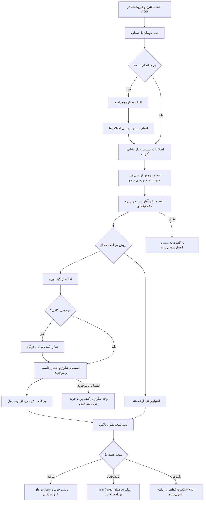

# سبد و مسیر خرید چریوا؛ نسخه ۰٫۳

این سند ادامه [طراحی Home/PLP/PDP](handoff-fa.md) است. هر سه جهت A متعادل و شیک، B فروش‌محور و C لوکس و تصویری، در دسکتاپ و موبایل نگه داشته شده‌اند. تصاویر و پیش‌نمایش مستقل‌اند؛ سورس اپلیکیشن و سایت منتشرشده تغییر نکرده‌اند. وضعیت طرح `in-review` است.

برای دیدن خروجی از [نمایشگر](index.html)، [مقایسه سبدها](images/cart-directions-comparison.png)، [مسیر خرید A](images/checkout-journey-balanced.png)، [مقایسه موبایل](images/checkout-mobile-comparison.png) و [مرجع دکمه](images/purchase-control-states.png) شروع کنید. [فهرست تصاویر](image-index-fa.md) همه نماها و حالت‌ها را دارد.

## مرز واقعیت، پیشنهاد و پرسش

| نوع | مبنا |
| --- | --- |
| درخواست صریح کاربر | طراحی سبد تا پرداخت در هر سه جهت؛ الهام از گوشی‌شاپ و نمونه چریوا؛ اصلاح دکمه طبق تصویر ارسالی؛ رنگ اصلی به‌عنوان امضای برند؛ تحویل PNG و MD فارسی |
| قواعد ثبت‌شده محصول | خرید مهمان تا سبد، ورود پیش از checkout، یک مقصد مشترک، تفکیک فروشندگان و ارسال، یک پرداخت نهایی، جلسه ۱۰ دقیقه‌ای، پرداخت نقدی از کیف پول و جدایی پرداخت اعتباری |
| پیشنهاد بصری | هدر و فوتر ساده‌تر در checkout، خلاصه چسبان دسکتاپ، نمایش تصویر کوچک اقلام، گروه‌بندی با نام فروشنده، تأکید روی جمع قبل از اقدام پرداخت، فرم OTP تک‌فیلدی |
| باز | انتخاب ترکیب نهایی A/B/C، ارائه‌دهنده و شرایط اعتبار، امکان اعتبار برای طلا/سبد مختلط طبق قرارداد، نام واقعی روش‌های حمل و سیاست خدمات |

قواعد حوزه از اسناد فعلی [مراجع](source-references.md) خوانده شده‌اند؛ این سند تصمیم‌های مالی جدید تصویب نمی‌کند. نام ارائه‌دهنده، فرمول اقساط، پرداخت در محل یا وعده حمل جدید از مرجع گوشی‌شاپ وارد محصول نشده است.

## تفاوت سه مسیر

| مسیر | سبد و checkout | کاربرد و ملاحظه |
| --- | --- | --- |
| A — متعادل و شیک | کارت‌های روشن با مرز ملایم، فاصله متوسط، خلاصه واضح با خط گیلاسی | پیشنهاد پایه برای مارکت‌پلیس چنددسته‌ای؛ خوانایی و مقایسه متعادل |
| B — فروش‌محور | فاصله کمتر، کارت فشرده‌تر، تأکید قوی‌تر روی مبلغ و CTA | مرور سریع‌تر سفارش؛ از شمارش معکوس تبلیغاتی یا کمیابی ساختگی استفاده نشده |
| C — لوکس و تصویری | تصویر بزرگ‌تر در سبد دسکتاپ، فضای باز، لبه‌های صاف‌تر و عنوان درشت‌تر | حس کالای ارزشمند و انتخاب‌شده؛ پیمایش بیشتر، مخصوصاً در سبد بلند |

تفاوت جهت‌ها عمدتاً در سبد و صفحه ورود دیده می‌شود؛ فرم‌های حساس نشانی و پرداخت عمداً ساختار و رفتار یکسان دارند تا تغییر زیبایی‌شناسی، معنی مبلغ یا نتیجه پرداخت را عوض نکند. در موبایل فاصله‌ها به خوانایی و فضای محدود صفحه نزدیک می‌شوند. هیچ مسیر رنگ اصلی یا شکل دکمه متفاوتی ندارد.

رنگ‌های ثابت: اصلی `#B51F46`، فشردن/حالت افزوده `#941637`، زمینه روشن `#FFF8FA`، تأکید ملایم `#FCE9EF`، متن `#231A21`، مرز `#E7D8DE`. بنفش دیجیتال و طلایی نقش کمکی دارند. هدر، مرحله فعال، کنترل انتخاب، خط بالای خلاصه، اقدام اصلی و مرز فوتر امضای گیلاسی دارند؛ بدنه سفید و روشن می‌ماند.

## فلو اصلی و نقاط توقف

این نمودار رفتار مورد انتظار محصول را شرح می‌دهد. پیش‌نمایش HTML همه انتقال‌های دامنه، ادغام سبد یا تراکنش‌های مالی را اجرا نمی‌کند. کاربر واردشده در محصول از مرحله ورود عبور می‌کند؛ نمایشگر برای مرور طراحی، صفحه ورود را مستقل در دسترس گذاشته است.

## سبد خرید

هر گروه نام فروشنده و عبارت ارسال جداگانه دارد. هر قلم تصویر، عنوان قابل رفتن به PDP مستقل، تنوع، فروشنده، آماده‌سازی، قیمت فعلی، قیمت قبلی در صورت تخفیف واقعی، تعداد، ویرایش تنوع/فروشنده و حذف دارد. قیمت هر قلم از تعداد ضربدر قیمت واحد روشن است.

خلاصه دسکتاپ هنگام پیمایش در دسترس می‌ماند و تعداد، تصاویر کوچک اقلام، قیمت اولیه، تخفیف، مبلغ پس از تخفیف و وضعیت هزینه ارسال را نشان می‌دهد. پیش از انتخاب مقصد/حمل، مبلغ کالاها به‌عنوان «جمع نهایی خرید» معرفی نمی‌شود. در موبایل خلاصه بعد از اقلام قرار می‌گیرد؛ اسکرول افقی کل صفحه لازم نیست.

| حالت | رفتار طراحی و قرارداد اجرای آینده |
| --- | --- |
| عادی | امکان تغییر تعداد و حذف؛ ادامه خرید پس از اعتبارسنجی |
| خالی | پیام کوتاه و یک اقدام برگشت به فروشگاه؛ بدون خلاصه مبلغ صفر گمراه‌کننده |
| تغییر قیمت | مبلغ قبلی/جدید، جمع به‌روز و تأیید آگاهانه؛ ادامه تا بررسی تغییر مسدود |
| ناموجودی | قلم مسئله‌دار مشخص؛ حذف یا انتخاب عرضه معتبر؛ بقیه اقلام بدون تأیید خودکار خریداری نشوند |
| تغییر تنوع | حفظ فروشنده اگر عرضه معتبر دارد؛ در غیر این صورت انتخاب آگاهانه، بدون تعویض مخفی |
| تغییر فروشنده | بازبینی قیمت، موجودی، تعداد مجاز، آماده‌سازی، روش و هزینه حمل |
| در حال تغییر / خطای شبکه | اندازه کنترل ثابت، جلوگیری از اقدام تکراری، حفظ انتخاب قبلی و پیام خطای قابل اقدام |

پنل ویرایش در پیش‌نمایش فقط جایگاه انتخاب و بازبینی را نشان می‌دهد؛ SKU یا عرضه جدید واقعاً جایگزین نمی‌شود. ادغام سبد مهمان/حساب باید اختلاف موجودی و تعداد را پیش از ادامه اعلام کند. نمایش یک عدد در سبد به معنای رزرو موجودی نیست.

## دکمه افزودن و کنترل تعداد؛ اصلاح دقیق مرجع

مرجع اصلی این اصلاح [تصویر ارسالی کاربر](assets/reference-purchase-control.png) است. [برد حالت‌ها](purchase-control-study.html) و [تصویر آن](images/purchase-control-states.png) شکل قبل و بعد را کنار هم دارند.

| حالت | شکل | کنش |
| --- | --- | --- |
| قبل از افزودن | تمام‌عرض، گیلاسی، متن سفید «افزودن به سبد»، گوشه ۷ پیکسل، ارتفاع ۴۴ پیکسل | افزودن همان عرضه و تنوع منتخب |
| یک عدد | زمینه گیلاسی تیره، عدد سفید وسط، ناحیه روشن چپ با مرز مورب سمت راست | سطح اصلی افزایش؛ بخش روشن حذف |
| چند عدد | همان ساختار با عدد جدید | سطح اصلی افزایش؛ بخش روشن کاهش |
| حداکثر | همان ساختار و عبارت «حداکثر» زیر عدد | افزایش غیرفعال؛ کاهش در دسترس |
| در حال تغییر | عرض/ارتفاع ثابت و پیام انتظار | جلوگیری از درخواست تکراری |
| ناموجود | دلیل متنی روشن | امکان خرید غیرفعال |

سطح روشن از چپ شروع می‌شود؛ جهت RTL نباید آن را به سمت راست ببرد یا علامت منها را روی لبه مورب بیندازد. عدد در مرکز کل کنترل است. در محصول، درخواست افزایش/کاهش باید از وضعیت واقعی سبد تغذیه شود؛ شکست پاسخ نباید عدد موفق نشان دهد. برای صفحه‌کلید، ناحیه افزایش و کاهش دو دکمه مستقل با نام روشن و فوکوس قابل دیدن‌اند. تغییر موفق تعداد باید برای فناوری کمکی اعلام شود؛ بررسی کامل دسترس‌پذیری این نمونه انجام نشده است.

این الگو در خرید PDP، نوار خرید موبایل و کنترل تعداد سبد استفاده شده است. هویت قلم سبد باید شامل کالا، تنوع و عرضه فروشنده باشد. انتخاب تنوع/فروشنده دیگر، تعداد همان قلم را نشان دهد. کارت Home/PLP طبق پیشنهاد قبلی، مسیر ورود به PDP است و کنترل خرید یا تنوع روی آن اضافه نشده؛ حذف/افزودن آن نیازمند تصمیم جداگانه محصول است.

## ورود و OTP

ورود در صفحه‌ای آرام با یک اقدام اصلی انجام می‌شود. نام‌نویسی و ورود از شماره همراه شروع می‌شوند؛ اگر حساب وجود ندارد، پس از تأیید شماره مسیر ساخت حساب ادامه می‌یابد. طرح دسکتاپ ناحیه برند و تصاویر دارد؛ موبایل فرم را در اولویت می‌گذارد.

شماره، مرحله کد، ویرایش شماره، شمارنده ارسال مجدد، کد نادرست، حفظ سبد و راه پیگیری پوشش داده شده‌اند. بر اساس سند هویت، اعتبار کد ۹۰ ثانیه و فاصله ارسال مجدد ۶۰ ثانیه است؛ محدودیت تلاش ساعتی و کنترل نرخ طبق همان سند اجرا شود. شمارنده «۰۰:۴۲» در طرح ثابت و نمونه است.

ورودی کد یک فیلد با ظاهر پیوسته است تا جای‌گذاری کامل کد، کیبورد عددی و اصلاح ساده بماند. در محصول، OTP autofill و دریافت رقم فارسی/لاتین در نظر گرفته شود. شماره، کد، نشانی و نام این بسته ساختگی‌اند؛ کد `000000` تنها برای مرور طراحی است. این بسته پیامک نمی‌فرستد و احراز هویت نمی‌کند.

## حساب و نشانی گیرنده

نام و نام خانوادگی صاحب حساب جدا از مشخصات گیرنده‌اند. یک نشانی انتخاب‌شده برای کل خرید استفاده می‌شود؛ امکان نگه‌داری چند نشانی محفوظ است. گیرنده می‌تواند متفاوت از صاحب حساب باشد و شماره او برای ورود به حساب استفاده نشود.

طرح شامل نشانی‌های نمونه، انتخاب رادیویی، ویرایش و فرم نشانی جدید با استان، شهر، نام/شماره گیرنده، کدپستی و نشانی کامل است. در اجرای محصول اعتبارسنجی متناسب با منطقه پشتیبانی‌شده، دسترس‌پذیری حمل و خطای هر فیلد لازم است. ذخیره فرم این نمونه داده‌ای نگه نمی‌دارد.

پیشنهاد: فیلدهای اضافی حساب در این مرحله فقط وقتی اجباری شوند که برای خرید یا مقررات نهایی واقعاً لازم‌اند؛ فرایند احراز ویژه کالا/اعتبار از فرم عمومی حدس زده نشود.

## ارسال چندفروشنده

نشانی مشترک در بالای صفحه و لینک تغییر آن دیده می‌شود. هر فروشنده گروه مستقل، اقلام خود، آماده‌سازی و گزینه‌های حمل معتبر دارد. آماده‌سازی، مدت حمل و برآورد دریافت سه مفهوم جدا هستند. تمام اقلام باقی‌مانده یک فروشنده با هم اعزام می‌شوند؛ چند بسته فیزیکی می‌توانند هم‌زمان اعزام شوند.

هزینه هر انتخاب کنار همان روش و مجموع هزینه‌ها در خلاصه دیده می‌شود. تغییر روش باید جمع را به‌روز کند. عناوین پست/پیک و هزینه‌ها فقط داده طراحی‌اند؛ مجازبودن حمل طلای فیزیکی و شیوه تضمین/بیمه آن از قرارداد عملیاتی معتبر بیاید. وعده ارسال رایگان، پرداخت در محل یا تحویل فوری به طرح اضافه نشده است.

طبق سند فعلی، روزهای کاری آماده‌سازی شنبه تا چهارشنبه‌اند؛ روز پرداخت، پنج‌شنبه، جمعه و تعطیلات مرکزی شمرده نمی‌شوند. نمونه به‌جای تاریخ تقویمی قطعی، بازه روز کاری دارد؛ محصول تاریخ را با تقویم، ساعت قطع سفارش و داده معتبر همان خرید محاسبه کند.

«تأیید مبلغ و ادامه پرداخت» بعد از نشانی، حمل و جمع معتبر، جلسه پرداخت و رزرو موجودی ۱۰ دقیقه‌ای را شروع می‌کند. این مدت از زمان افزودن به سبد یا بازشدن PDP آغاز نمی‌شود.

## پرداخت نقدی و اعتباری

خلاصه مبلغ نهایی در کنار فرم دسکتاپ و بعد از فرم موبایل قرار دارد. اقدام پرداخت کنار جمع همان خلاصه است تا مبلغ قبل از کلیک روشن باشد. شمارنده جلسه با متن علت نمایش داده می‌شود؛ این شمارنده تبلیغاتی نیست.

### نقدی از کیف پول

موجودی قابل مصرف، کسری و حداقل شارژ جدا دیده می‌شوند. شارژ برابر کسری به‌صورت پیش‌فرض پیشنهاد شده و شارژ بیشتر مجاز است. کل مبلغ سفارش از کیف پول مصرف می‌شود؛ این طرح پرداخت مستقیم بخشی از سفارش از درگاه در کنار بخشی از کیف پول را معرفی نمی‌کند.

اگر موجودی کافی باشد، دکمه «پرداخت کل خرید از کیف پول» است. اگر کافی نباشد، «شارژ کیف پول و ادامه خرید» نشان داده می‌شود. موفقیت درگاه ابتدا موفقیت شارژ است؛ اعتبار جلسه و موجودی کالا دوباره بررسی شوند و سپس پرداخت سفارش از کیف پول تأیید شود. باقی‌مانده شارژ بیشتر، در کیف پول می‌ماند.

اگر شارژ بعد از انقضای جلسه برسد یا کالا پس از شارژ ناموجود شود، مبلغ در کیف پول می‌ماند؛ سفارش ناقص، تغییر فروشنده یا برداشت جایگزین خودکار ایجاد نمی‌شود. برداشت وجه از کیف پول، قابلیت جداگانه پروفایل است و در checkout این بسته طراحی نشده است.

### اعتباری

پرداخت اعتباری مسیر مستقل با ارائه‌دهنده فعال است و کیف پول را شارژ نمی‌کند. با نقدی ترکیب نمی‌شود. سقف، احراز شرایط، پیش‌پرداخت و برنامه اقساط باید از قرارداد و پاسخ ارائه‌دهنده معتبر بیایند؛ عدد چهار قسط یا نرخ کارمزد فرض نشده است. نمایش گزینه برای طلا یا سبد مختلط به مجازبودن کالاها و قرارداد وابسته است؛ این پیش‌نمایش صرفاً جایگاه بصری آن را نشان می‌دهد.

### انقضا

با تمام‌شدن ۱۰ دقیقه، روش‌ها و اقدام پرداخت غیرفعال‌اند و مسیر اصلی به سبد برمی‌گردد. دکمه «پرداخت مجدد» برای زنده‌کردن همان جلسه منقضی پیشنهاد نشده است. زمان و اعتبار در محصول از سرور بیاید؛ شمارنده‌های این بسته ثابت‌اند.

## نمونه محاسبات طرح

تمام اعداد فرضی و صرفاً برای مقایسه خوانایی‌اند. نمایش تومان در طرح تأیید قرارداد ریال/تومان در API نیست.

| عنوان | تومان نمونه |
| --- | ---: |
| قیمت اولیه گوشی + شمش | ۱۱۰٬۵۰۰٬۰۰۰ |
| تخفیف اقلام | ۴٬۱۵۰٬۰۰۰ |
| مبلغ کالاها پس از تخفیف | ۱۰۶٬۳۵۰٬۰۰۰ |
| حمل فروشنده دیجیتال | ۹۵٬۰۰۰ |
| حمل فروشنده طلا | ۸۵٬۰۰۰ |
| جمع نهایی | ۱۰۶٬۵۳۰٬۰۰۰ |
| موجودی کیف پول | ۲٬۰۰۰٬۰۰۰ |
| حداقل شارژ لازم | ۱۰۴٬۵۳۰٬۰۰۰ |

در حالت تغییر قیمت، گوشی به ۹۰٬۹۰۰٬۰۰۰ می‌رسد و تخفیف/جمع از داده جدید دوباره محاسبه می‌شوند. قیمت طلا در این نمونه، قیمت کل قطعه با وزن و عیار مشخص است؛ نرخ زنده، فرمول طلای گرمی، اجرت یا مالیات ساختگی ندارد. کد تخفیف جدید به checkout اضافه نشده؛ تخفیف نمایش‌داده‌شده مربوط به اقلام است و طراحی کد/محدودیت آن تابع قرارداد تخفیف محصول خواهد بود.

## نتیجه و پیگیری پرداخت

| حالت | پیام و اقدام |
| --- | --- |
| موفق قطعی سفارش | خرید ثبت شد، مبلغ و روش، مقصد مشترک، سفارش‌های هر فروشنده با حمل و برآورد مستقل، مشاهده سفارش‌ها |
| نامشخص / در حال بررسی | بدون اعلام موفقیت/شکست؛ شناسه همان تلاش، استعلام مجدد همان تلاش و پیگیری پشتیبانی؛ بدون دعوت به پرداخت جدید |
| ناموفق قطعی | خطای قابل فهم و بازگشت کنترل‌شده به روش پرداخت؛ اعتبار جلسه در محصول پیش از تلاش بعدی بررسی شود |
| شارژ موفق / سفارش ثبت نشده | تفکیک نتیجه شارژ از سفارش؛ نمایش موجودی و بازگشت به سبد برای خرید تازه |

رسید سفارش فقط پس از تأیید پرداخت سفارش نمایش داده شود. بازگشت مرورگر از درگاه به‌تنهایی سند موفقیت نیست. تازه‌سازی صفحه، چند تب، دوبار کلیک و callback تکراری نباید خرید یا برداشت تکراری بسازند. متن و رنگ تنها نشانه وضعیت نیستند؛ عنوان، توضیح و اقدام متناسب هم لازم‌اند.

## حالت‌ها و معیار تحویل به تیم فنی

| شناسه | سناریوی پذیرش پیشنهادی |
| --- | --- |
| DESIGN-CHECKOUT-AC-01 | مهمان سبد بسازد؛ ورود پیش از checkout و ادغام با بازبینی اختلاف انجام شود |
| DESIGN-CHECKOUT-AC-02 | عرضه و تنوع منتخب در PDP، کنترل تعداد، سبد و خلاصه یکسان باشند؛ تغییر فروشنده پنهانی رخ ندهد |
| DESIGN-CHECKOUT-AC-03 | قبل/بعد افزودن مطابق مرجع؛ منها در بخش روشن چپ، عدد وسط، حداکثر مشخص و درخواست تکراری مهار شود |
| DESIGN-CHECKOUT-AC-04 | تغییر قیمت/ناموجودی در سبد مانع ادامه نامعتبر شود؛ حذف قلم دیگر مشکل را پنهان نکند |
| DESIGN-CHECKOUT-AC-05 | اطلاعات حساب با گیرنده جدا و یک مقصد برای کل خرید باشد |
| DESIGN-CHECKOUT-AC-06 | هر فروشنده روش/هزینه معتبر و مجموع روشن داشته باشد؛ هزینه نامشخص صفر تلقی نشود |
| DESIGN-CHECKOUT-AC-07 | تغییر نشانی، تعداد، عرضه یا حمل، اعتبارسنجی‌های وابسته را تازه کند |
| DESIGN-CHECKOUT-AC-08 | رزرو/جلسه پس از تأیید جمع آغاز شود؛ انقضا به سبد برگردد و از سرور اعتبار بگیرد |
| DESIGN-CHECKOUT-AC-09 | پرداخت نقدی کل مبلغ را از کیف پول مصرف کند؛ شارژ موفق با سفارش موفق یکی نباشد |
| DESIGN-CHECKOUT-AC-10 | اعتباری فقط برای خرید واجد شرایط، بدون ترکیب نقدی/شارژ کیف پول ارائه شود |
| DESIGN-CHECKOUT-AC-11 | وضعیت نامشخص فقط همان تلاش را پیگیری کند؛ پرداخت و برداشت تکراری ایجاد نشود |
| DESIGN-CHECKOUT-AC-12 | شارژ دیررس/ناموجودی پس از شارژ، وجه را در کیف پول نگه دارد و خرید ناقص خودکار نسازد |
| DESIGN-CHECKOUT-AC-13 | مبلغ نهایی قبل از اقدام اصلی در موبایل و دسکتاپ خوانا باشد؛ فرم خطا و فوکوس واضح داشته باشد |
| DESIGN-CHECKOUT-AC-14 | رسید موفق، سفارش‌های فروشندگان و روش پرداخت تأییدشده را تفکیک کند |

این جدول قرارداد پذیرش آینده است؛ عبور از این سناریوها در سرویس واقعی ادعا نشده است. خروجی فعلی طراحی UI است، مجوز توسعه بخش تأییدنشده یا اتصال درگاه نیست.

## محدودیت پیش‌نمایش و تصمیم‌های باز

پیش‌نمایش با داده ثابت برای هر صفحه شروع می‌شود. تغییر تعداد در سبد و انتخاب حمل در همان صفحه خلاصه را به‌روز می‌کند، اما با رفتن به صفحه بعد داده ثابت اولیه برمی‌گردد. انتخاب نشانی، ادغام سبد، فرم جدید، ویرایش عرضه، شمارنده زمان و استعلام پرداخت قرارداد عملیاتی ندارند. هیچ داده‌ای در سرور، localStorage یا حساب ذخیره نمی‌شود. پرداخت نمایشی عمداً به حالت «در حال بررسی» می‌رود؛ نتیجه قطعی را از انتخاب حالت نمایشگر می‌توان دید. این محدودیت را با فلو محصول اشتباه نگیرید.

| شناسه محلی | باز برای بررسی | مالک پیشنهادی |
| --- | --- | --- |
| DESIGN-CHECKOUT-OPEN-01 | انتخاب جهت نهایی یا اجزای مشخص ترکیبی از سه مسیر | مالک محصول |
| DESIGN-CHECKOUT-OPEN-02 | نام، شرایط و مجازبودن اعتبار برای دسته طلا/سبد مختلط؛ مطابق پرسش‌های موجود محصول | محصول / قرارداد پرداخت |
| DESIGN-CHECKOUT-OPEN-03 | نام روش حمل، پوشش مقصد، تضمین/بیمه طلای فیزیکی و متن خدمات واقعی | عملیات / تأمین |
| DESIGN-CHECKOUT-OPEN-04 | متن قوانین، پشتیبانی و مجوزهایی که واقعاً اخذ و قابل نمایش‌اند | مالک کسب‌وکار |

جلسه ۱۰ دقیقه‌ای، نشانی مشترک و مسیر نقدی کیف پول طبق سند فعلی‌اند و در این بسته دوباره سؤال باز نشده‌اند. بازخوردها را با مسیر/صفحه/اندازه/نام فایل در [دفتر نظرها](review-notes-fa.md) ثبت کنید. تاریخچه ۰٫۲ در پوشه قبلی حفظ است؛ این نسخه تأیید نهایی نشده است.
