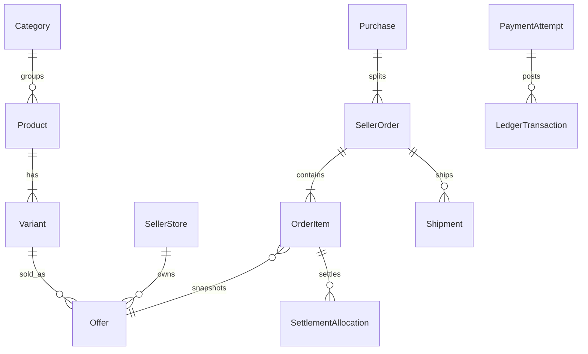

# مدل منطقی داده و قیدهای مهم

نسخه: ۱.۰ | تاریخ: ۲۰۲۶-۱۱-۱۷ | وضعیت: تحلیل و طراحی برای بازبینی تیم فنی | مالک بررسی: محصول و راهبر فنی؛ انتساب شخص هنوز انجام نشده

این مدل پیشنهادی برای طراحی schema است؛ migration اجراشده نیست. شناسه پایدار، زمان UTC، نسخه optimistic concurrency و ثبت عامل برای موجودیت‌های قابل تغییر پیشنهاد می‌شود. مبلغ integer ریال؛ نرخ و وزن decimal با واحد صریح، بدون float. دقت نرخ و محل گردکردن باید با سؤال مالی تثبیت شوند.

| موجودیت | فیلدهای محوری پیشنهادی | قید / دلیل بیزینسی |
| --- | --- | --- |
| User / Session / OtpChallenge | mobile، state، expires_at، attempts، consumed_at | OTP یک‌بارمصرف؛ نشست پس از تغییر اختیار دوباره مجوزسنجی شود |
| Role / Permission / RoleGrant / StoreMembership | key، title، permission_keys، user_id، store_id | نقش قابل تعریف؛ grant با مالکیت فروشگاه یکی نیست؛ چندنقشی باز |
| SellerStore | owner، status، catalog_mode، publication_policy، gold_rate_source | فروشگاه واحد تجاری است، نه مشتری؛ صلاحیت/وضعیت انتشار مستقل |
| Category | parent_id، slug، path، display_order، seo، card_attribute_ids | FK والد، منع چرخه، عمق کنترل‌شده؛ حداکثر سه ویژگی کارت |
| AttributeDefinition / Value | type، unit، filterable، variant_axis، order | تنوع حداکثر یک یا دو محور اصلی مورد استفاده دیزاین؛ داده فنی بیشتر مجاز |
| Brand / Product | name، category_id، brand_id، content_version، publication_state | محصول محتوای کاتالوگ؛ عرضه و قیمت جدا |
| Variant | product_id، SKU، attribute_value_ids، weight، purity | ترکیب یکتا و معتبر؛ وزن/عیار طلا واحددار |
| Offer | seller_store_id، variant_id، stock، reserved، base_price، pricing_mode، lead_time | یکتایی عرضه هر فروشگاه/تنوع طبق سیاست؛ stock/reserved اتمیک |
| Media | owner، storage_key، mime، size، alt، order، variant_id | URL امن؛ تصویر تنوع دقیق؛ حذف فایل استفاده‌شده کنترل شود |
| GoldRate / GoldRateSelection / GoldFormulaVersion | source، seller_id، kind، unit، purity، amount، valid_from/to، version | نرخ مشترک/اختصاصی؛ نبود نرخ اختصاصی fallback پنهان ندارد |
| SaleMethod / GatewayBinding / CategoryMarkup | method، gateway، enabled، category، percentage، version | تنظیم صفر صریح با نبود رکورد فرق دارد؛ rule method-specific |
| CommissionRule | scope، amount_type، amount، dates، collection_mode | مستقل از markup؛ قرارداد صفر و clock مستقل |
| Promotion / Coupon / Redemption | target، fixed/percent، cap، funder، limits، reservation | تکرار مصرف/هم‌زمانی و برگرداندن سهم تخفیف قابل پیگیری |
| Page / Section / Publication | scope، page_type، ordered_sections، typed_config، revision | draft با published جدا؛ جابه‌جایی ترتیب اتمیک |
| Cart / CartItem / CartMerge | actor، variant، offer، quantity، version، merge_key | هویت قلم با عرضه و تنوع؛ retry ادغام تعداد را دوباره زیاد نکند |
| PriceQuote / QuoteLine | input_versions، selected_method، components، expiry، rules | محاسبه قابل بازسازی؛ قیمت جاری سفارش قبلی را عوض نمی‌کند |
| CheckoutSession / InventoryReservation | cart_version، quote_id، destination، expires_at، state | یک جلسه معتبر، رزرو خود مشتری به‌عنوان موجودی قابل تخصیص شناخته شود |
| Purchase / SellerOrder / OrderItem | buyer، seller، variant_snapshot، quantity، price_snapshot، state | یک خرید چند سفارش فروشگاهی؛ خرید و پرداخت جدا |
| Shipment / Package / Tracking | seller_order/assignment، method، tariff_snapshot، packages | اعزام همه اقلام باقی‌مانده فروشگاه یکجا؛ چند بسته فیزیکی ممکن |
| PaymentAttempt / ProviderEvent | purpose، currency، amount، provider_ref، idempotency_key، state | purpose شارژ با پرداخت سفارش یکی نیست؛ اثر یکتا |
| LedgerTransaction / LedgerEntry / Hold / FundingLot | account، amount، direction، source_attempt، allocation | دفتر append-only و تراز؛ مانده محاسبه/ماده‌شده، نه edit مستقیم |
| Withdrawal / Refund / RefundAllocation | source، amount، hold_id، destination_ref، state | ظرفیت منشأ، موجودی و سقف سفارش سه کنترل جدا |
| Settlement / SettlementAllocation / SellerDebt | order_item، gross، adjustments، paid، due | تخصیص قلم‌محور؛ refund بعد تسویه بدهی قابل ردیابی |
| SupportCase / SupplyAssignment | reason، item_quantities، assignee، result، version | واگذاری، سفارش اصلی و عامل واقعی تأمین را حفظ کند |
| Review / Question / Bookmark / Subscription | customer، product، moderation_state، consent | سیاست انتشار/رضایت باز؛ داده عمومی با خصوصی جدا |
| Audit / Outbox / ReconciliationCase | actor، action، resource، state، correlation، retries | نگهداری علت و تغییر؛ بدون OTP/token/PII خام |

## قیدهای پایگاه داده

- موجودی و تعداد منفی، تخصیص بیش از مقدار قلم و خروج وجه بیش از hold با قید و تراکنش رد شوند.
- `(provider, purpose, idempotency_key)` و شناسه رویداد ارائه‌دهنده یکتا؛ کلید یکسان با payload متفاوت conflict است.
- مجموع مانده حساب‌های متناظر در ledger متوازن؛ اصلاح با رکورد جبرانی، نه UPDATE تاریخچه قطعی.
- کوپن رزروشده/مصرف‌شده به attempt/order متصل باشد؛ زمان آزادسازی نیازمند سیاست مشخص است.
- حذف فیزیکی نرخ/قانون/عرضه استفاده‌شده در سفارش ممنوع؛ نسخه و snapshot حفظ شوند.
- شناسه فروشگاه از نشست/عضویت و منبع بازیابی شود؛ اعتماد به `store_id` فرانت مجاز نیست.
- ایندکس‌های اصلی: category parent/path، offer variant+seller+active، search document نرمال، status+created_at، attempt provider_ref، wallet account+sequence و audit resource+time.

