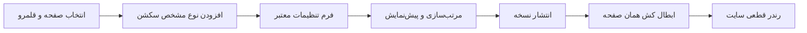

# مدیریت ساده سکشن‌ها، صفحات و فرم‌های محتوا

نسخه: ۱.۰ | تاریخ: ۲۰۲۶-۱۱-۱۷ | وضعیت: تحلیل و طراحی برای بازبینی تیم فنی | مالک بررسی: محصول و راهبر فنی؛ انتساب شخص هنوز انجام نشده

## مسئله و راه‌حل

کاربر می‌خواهد صفحه اصلی و صفحات محتوایی با افزودن، ویرایش، حذف و تغییر ترتیب سکشن اداره شوند. پیشنهاد ما یک `Page` با فهرست `Section`های typed است؛ هر نوع یک renderer در سایت و یک فرم مشخص در پنل دارد. تیم برای نوع جدید renderer و schema اضافه می‌کند؛ اپراتور بدون کدنویسی نمونه جدید و ترتیب می‌سازد. CMS آزاد، widget zoneهای متعدد، SQL یا کد HTML اجرایی لازم نیست.

| نوع محدود پیشنهادی | تنظیمات | قاعده نمایش |
| --- | --- | --- |
| hero | تصویر desktop/mobile، alt، عنوان، لینک و بازه | تصویر واکنش‌گرا؛ زمان‌بندی نسخه اول اختیاری |
| category-icons | دسته‌های مجاز و ترتیب یا منبع خودکار | فقط دسته دارای عرضه قابل خرید در scope |
| product-rail | عنوان، source=category/promotion/manual، حداکثر ۱۰، لینک همه | فقط منتشر/قابل خرید؛ سکشن صفر کالا پنهان |
| banner-grid | ۱ یا ۲ تصویر و لینک | نسبت تصویر و scope معتبر؛ طرح آزاد شبکه‌ای لازم نیست |
| brand-rail | برندها/لوگو و ترتیب | ویرایش‌پذیر از پنل؛ برند واقعی و لینک معتبر |
| rich-text | عنوان و محتوای محدود | sanitize؛ بدون script/style/embed دلخواه |
| trust-links | خدمات تأییدشده، تماس، شبکه و badge | ادعای خدمت/نماد فقط با شاهد و لینک صحیح |
| installment-guide | ارائه‌دهندگان فعال، مراحل، FAQ و CTA | شرایط/نرخ از داده معتبر؛ نمونه اقساط تبلیغی ثابت ساخته نشود |

عدد ۵ تا ۱۰ محصول هدف ریل خواسته‌شده است. کمتر از ۵: پیشنهاد نمایش تعداد واقعی/شبکه کوتاه؛ این رفتار CHQ-12 است و برای پرکردن ریل محصول تکراری یا ناموجود ساخته نشود. سکشن «همه تخفیف‌ها» به PLP تخفیف معتبر می‌رود؛ ریل دسته به PLP همان دسته. منبع داده شناسه ساخت‌یافته است، نه URL جست‌وجوی دلخواه قابل اجرای بک‌اند.

## فرم سکشن

شناسه، type، عنوان داخلی/عمومی، scope، page_key، config معتبر نوع، enabled، display_order، revision، link و alt تصاویر. تاریخ شروع/پایان و status پیشنهادی برای انتشار زمان‌دار است؛ اگر فاز اول حذف شد فعال‌بودن دستی کافی است. انتخاب تصویر از media manager؛ لینک بیرونی فقط allowlist/URL امن. ویرایش draft باید preview داشته باشد و انتشار با مجوز مستقل revision عمومی را عوض کند. انتشار، cache همان scope/page را با نسخه جدید بی‌اعتبار می‌کند؛ هم‌زمانی دو اپراتور conflict می‌دهد.

## منظور از فرم‌ها

فرم‌های تراکنشی مثل قیمت، سفارش، برداشت و تسویه از component و schema مشترک کدنویسی‌شده استفاده می‌کنند؛ اپراتور نمی‌تواند guard مالی یا permission را با تغییر فرم حذف کند. اگر فرم جذب سلر/تماس/کمپین لازم شد، `content-form` ساده با فیلدهای text/select/checkbox و رضایت پیشنهاد می‌شود؛ مقصد ذخیره و دسترسی مشخص و بدون اسکریپت یا عملیات مالی. اینکه فرم‌ساز محتوایی در شروع لازم است CHQ-12؛ تسک جدا دارد و مانع سکشن‌های صفحه اصلی نیست.

## مشاهده‌پذیری و حالت خطا

خرابی یک سکشن عمومی، هدر و سایر صفحه را از کار نیندازد؛ خطا ثبت و سکشن نامعتبر پنهان/با fallback محتوایی امن نمایش یابد. قیمت fallback کهنه مجوز خرید نیست. preview URL محدود و دارای زمان باشد و index نشود. انتشار تغییر منو/فوتر، نسخه تنظیمات عمومی را نیز تغییر دهد.
