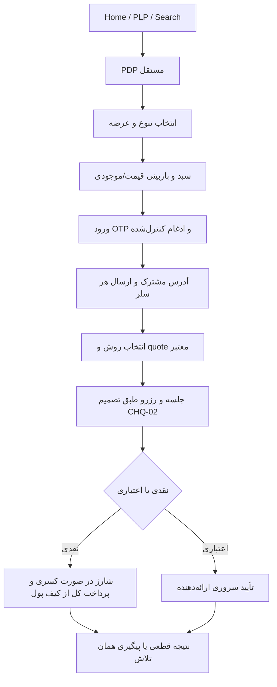

# ساختار دیزاین و فلوهای سایت مشتری

نسخه: ۱.۰ | تاریخ: ۲۰۲۶-۱۱-۱۷ | وضعیت: تحلیل و طراحی برای بازبینی تیم فنی | مالک بررسی: محصول و راهبر فنی؛ انتساب شخص هنوز انجام نشده

## چارچوب بصری مشترک

رنگ اصلی گیلاسی `#B51F46`، پس‌زمینه `#FFF8FA`، متن `#231A21`، مکمل `#F0B8C9`، تأکید طلا `#93621D` و دیجیتال `#5046C7` طبق بسته طراحی منتقل شوند. assets برند از reference مصرف شوند؛ بازطراحی خودسرانه لوگو انجام نشود. امضای گیلاسی در هدر، hero، عنوان سکشن، تخفیف، CTA و فوتر تکرار شود؛ قیمت و انتخاب فقط با رنگ بیان نشوند. سه طرح A/B/C مرجع بررسی هستند؛ پیاده‌سازی سه محصول موازی لازم نیست. توکن/spacing/density مشترک و قابل تعویض برای انتخاب نهایی پیشنهاد است.

## ساختار صفحات

| صفحه | ترتیب بلوک‌ها | تعامل و نیاز فنی |
| --- | --- | --- |
| مشترک | لوگو، جست‌وجو، حساب و سبد؛ سپس منوی اصلی | جست‌وجو با popup؛ منوی حساب: پروفایل، آدرس، سفارش، کیف پول، علاقه‌مندی و خروج |
| Home | hero → دسته موجود → تخفیف ویژه → ریل دسته‌های موجود → برند دیجیتال → درباره سایت → خدمات واقعی → فوتر | همه بلوک‌های محتوایی تحت Section؛ لینک مشاهده همه؛ حداکثر ۱۰ محصول ریل |
| PLP | breadcrumb → عنوان/زیرشاخه → فیلتر/مرتب‌سازی/تعداد → شبکه → صفحه‌بندی → متن دسته → فوتر | فیلتر خصوصیات دسته/موجودی/قیمت؛ موبایل زیرشاخه و برگ؛ URL فیلتر قابل بازگشت |
| PDP | breadcrumb → گالری → نام → انتخاب یک/دو محور → buybox → سایر سلرها → ویژگی‌های کلیدی → مشخصات/شرح → نظر → پرسش → فوتر | صفحه مستقل؛ قیمت/ارسال هر سلر؛ تغییر تنوع و عرضه روشن؛ URL اشتراک‌پذیر |
| Cart | اقلام گروه‌بندی‌شده سلر، تنوع/تعداد/حذف، اختلاف قیمت/موجودی، کوپن و خلاصه | تغییر عرضه/تنوع با revalidation؛ اقلام مسئله‌دار مشخص؛ نمایش سبد رزرو نیست |
| Address | آدرس‌های خود کاربر و فرم گیرنده | یک مقصد کل خرید؛ گیرنده از صاحب حساب جدا |
| Shipping | هر سلر، اقلام، آماده‌سازی، روش‌های مجاز، تعرفه و برآورد | انتخاب مستقل هر گروه؛ جمع هزینه‌ها روشن |
| Payment | روش‌های واجد شرایط، مبلغ نقدی/اعتباری، breakdown، کیف پول/کسری و شمارنده | روش منتخب مبلغ واقعی را عوض می‌کند؛ CHQ-02 محل قفل جلسه را تعیین می‌کند |
| Result | موفق قطعی / ناموفق / در حال بررسی / شارژ موفق بدون سفارش | مرجع تلاش؛ بدون وعده موفقیت بر اساس redirect |
| Profile | اطلاعات حساب، آدرس، سفارش و پیگیری، کیف پول، علاقه‌مندی | data خصوصی no-store؛ لینک خروج و وضعیت خالی/خطا |
| Installment landing | معرفی واقعی روش‌ها، شرایط دسته، مراحل، سؤال‌ها و کالاهای واجد شرایط | متن و برنامه قسط از قرارداد؛ نمایش اعتبار به معنی eligibility نیست |

## کارت و دکمه

Home: تصویر، دسته، نام، قیمت/تخفیف معتبر و عرضه نماینده؛ PLP علاوه بر آن حداکثر سه ویژگی مهم همان دسته. انتخاب تنوع و افزودن مستقیم روی کارت در این نسخه نیست. لینک اصلی کارت به PDP؛ قیمت «از» فقط با عرضه/تنوع واقعی منطبق. دسته/فروشنده منتخب کارت باید در ورودی PDP قابل بازسازی باشد و به قیمت تخفیفی نامرتبط هدایت نشود.

دکمه طبق مرجع: قبل خرید تمام‌عرض گیلاسی با متن سفید؛ بعد خرید کنترل تعداد با عدد وسط و بخش روشن سمت چپ و لبه مورب. بخش اصلی افزایش، بخش روشن کاهش و در تعداد یک حذف؛ حداکثر/انتظار/ناموجود مشخص. دو ناحیه تعاملی دکمه مستقل با نام دسترس‌پذیر؛ شکست سرور عدد موفق نشان ندهد. همین component در PDP، sticky موبایل و سبد مصرف شود. تصاویر [برد دکمه](references/purchase-control-states.png) مرجع شکل است.

## فلو خرید

ترتیب روش/قفل در این نمودار پیشنهاد حل CHQ-02 است، نه پاسخ ساخته‌شده کاربر. UI می‌تواند پیش‌نمایش روش داشته باشد؛ production مبلغ جلسه را بدون حل این سؤال تغییر نمی‌دهد.

## حالت‌های لازم در هر طراحی

loading، empty، خطای شبکه با retry امن، عدم مجوز، ناموجودی، قیمت تغییرکرده، تنوع غیرقابل خرید، فیلتر بی‌نتیجه، داده ناقص، session منقضی و پرداخت unknown. موبایل و desktop، keyboard و focus، متون RTL و ارقام فارسی/لاتین، گالری و نوار خرید بدون پوشاندن محتوا بررسی شوند. footer در همه صفحات عمومی شامل معرفی/لینک سریع/شبکه/ثبت ایمیل/نماد واقعی/copyright/تماس است؛ مسیر خرید می‌تواند footer فشرده پیشنهادی داشته باشد تا فرم طولانی نشود.

## قلمرو و SEO

مادر همه دسته‌های مجاز؛ gold فقط طلا و digi فقط دیجیتال در Home/PLP/search/suggest/rail. scope باید سروری باشد، نه فیلتر نمایشی. host ناشناخته reject؛ PDP مرجع و انتقال cart/login/checkout، canonical و session بین hostها در CHQ-08 نهایی شوند. پیاده‌سازی abstraction scope مستقل از فعال‌سازی DNS قابل انجام است.
