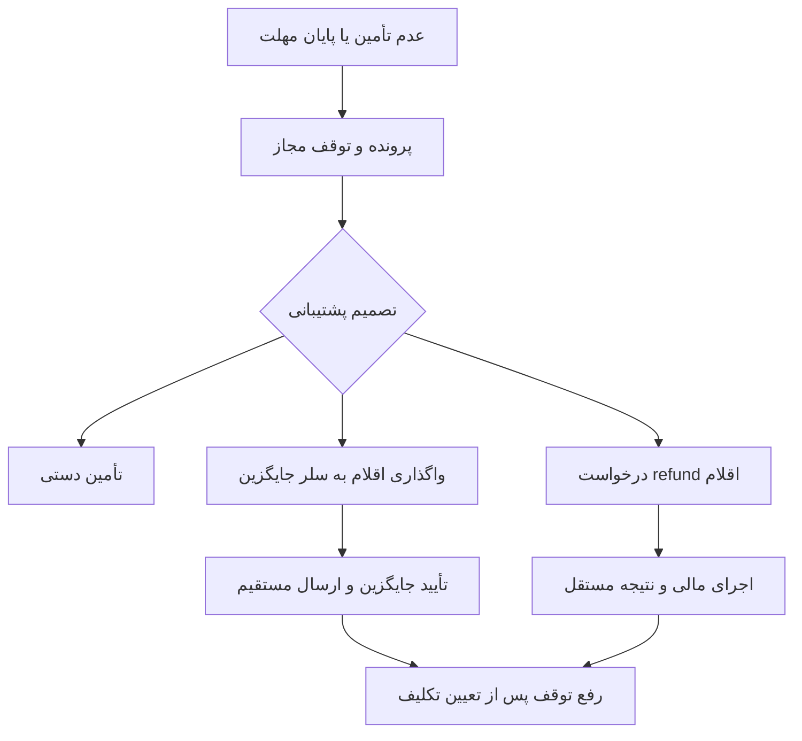

# چرخه سفارش، تأمین، ارسال و پشتیبانی

نسخه: ۱.۰ | تاریخ: ۲۰۲۶-۱۱-۱۷ | وضعیت: تحلیل و طراحی برای بازبینی تیم فنی | مالک بررسی: محصول و راهبر فنی؛ انتساب شخص هنوز انجام نشده

## مدل بیزینسی

یک خرید مشتری به سفارش‌های فروشگاهی شکسته می‌شود؛ هر قلم، snapshot کالا/تنوع/سلر/قیمت دارد. پرداخت موفق، آغاز تعهد تأمین است؛ رد یا بی‌پاسخی سلر بعد پرداخت با ناموجودی پیش از پرداخت یکی نیست. فروشنده معمولاً ارسال را انجام می‌دهد؛ روش‌های حمل و پوشش واقعی با عملیات نهایی شوند. سایت خدماتی مثل پرداخت در محل یا ارسال فوری را فقط پس از تأیید قابلیت واقعی نشان می‌دهد.

## فلو تأمین و حریم خصوصی

پرداخت قطعی → ایجاد سفارش‌های سلر و اعلان مستقل → مشاهده اقلام و شهر توسط سلر → تأیید/عدم تأمین قلمی در یک روز کاری → پس از تعیین تکلیف مجاز همه اقلام، نمایش داده لازم ارسال → آماده‌سازی → ایجاد مرسوله و بسته‌ها → اعزام یکجای اقلام باقی‌مانده → رهگیری → تأیید دریافت یا پرونده پیگیری. پنج‌شنبه/جمعه و تعطیلات مرکزی در آماده‌سازی شمرده نشوند؛ روز پرداخت مبدأ روز کاری بعد است.

پیشنهاد حالت‌ها: supply=`pending/accepted/unavailable/reassigned/cancelled`، shipment=`preparing/ready/dispatched/delivery-reported/delivered`، payment مستقل. یک status عمومی برای همه ابعاد کافی نیست. هر انتقال guard، version، actor، reason در صورت نیاز و audit دارد. سلر پس از تأیید حق لغو قطعی ندارد؛ پشتیبانی مجاز تصمیم می‌گیرد.

## عدم تأمین و واگذاری

واگذاری فقط اقلام/تعداد مشخص؛ مبلغ اضافه از مشتری دریافت نشود؛ قرارداد و سهم تأمین‌کننده واقعی در زمان تأیید واگذاری snapshot شود. فروشنده اصلی دیگر روی قلم واگذارشده اقدام نکند. جایگزین پیش از تأیید فقط داده محدود همان واگذاری می‌بیند. تعیین حالت رفع توقف و تفاوت جبران نقدی/refund با ثبت تأمین باید در قرارداد عملیات دقیق شوند؛ مسیر مستقل UI قابل طراحی است.

## روش حمل و هزینه

تعریف روش مرکزی؛ هر سلر پوشش شهر، تعرفه، زمان آماده‌سازی و رهگیری را تنظیم کند. هزینه بر اساس روش و شهر و داده معتبر همان خرید؛ snapshot تعرفه ذخیره شود. یک گروه سلر می‌تواند چند بسته/رهگیری داشته باشد، به شرط تحویل هم‌زمان همه بسته‌ها به حمل‌کننده. تقسیم ارسال بین روش‌های ناسازگار/کلاس حمل مثل طلا با قواعد واقعی CHQ-07 است؛ نسخه اول بدون موتور route optimization.

با لغو اقلام ارسال‌نشده، حمل از snapshot خرید برای باقی‌مانده محاسبه شود؛ فقط اختلاف قابل برگشتِ هنوز نگه‌داشته‌شده refund شود. افزایش محاسبه جدید مبلغ اضافه مشتری ایجاد نکند و به هزینه پلتفرم ثبت شود. اعزام و لغو هم‌زمان با قفل/نسخه کنترل شوند؛ قلم نمی‌تواند هم ارسال‌شده و هم قابل لغو بماند.

## پس از ارسال و مرجوعی

گزارش نرسیدن/آسیب/کسری → پرونده با مرجع مرسوله/بسته و مدارک مجاز → بررسی → تصمیم ارسال مجدد یا درخواست refund. ثبت گزارش یا بستن پرونده، پرداخت موفق نیست. تحویل پشتیبانی با دلیل و audit ممکن؛ job زمانی به‌تنهایی تحویل قطعی اعلام نکند. بازگشت فیزیکی کالا، مهلت، مسئول هزینه، بازرسی و برگشت به موجودی CHQ-05 است و باید جدا از refund ساخته شود.

صف پشتیبانی زمان ایجاد، علت عدم تأمین/بی‌پاسخی/حمل، مهلت اولین رسیدگی قابل تنظیم، شروع رسیدگی، مسئول و نتیجه را نشان دهد. آغاز رسیدگی «حل‌شده» نیست. سلر/پشتیبانی/مالی هرکدام فقط عملیات مجاز خود را دارند؛ اصل داده و عامل ثبت حفظ می‌شود.
