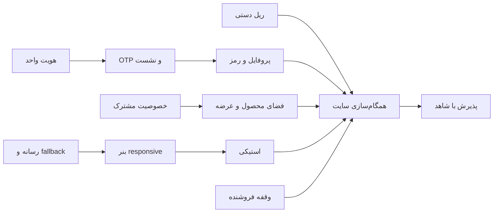

# کارهای اصلاحی و ترتیب شروع

نسخه: ۱.۱ | تاریخ: ۲۰۲۶-۱۱-۱۷ | وضعیت سند: in-review | مالک تصمیم: الیاس؛ بازبین فنی: راهبر فنی، انتساب فرد باز | شناسه: CV-R2-TASKS

این ۱۲ کار، اصلاح ۹۱ تسک پایه‌اند؛ ابتدا در backlog تیم با تسک متأثر ادغام شوند. ۱۰۳ قابلیت مستقل یا ۱۰۳ تسک ساخته‌شده محصول ادعا نمی‌شود. وضعیت اجرای همه todo و مسئول فردی unassigned است. W3 سایت بعد از قبولی تمام دامنه پنل/سلر با داده آزمون است؛ P0 به معنی حذف این گیت نیست.

| کار | اولویت / موج | اصلاح تسک‌های پایه | وابستگی |
| --- | --- | --- | --- |
| [CV-R2-01 — هویت واحد و عضویت چندمنظوره](tasks/cv-r2-01-single-user.md) | P0 / W0 | CV-IAM-04، CV-IAM-05، CV-IAM-07 | CV-FND-04 |
| [CV-R2-02 — ورود نخست با موبایل و اتصال به همان هویت](tasks/cv-r2-02-phone-otp-link.md) | P0 / W0 | CV-IAM-01، CV-IAM-02 | CV-R2-01، CV-IAM-01، CV-IAM-02 |
| [CV-R2-03 — پروفایل و ورود با ایمیل یا موبایل و یک رمز](tasks/cv-r2-03-profile-email-password.md) | P0 / W0 | CV-IAM-02، CV-IAM-07، CV-WEB-07 | CV-R2-02 |
| [CV-R2-04 — آیکن دسته و برند با پیش‌فرض](tasks/cv-r2-04-category-brand-media.md) | P1 / W1 | CV-CAT-01، CV-CAT-03، CV-CAT-07 | CV-CAT-01، CV-CAT-03، CV-CAT-07 |
| [CV-R2-05 — کتابخانه خصوصیت و انتساب مستقل به دسته](tasks/cv-r2-05-shared-attribute-bindings.md) | P0 / W1 | CV-CAT-02، CV-CAT-05، CV-CAT-08 | CV-CAT-01، CV-CAT-02 |
| [CV-R2-06 — اکشن سریع تنوع، قیمت و موجودی در محصول](tasks/cv-r2-06-product-workspace.md) | P0 / W1 | CV-CAT-04، CV-CAT-05، CV-CAT-06 | CV-R2-05، CV-CAT-04، CV-CAT-06 |
| [CV-R2-07 — سکشن بنر با تصویر دسکتاپ و موبایل](tasks/cv-r2-07-responsive-banner-section.md) | P1 / W2 | CV-CMS-01، CV-CMS-02 | CV-CMS-01، CV-CMS-02، CV-R2-04 |
| [CV-R2-08 — کروسل اختصاصی با انتخاب و ترتیب دستی کالا](tasks/cv-r2-08-manual-product-rail.md) | P1 / W2 | CV-CMS-01، CV-CMS-02، CV-WEB-03 | CV-CMS-01، CV-CMS-02، CV-CAT-09، CV-PRC-07 |
| [CV-R2-09 — سکشن استیکی با کنترل نمایش و بستن](tasks/cv-r2-09-sticky-banner-section.md) | P1 / W2 | CV-CMS-01، CV-CMS-02، CV-WEB-03 | CV-R2-07 |
| [CV-R2-10 — وقفه تأمین ثابت فروشنده و snapshot سفارش](tasks/cv-r2-10-seller-supply-lead.md) | P0 / W2 | CV-IAM-06، CV-CAT-06، CV-OPS-05، CV-OPS-06 | CV-IAM-06، CV-CAT-06، CV-OPS-01 |
| [CV-R2-11 — همگام‌سازی سایت با قراردادهای اصلاح‌شده](tasks/cv-r2-11-storefront-alignment.md) | P0 / W3 | CV-WEB-02، CV-WEB-03، CV-WEB-04، CV-WEB-05، CV-WEB-06، CV-WEB-07، CV-WEB-08 | CV-R2-03، CV-R2-05، CV-R2-06، CV-R2-08، CV-R2-09، CV-R2-10 |
| [CV-R2-12 — پذیرش اصلاحات، ردیابی و آماده‌سازی تحویل](tasks/cv-r2-12-revision-acceptance.md) | P0 / W3 | CV-QA-01، CV-QA-04، CV-QA-06 | CV-R2-01، CV-R2-02، CV-R2-03، CV-R2-04، CV-R2-05، CV-R2-06، CV-R2-07، CV-R2-08، CV-R2-09، CV-R2-10، CV-R2-11 |

## مسیر پیشنهادی

W0: قرارداد پایه و هویت → OTP مشترک → پروفایل و رمز. W1: کاتالوگ/خصوصیت/عرضه و منبع وقفه فروشنده. W2: فرم typed بنر، ریل دستی و sticky. در کنار این اصلاحات، تمام سفارش/تأمین/ارسال/پشتیبانی/واگذاری/مالی/تسویه پایه با آداپتر آزمون ادامه دارند و از مرحله اول حذف نشده‌اند. W3: پس از پذیرش پنل، مصرف این قراردادها در سایت و پذیرش نهایی اصلاحات.

گراف فقط اصلاحات را نشان می‌دهد؛ وابستگی تمام کارهای پایه در [task-index پایه](../03-analysis-v1-0/task-index.json) و [برنامه تحویل](../03-analysis-v1-0/12-delivery-plan.md) است. نسخه ماشین‌خوان اصلاحات: [JSON](task-index.json).

وقفه فروشنده: مدل و فرم در W1 قابل شروع‌اند؛ پذیرش snapshot و پایان CV-R2-10 در W2 پس از سفارش آزمون انجام شود.
